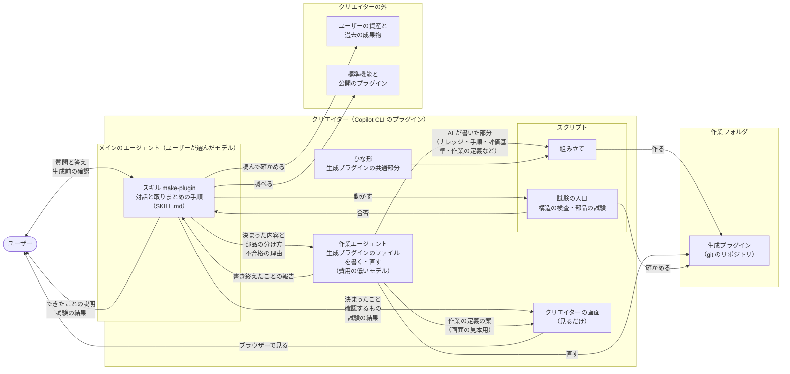
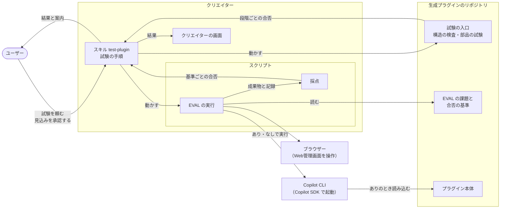

# クリエイターの構造

クリエイターがどんな部品でできていて、どうつながって生成プラグインを作り、試験するかを示す。仕様は [作る流れの要件](../specs/creation-requirements.md)、[出力の要件](../specs/output-requirements.md)、[試験の要件](../specs/test-requirements.md) にある。

## 1. 全体の図

作るとき：

試験を頼まれたとき：

## 2. 部品

| 部品 | 役割 | 対応する要件 |
| --- | --- | --- |
| マニフェストと README | クリエイターの `plugin.json`（Agent Plugins の形式）と説明書き。README には、モデルの選び方と、エクステンションを使うために要る `/experimental on` と、会話例のページへの案内を書く | REQ-023、REQ-037、REQ-047 |
| スキル make-plugin | メインのエージェントが使う。対話の手順を持つ。項目ごとの質問、実際の1回をたどる、ファイルを読んで確かめる、資産を探す、生成前の確認、できたことの説明を、この順に進める。作る中で高い推論力が要る判断（部品の分け方など）もここで行い、決まった内容とあわせて作業エージェントに渡す。決まったことは、そのつどクリエイターの画面に出す。生成前の確認では、EVAL の課題と合否の基準も示す。画面で見たいことは、用意のある部品の中で聞いて決め、見本で確かめる（[生成プラグインの構造](generated-plugin-structure.md) 4.9）。生成の後は、構造の検査と部品の試験を行い、不合格なら作業エージェントに直させる（4.1）。既存のプラグインを示されたときは、それを読んで、読み取ったことを確かめ、足りないナレッジだけを聞き、引き継ぐことと変わることを示す（作り直し）。最後に、自分の質問を振り返り、質問の改善案を示す（4.5）。description で、作業の自動化を頼まれたときに呼ばれる | REQ-015〜REQ-020、REQ-022〜REQ-024、REQ-026、REQ-027、REQ-032〜REQ-036、REQ-038、REQ-039、REQ-043、REQ-045、REQ-049 |
| スキル test-plugin | メインのエージェントが使う。ユーザーが生成プラグインの試験を頼んだときの手順を持つ。道具の用意、構造の検査と部品の試験、EVAL の見込みと承認、EVAL、結果の説明、質問の改善案を、この順に進める（4.2、4.5） | REQ-024、REQ-040〜REQ-042、REQ-048、REQ-049 |
| 作業エージェント | 渡された内容に沿って、生成プラグインのうち作業ごとに違う部分のファイルを書く。作業の定義（合否の基準、作業ごとの画面）の案も、ユーザーが見本で直した分も、この1人が書く（4.3）。試験で不合格になったところも直す（4.1）。費用の低いモデルで動く（3.3） | REQ-028、REQ-031、REQ-039、REQ-046 |
| スクリプト：組み立て | ひな形と、AI が書いた部分を合わせて、作業フォルダの中に生成プラグインを作り、git のリポジトリにする。番号と種類を付けたナレッジの一覧と、EVAL の課題（合否の基準の番号と文の写し、採点のしかた）も、テストのフォルダに入れる。合否の基準そのものは、作業の定義に入る。組み立ての後に、土台のファイル（`core/`、`ui/`、`extension.mjs`）がひな形と同じかを確かめる（4.1）。作り直しのときも新しいフォルダに作り、元のプラグインのフォルダは変えない | REQ-001、REQ-021、REQ-036、REQ-038 |
| スクリプト：構造の検査 | 生成プラグインが公式仕様に沿っているかと、作業の定義が決まりの形に合い、EVAL の課題の基準の写しが作業の定義と同じか、確かめたナレッジがすべて入っているか（番号の突き合わせ）を確かめる。クリエイター自身には、会話例の版も確かめる（[試験の設計](testing.md) 2章、6.6、10.3） | REQ-004、REQ-037、REQ-039 |
| スクリプト：部品の試験 | 生成プラグインのスクリプト、フック、MCP サーバー、Web管理画面を動かして確かめる（[試験の設計](testing.md) 2章） | REQ-039 |
| スクリプト：試験の入口 | 道具がそろっているかを確かめてから、構造の検査と部品の試験を1つのコマンドで動かし、段階ごとの合否を出す。入口・構造の検査・部品の試験は、ひな形にも写しを入れる（[試験の設計](testing.md) 10.2） | REQ-039、REQ-042、REQ-048 |
| スクリプト：EVAL の実行 | 始める前の見込みを出す。Copilot SDK で、生成プラグインあり・なしで課題を実行し、Web管理画面を操作して、記録を残す（[試験の設計](testing.md) 8.2、10.4） | REQ-040、REQ-041 |
| スクリプト：採点 | 成果物と記録を、合否の基準で採点する。開発の試験の内側の EVAL と同じもの（[試験の設計](testing.md) 10.4、10.5） | REQ-041 |
| スクリプト：会話例の作成 | 外側の EVAL の記録から、会話例を作る。開発のときだけ使う（[試験の設計](testing.md) 6.6） | REQ-037 |
| クリエイターの画面 | 決まったことの一覧、生成前の確認で示すもの、試験の結果、会話例を見せる。見るだけ。Web管理画面の見本（REQ-027）もここから開く。クリエイターのエクステンションとして動き、Web管理画面の土台を流用する（4.3） | REQ-027、REQ-043、REQ-044 |
| 会話例のファイル | 模擬ユーザーごとに1つの Markdown。スキルのフォルダの外に置き、README とクリエイターの画面から開く（4.4） | REQ-037 |
| ひな形 | どの生成プラグインにも共通する部分（土台）。Web管理画面とそれを動かすエクステンション、統括・作業・検証のエージェントの決まった手順、生成プラグインの憲章・仕様書・設計書のひな形、テスト（試験の入口と、1・2段目のスクリプトの写し、偽物のつなぎ口）。中身は [生成プラグインの構造](generated-plugin-structure.md) にある | REQ-001〜REQ-014、REQ-025、REQ-029〜REQ-031 |

## 3. 分け方の考え方

### 3.1 推論の重さで分ける

クリエイターの仕事を、推論の重さで分け、担当を決める（憲章 第16条）。

| 分類 | 仕事 | 担当 |
| --- | --- | --- |
| 高い推論力が要る | 対話で仕様を決めること（項目ごとの質問と聞き直し、実際の1回をたどる、ファイルから決まりを推し量る、資産や公開のプラグインが使えるかの見極め、振る舞いの案と直し）。作る中での判断（生成プラグインの部品の分け方、生成プラグインのスキルの description） | メインのエージェント |
| 費用の低いモデルで足りる | 決まった内容に沿って、生成プラグインのうち作業ごとに違う部分のファイルを書くこと（仕様書・設計書の作業ごとの部分、SKILL.md の手順、エージェントへの指示と評価基準、スクリプト、画面の定義、テスト） | 作業エージェント |
| AI が要らない | 組み立て、構造の検査、git のリポジトリにすること | スクリプト |

- 部品の分け方（どの手順をスクリプトにし、どこを AI に任せるか）は、生成プラグインの出来を左右するので、メインのエージェントが決める。スキルの description も、スキルが呼ばれるかどうかを決めるので、メインのエージェントが書く（ナレッジ「スキル」）。
- 生成プラグインのファイルを書くこと以外の仕事（できたことの説明など）は、費用の低いモデルで足りるものでも、メインのエージェントが行う。作業エージェントを起動して内容を渡す手間のほうが大きいためである。
- 画面の見本は、メインのエージェントが作業エージェントに書かせた作業の定義の案で出す（4.3）。
- 作業エージェントは1つにする（憲章 第10条）。
- この分け方は、クリエイター自身の構成である。生成プラグインの構成（統括・作業・検証のエージェント。憲章 第19条）は、ひな形から作る。

### 3.2 メインのエージェント

- ユーザーが Copilot CLI で話している相手である。モデルは、ユーザーが `/model` などで選んだものになる。Copilot CLI のプラグインのマニフェストにはモデルの項目がなく、プラグインからは決められない。
- そのため、対話には思考力の高いモデルが向いていることを、README で知らせる（REQ-047）。
- ユーザーへの質問は、メインのエージェントだけが行う。理由は次の2つである。
  - Copilot CLI の公式ドキュメントに、サブエージェントがユーザーに質問できる（`ask_user` を使える）という記述がない。
  - 試験に使う Claude Code では、サブエージェントは質問のツールを使えない（[試験の設計](testing.md) 4章）。

### 3.3 作業エージェント

- カスタムエージェントとして `com.github.copilot/agents/` に置く。Agent Plugins の形式のまま、Copilot CLI 固有の部品を入れる場所である（ナレッジ「プラグイン」）。
- メインのエージェントが、組み込みの `task` ツールで仕事を頼む。
- 作業エージェントは会話を見ていない。メインのエージェントは、生成前の確認でユーザーがよいと答えた内容（ナレッジの一覧と振る舞いの案）と、作る中で決めたこと（部品の分け方など）を、すべて渡す。渡していないことは、生成プラグインに入らない。
- 使うモデルは、フロントマターの `model` に、優先する順のリストで書く（例：`model: [gpt-6-luna, claude-haiku-5.5]`）。ユーザーのプランで使える最初のモデルが使われ、どれも使えないときは、メインのエージェントのモデルになる。

  | 順 | モデル（Copilot CLI の ID） | 選んだ理由 |
  | --- | --- | --- |
  | 1 | `gpt-6-luna`（GPT-6 Luna） | ユーザーが例に挙げたモデル。GPT-6 の中で最も費用が低い（100万トークンあたり、入力 0.10 ドル、出力 0.50 ドル）。Copilot Pro 以上のプランで使える |
  | 2 | `claude-haiku-5.5`（Claude Haiku 5.5） | GPT-6 Luna と同じ価格で、同じプランで使える。組織の設定などで GPT-6 Luna が使えないときの代わり。試験で Claude Code 向けに置き換えるときも、このモデルにする（[試験の設計](testing.md) 4章） |

- ユーザーがモデルを Auto にしているときは、`model` に関係なく、作業エージェントも Auto が選んだモデルで動く（Copilot CLI の決まり）。このことも README で知らせる（REQ-047）。
- スキルを呼べないように、`tools` をファイルの読み書きと検索（`read`、`edit`、`search`）に絞る。サブエージェントにもプラグインのスキルが見え、スキルの手順を最初から始めてしまうことがあるためである（ナレッジ「カスタムエージェント」）。絞るとスキルを呼べなくなるかは要確認である。生成プラグインの統括・作業・検証と同じで、確かめ方と効かないときの代わりは [生成プラグインの構造](generated-plugin-structure.md) 4.7、11章にある。
- この書き方は、Copilot CLI 1.0.98 の実装（パッケージに含まれるプログラム、付属の説明、更新履歴）で確かめた。組み込みのエージェントの定義も `model` にリストで書いている。コマンドリファレンスにある `models` と `modelPolicy` は、読み込んだ後のエージェントを SDK や API で表すときの項目名である。

### 3.4 スクリプトとひな形

- 決まった処理（組み立て、検査）はスクリプトにし、推論が要ることだけをスキルと作業エージェントに書く（ナレッジ「スキル」）。
- 生成プラグインのうち、どれにも共通する部分はひな形から作り、作業ごとに違う部分（ナレッジ、手順、評価基準）だけを AI が書く。毎回同じ品質で作るためである（ナレッジ「プラグインを作るプラグイン」）。作業エージェントは費用の低いモデルで動くので、AI が書く量を、ひな形でできるだけ減らす。

### 3.5 作業エージェントが書いたものの確かめ方

- 専用の確認の手順や検証エージェントは置かず、生成プラグインの試験（[試験の要件](../specs/test-requirements.md)）の中で確かめる。
- メインのエージェントは、生成前の確認でよいと答えたナレッジに、番号と種類（合否の決め方か、それ以外か）を付けて渡す。作業エージェントは、ナレッジを入れた箇所に、その番号を書く。
- 構造の検査で、種類ごとの置き場所に番号があるかを突き合わせる（REQ-039）。合否の決め方のナレッジは作業の定義の合否の基準に、それ以外は作業の定義とテストのフォルダを除くファイルに書く（[生成プラグインの構造](generated-plugin-structure.md) 6.4、[試験の設計](testing.md) 10.3）。抜けた番号があれば、どのナレッジが抜けたかを示す。
- ナレッジが正しい意味で効いているかは、EVAL で、ユーザーと確かめた合否の基準によって確かめる（REQ-041）。

## 4. 試験・画面・会話例

### 4.1 生成した直後の試験と直し

- 組み立ての後、土台のファイルがひな形と同じかを、組み立てのスクリプトが確かめる。生成プラグインの1段目には入れない。クリエイターがない環境では比べられず、ユーザーが土台を直すと必ず落ちるためである（[生成プラグインの構造](generated-plugin-structure.md) 7章）。違うときは不合格とし、違うファイルを示して、ひな形から入れ直す。
- 続けて、メインのエージェントは、生成プラグインの試験の入口で、構造の検査と部品の試験を行う（REQ-039）。道具が足りないときは、先に用意する（4.2 と同じ）。
- 不合格のときは、落ちた試験とその理由を作業エージェントに渡して直させ、入口でやり直す。ナレッジが抜けたときは、抜けたナレッジの文も渡す。作業エージェントは会話を見ていないためである（3.3）。
- 上限の回数まで直しても合格しないときは止めて、残った不合格の試験とその理由を示す。
- 合否は試験のスクリプトが出し、作業エージェントは自分の直しを判定しない（3.5）。

### 4.2 試験を頼まれたとき

- ユーザーが試験を頼むと、メインのエージェントが、スキル test-plugin の手順で進める。試験は、生成の後に別の会話で頼まれることもあるので、make-plugin と分け、description で呼ばれる場面を分ける（ナレッジ「スキル」）。
- 道具を入れる前と、EVAL を始める前には、チャットでユーザーの承認を得る（REQ-048、REQ-040）。
- 進め方は [試験の設計](testing.md) 10章にある。

### 4.3 クリエイターの画面

- 生成プラグインの Web管理画面の土台を流用し、見るだけの使い方で動かす（憲章 第15条2項）。作り方、出すもの、起動と終了、同じマシンのブラウザーからだけ開ける接続、サンドボックスとの関係は、[生成プラグインの構造](generated-plugin-structure.md) 9章にある。
- 生成前の確認で、この一覧のナレッジに番号と種類を付けたものが、構造の検査で突き合わせるナレッジの一覧になる（[試験の設計](testing.md) 10.3）。
- Web管理画面の見本（REQ-027）は、メインのエージェントが作業エージェントに書かせた作業の定義の案で出す。ユーザーが直したら、作業エージェントに直させる。よいと答えた定義を、そのまま組み立てに渡す（同 9章）。
- エクステンションは試験的な機能なので、クリエイターを使うにも `/experimental on` が要る。エクステンションが読み込まれていないとき、スキルは、有効にするしかたを示して止まる。仕様にない振る舞いなので、仕様の判断待ちである。

### 4.4 会話例

- 外側の EVAL の記録から、スクリプト「会話例の作成」で作る。選び方と、版の確かめ方は、[試験の設計](testing.md) 6.6 にある。
- クリエイターのスキルのフォルダの外に置き、README とクリエイターの画面から同じファイルを開く。クリエイターのモデルに読ませないためである。

### 4.5 質問の改善案

- 生成の後と、頼まれた試験の後に、メインのエージェントが、対話と試験の結果を振り返って質問の改善案を作る（REQ-049）。対話を見ているのはメインのエージェントだけなので、作業エージェントには任せない（3.1）。
- 案は、チャットで示し、承認を得てから plugin-creater に起票する。起票は、承認された案ごとに、メインのエージェントがクリエイターのエクステンションのツールを呼び、エクステンションが `gh issue create` で行う。題と本文を渡すしかたは、生成プラグインの起票と同じである（[生成プラグインの構造](generated-plugin-structure.md) 4.11）。起票のツールは、許可の確認を省く設定（`skipPermission`）にせず、起票のコマンドを前もって許可しないよう案内する。承認された案を起票するときに出る Copilot CLI の許可の確認を、承認の歯止めにする。`gh` がないときやログインしていないときは、入れ方とログインのしかたを示す。

## 根拠

- 憲章 第4条、第6条3項（部品の表で、すべての要件を部品にたどれるようにする）、第10条、第12条、第14条、第15条2項、第16条、第17条、第18条、第19条
- 作る流れの要件、出力の要件、試験の要件

## 出典

- [GitHub Copilot CLI command reference](https://docs.github.com/en/copilot/reference/copilot-cli-reference/cli-command-reference)（カスタムエージェントの `model`・`tools`、組み込みのツール `task` と `ask_user`、モデルが Auto のときの決まり、`/model`）
- [GitHub Copilot CLI plugin reference](https://docs.github.com/en/copilot/reference/copilot-cli-reference/cli-plugin-reference)（マニフェストの項目、`com.github.copilot/agents/`）
- [About extensions for GitHub Copilot CLI](https://docs.github.com/en/copilot/concepts/agents/copilot-cli/about-cli-extensions)（エクステンションが試験的な機能であること）
- [Supported AI models in GitHub Copilot](https://docs.github.com/en/copilot/reference/ai-models/supported-models)（プランごとに使えるモデル）
- [Models and pricing for GitHub Copilot](https://docs.github.com/en/copilot/reference/copilot-billing/models-and-pricing)（モデルごとの価格）
- [GitHub Changelog: OpenAI's GPT-6 Sol and GPT-6 Luna now available](https://github.blog/changelog/2026-09-22-openais-gpt-6-sol-and-gpt-6-luna-now-available)（GPT-6 Luna の位置づけ）
- [Copilot CLI changelog](https://github.com/github/copilot-cli/blob/main/changelog.md)（1.0.83 の項）
- [Claude Code: Create custom subagents](https://code.claude.com/docs/en/sub-agents)（サブエージェントは質問のツールを使えない）
- Copilot CLI 1.0.98 の npm パッケージ（`@github/copilot`）に含まれるプログラム、更新履歴（`changelog.json`）
