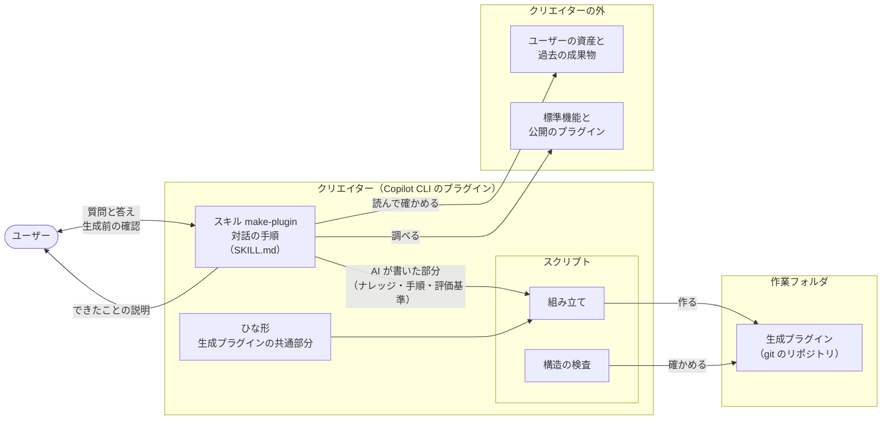

# クリエイターの構造

クリエイターがどんな部品でできていて、どうつながって生成プラグインを作るかを示す。仕様は [作る流れの要件](../specs/creation-requirements.md) と [出力の要件](../specs/output-requirements.md) にある。

仕様を見直している途中の版である。仕様が固まったら、それに合わせて直す。

## 1. 全体の図

## 2. 部品

| 部品 | 役割 | 対応する要件 |
| --- | --- | --- |
| スキル make-plugin | 対話の手順を持つ。項目ごとの質問、実際の1回をたどる、ファイルを読んで確かめる、資産を探す、生成前の確認、できたことの説明を、この順に進める | REQ-015〜REQ-020、REQ-022 |
| スクリプト：組み立て | ひな形と、AI が書いた部分を合わせて、作業フォルダの中に生成プラグインを作り、git のリポジトリにする | REQ-021 |
| スクリプト：構造の検査 | できた生成プラグインが公式仕様に沿っているかを確かめる（[試験の設計](testing.md) の1段目と同じもの） | REQ-004 |
| ひな形 | どの生成プラグインにも共通する部分。Web管理画面、作業エージェントと検証エージェント、エージェントの状態を画面に伝える仕組み、生成プラグインの憲章・仕様書・設計書のひな形、テスト | REQ-001〜REQ-014 |

## 3. 分け方の考え方

- クリエイターは、スキル1つと、スクリプトとひな形で組む。マルチエージェント構成（憲章 第19条）は生成プラグインの条項なので、クリエイターには使わず、単純にする（憲章 第10条）。
- 決まった処理（組み立て、検査）はスクリプトにし、推論が要ること（対話、ナレッジの整理）だけをスキルに書く（ナレッジ「スキル」）。
- 生成プラグインのうち、どれにも共通する部分はひな形から作り、作業ごとに違う部分（ナレッジ、手順、評価基準）だけを AI が書く。毎回同じ品質で作るためである（ナレッジ「プラグインを作るプラグイン」）。

## 根拠

- 憲章 第4条、第10条、第12条、第19条
- 作る流れの要件、出力の要件
