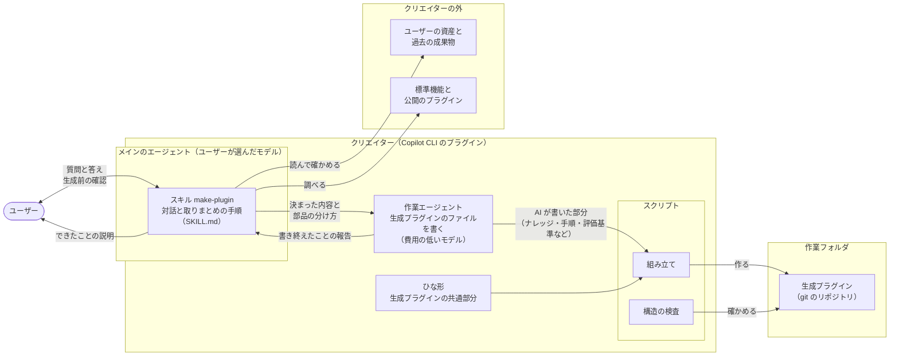

# クリエイターの構造

クリエイターがどんな部品でできていて、どうつながって生成プラグインを作るかを示す。仕様は [作る流れの要件](../specs/creation-requirements.md) と [出力の要件](../specs/output-requirements.md) にある。

仕様を見直している途中の版である。仕様が固まったら、それに合わせて直す。

## 1. 全体の図

## 2. 部品

| 部品 | 役割 | 対応する要件 |
| --- | --- | --- |
| スキル make-plugin | メインのエージェントが使う。対話の手順を持つ。項目ごとの質問、実際の1回をたどる、ファイルを読んで確かめる、資産を探す、生成前の確認、できたことの説明を、この順に進める。作る中で高い推論力が要る判断（部品の分け方など）もここで行い、決まった内容とあわせて作業エージェントに渡す | REQ-015〜REQ-020、REQ-022、REQ-045 |
| 作業エージェント | 渡された内容に沿って、生成プラグインのうち作業ごとに違う部分のファイルを書く。費用の低いモデルで動く（3.3） | REQ-028、REQ-046 |
| スクリプト：組み立て | ひな形と、AI が書いた部分を合わせて、作業フォルダの中に生成プラグインを作り、git のリポジトリにする | REQ-021 |
| スクリプト：構造の検査 | できた生成プラグインが公式仕様に沿っているかを確かめる（[試験の設計](testing.md) の1段目と同じもの） | REQ-004 |
| ひな形 | どの生成プラグインにも共通する部分。Web管理画面、作業エージェントと検証エージェント、エージェントの状態を画面に伝える仕組み、生成プラグインの憲章・仕様書・設計書のひな形、テスト | REQ-001〜REQ-014 |

## 3. 分け方の考え方

### 3.1 推論の重さで分ける

クリエイターの仕事を、推論の重さで分け、担当を決める（憲章 第16条）。

| 分類 | 仕事 | 担当 |
| --- | --- | --- |
| 高い推論力が要る | 対話で仕様を決めること（項目ごとの質問と聞き直し、実際の1回をたどる、ファイルから決まりを推し量る、資産や公開のプラグインが使えるかの見極め、振る舞いの案と直し）。作る中での判断（生成プラグインの部品の分け方、生成プラグインのスキルの description） | メインのエージェント |
| 費用の低いモデルで足りる | 決まった内容に沿って、生成プラグインのうち作業ごとに違う部分のファイルを書くこと（仕様書・設計書の作業ごとの部分、SKILL.md の手順、エージェントへの指示と評価基準、スクリプト、画面の定義、テスト） | 作業エージェント |
| AI が要らない | 組み立て、構造の検査、git のリポジトリにすること | スクリプト |

- 部品の分け方（どの手順をスクリプトにし、どこを AI に任せるか）は、生成プラグインの出来を左右するので、メインのエージェントが決める。スキルの description も、スキルが呼ばれるかどうかを決めるので、メインのエージェントが書く（ナレッジ「スキル」）。
- 生成プラグインのファイルを書くこと以外の仕事（画面の見本、できたことの説明など）は、費用の低いモデルで足りるものでも、メインのエージェントが行う。作業エージェントを起動して内容を渡す手間のほうが大きいためである。
- 作業エージェントは1つにする（憲章 第10条）。
- この分け方は、クリエイター自身の構成である。生成プラグインの構成（統括・作業・検証のエージェント。憲章 第19条）は、ひな形から作る。

### 3.2 メインのエージェント

- ユーザーが Copilot CLI で話している相手である。モデルは、ユーザーが `/model` などで選んだものになる。Copilot CLI のプラグインのマニフェストにはモデルの項目がなく、プラグインからは決められない。
- そのため、対話には思考力の高いモデルが向いていることを、README で知らせる（REQ-047）。
- ユーザーへの質問は、メインのエージェントだけが行う。理由は次の2つである。
  - Copilot CLI の公式ドキュメントに、サブエージェントがユーザーに質問できる（`ask_user` を使える）という記述がない。
  - 試験に使う Claude Code では、サブエージェントは質問のツールを使えない（[試験の設計](testing.md) 4章）。

### 3.3 作業エージェント

- カスタムエージェントとして `com.github.copilot/agents/` に置く。Agent Plugins の形式のまま、Copilot CLI 固有の部品を入れる場所である（ナレッジ「プラグイン」）。
- メインのエージェントが、組み込みの `task` ツールで仕事を頼む。
- 作業エージェントは会話を見ていない。メインのエージェントは、生成前の確認でユーザーがよいと答えた内容（ナレッジの一覧と振る舞いの案）と、作る中で決めたこと（部品の分け方など）を、すべて渡す。渡していないことは、生成プラグインに入らない。
- 使うモデルは、フロントマターの `models` に、優先する順に書く。ユーザーのプランで使える最初のモデルが使われ、どれも使えないときは、メインのエージェントのモデルになる。

  | 順 | モデル（Copilot CLI の ID） | 選んだ理由 |
  | --- | --- | --- |
  | 1 | `gpt-6-luna`（GPT-6 Luna） | ユーザーが例に挙げたモデル。GPT-6 の中で最も費用が低い（100万トークンあたり、入力 0.10 ドル、出力 0.50 ドル）。Copilot Pro 以上のプランで使える |
  | 2 | `claude-haiku-5.5`（Claude Haiku 5.5） | GPT-6 Luna と同じ価格で、同じプランで使える。組織の設定などで GPT-6 Luna が使えないときの代わり。試験で Claude Code 向けに置き換えるときも、このモデルにする（[試験の設計](testing.md) 4章） |

- ユーザーがモデルを Auto にしているときは、`models` に関係なく、作業エージェントも Auto が選んだモデルで動く（Copilot CLI の決まり）。このことも README で知らせる（REQ-047）。
- スキルを呼べないように、`tools` をファイルの読み書きと検索（`read`、`edit`、`search`）に絞る。サブエージェントにもプラグインのスキルが見え、スキルの手順を最初から始めてしまうことがあるためである（ナレッジ「カスタムエージェント」）。
- 要確認：`models` の書き方は Copilot CLI のコマンドリファレンスに従った。Copilot CLI の更新履歴（1.0.83）には「`model` に複数書ける」とあり、書き方が違う。実機で確かめる。

### 3.4 スクリプトとひな形

- 決まった処理（組み立て、検査）はスクリプトにし、推論が要ることだけをスキルと作業エージェントに書く（ナレッジ「スキル」）。
- 生成プラグインのうち、どれにも共通する部分はひな形から作り、作業ごとに違う部分（ナレッジ、手順、評価基準）だけを AI が書く。毎回同じ品質で作るためである（ナレッジ「プラグインを作るプラグイン」）。作業エージェントは費用の低いモデルで動くので、AI が書く量を、ひな形でできるだけ減らす。

### 3.5 作業エージェントが書いたものの確かめ方

- 専用の確認の手順や検証エージェントは置かず、生成プラグインの試験（[試験の要件](../specs/test-requirements.md)）の中で確かめる。
- メインのエージェントは、生成前の確認でよいと答えたナレッジに番号を付けて渡す。作業エージェントは、ナレッジを入れた箇所に、その番号を書く。
- 構造の検査で、すべての番号が生成プラグインのどこかにあるかを突き合わせる（REQ-039）。抜けた番号があれば、どのナレッジが抜けたかを示す。
- ナレッジが正しい意味で効いているかは、EVAL で、ユーザーと確かめた合否の基準によって確かめる（REQ-041）。

## 根拠

- 憲章 第4条、第10条、第12条、第16条、第19条
- 作る流れの要件、出力の要件

## 出典

- [GitHub Copilot CLI command reference](https://docs.github.com/en/copilot/reference/copilot-cli-reference/cli-command-reference)（カスタムエージェントの `model`・`models`・`tools`、組み込みのツール `task` と `ask_user`、モデルが Auto のときの決まり、`/model`）
- [GitHub Copilot CLI plugin reference](https://docs.github.com/en/copilot/reference/copilot-cli-reference/cli-plugin-reference)（マニフェストの項目、`com.github.copilot/agents/`）
- [Supported AI models in GitHub Copilot](https://docs.github.com/en/copilot/reference/ai-models/supported-models)（プランごとに使えるモデル）
- [Models and pricing for GitHub Copilot](https://docs.github.com/en/copilot/reference/copilot-billing/models-and-pricing)（モデルごとの価格）
- [GitHub Changelog: OpenAI's GPT-6 Sol and GPT-6 Luna now available](https://github.blog/changelog/2026-09-22-openais-gpt-6-sol-and-gpt-6-luna-now-available)（GPT-6 Luna の位置づけ）
- [Copilot CLI changelog](https://github.com/github/copilot-cli/blob/main/changelog.md)（1.0.83 の項）
- [Claude Code: Create custom subagents](https://code.claude.com/docs/en/sub-agents)（サブエージェントは質問のツールを使えない）
