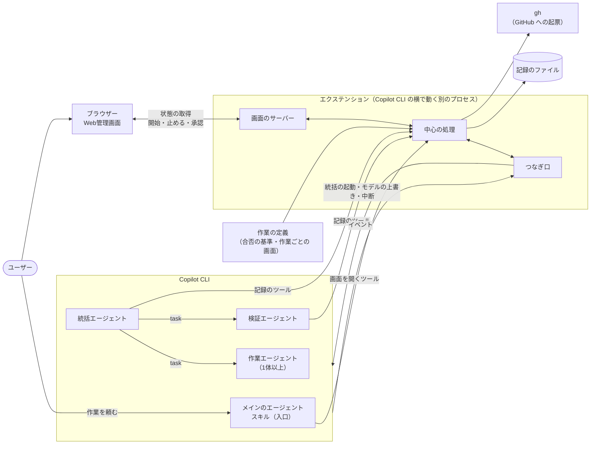
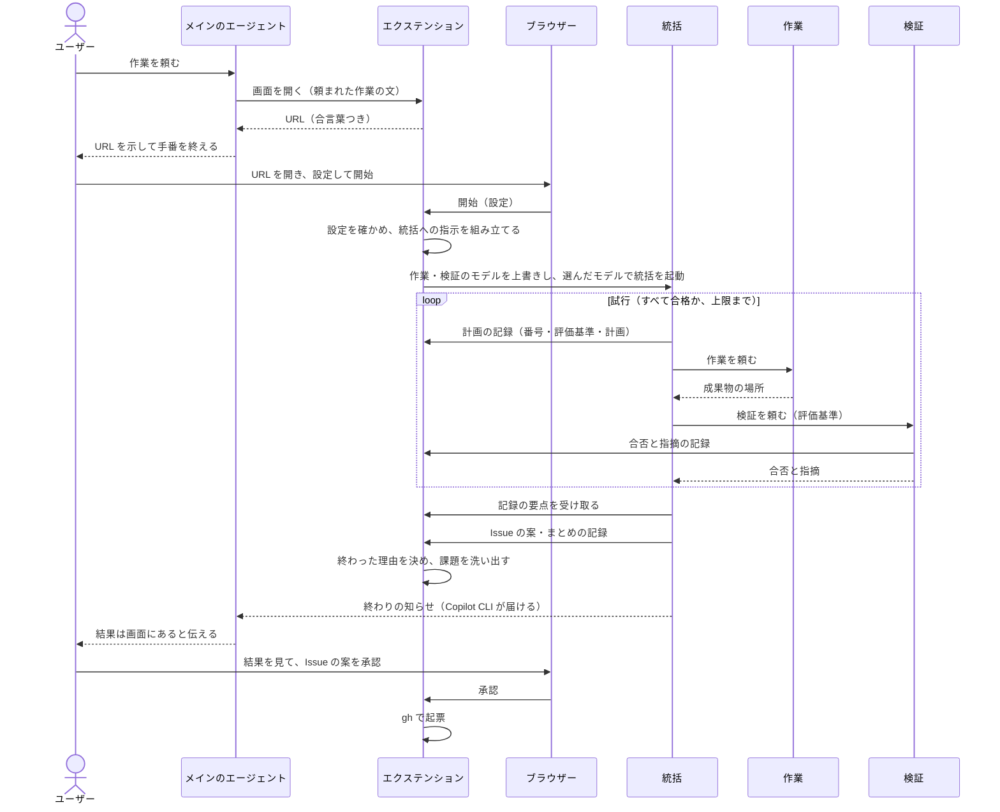
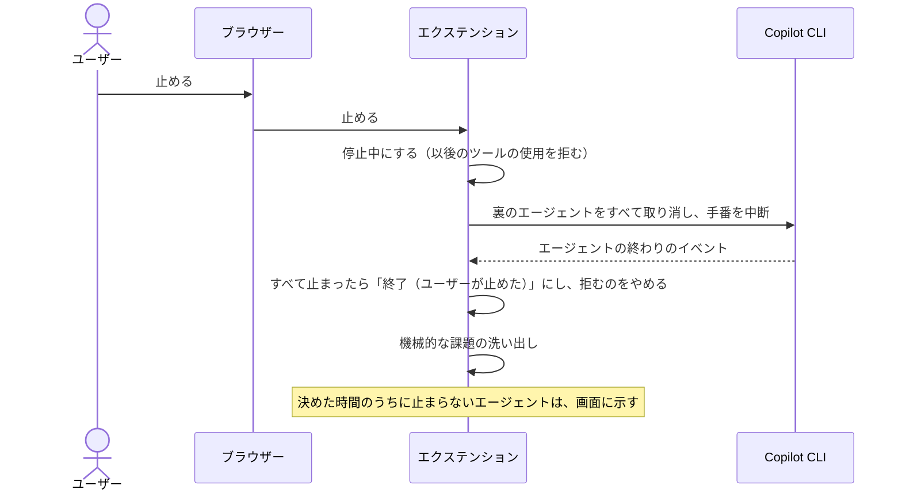
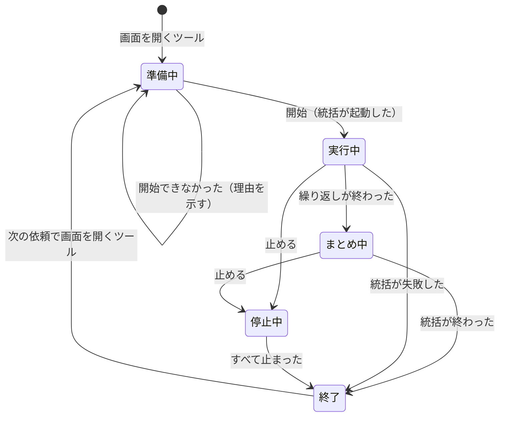

# 生成プラグインの構造

生成プラグインがどんな部品でできていて、どう動くかを示す。中心は、どの生成プラグインにも共通する「土台」（ひな形の共通部分。憲章 第15条2項）である。仕様は [出力の要件](../specs/output-requirements.md) にある。クリエイターがこの構造をどう作るかは [クリエイターの構造](creator-structure.md)、どう試験するかは [試験の設計](testing.md) にある。

## 1. 範囲

| 区分 | 中身 | 書く人 |
| --- | --- | --- |
| 土台 | Web管理画面とその仕組み、エージェントの決まった手順、記録と課題の洗い出し、Issue の起票 | クリエイターのひな形 |
| 作業ごとの部分 | 作業の手順とナレッジ、合否の基準、作業ごとの画面の定義、作業ごとのスクリプトや MCP サーバー | クリエイターの作業エージェント（[クリエイターの構造](creator-structure.md) 3.1） |

この設計書では、土台の作りと、作業ごとの部分を入れる場所と形を定める。

## 2. 設計で重視すること

ユーザーがこれまでに経験した失敗（ナレッジ「ハーネスエンジニアリングの目的と人間の役割」）が起きないことを、具体的な場面で決め、それぞれを満たす決定に結び付ける。

| 重視すること | こうなれば満たす（場面） | 要件 | 決定 |
| --- | --- | --- | --- |
| 開始で確実に動き出す | 画面で開始を押すと、チャットで何もしなくても統括エージェントが動き出し、画面が「実行中」になる | REQ-005 | 4.3 |
| すぐ止まる | 止めるを押すと、すべてのエージェントの手番が中断され、その後ツールが1回も使われない。止まったことを確かめてから画面が「停止」になる | REQ-009 | 4.4 |
| 表示が実際とずれない | エージェントの開始・終了・失敗が、再読み込みなしで約1秒のうちに画面に出る。終わったエージェントが「実行中」のまま残らない | REQ-008 | 4.5 |
| サーバーが残らない・ぶつからない | いつもの番号が使われていても起動する。Copilot CLI を終えると、異常終了でもサーバーのプロセスが残らない | REQ-029 | 4.2 |
| 手元だけで開ける | ほかのマシンからも、同じマシンのほかの Web ページからも、開始・停止・起票を送れない | REQ-006 | 4.2 |
| 費用の低いモデルでも同じ画面 | 作業ごとの画面は、AI が決まった形の定義を書くだけでできる。見た目と動きは土台が決める | REQ-028、REQ-030、REQ-031 | 4.9 |
| 作ることと判定することが混ざらない | 検証エージェントは成果物を書き換えられない。ユーザーと確かめた基準は、評価基準から外せない | REQ-010、REQ-011 | 4.7、4.8 |
| Copilot CLI がなくても土台を試せる | 偽物のつなぎ口（3.2）で、画面と中心の処理を試験できる | REQ-039、REQ-042 | 3.2 |

## 3. 全体の構成

### 3.1 部品のつながり



- エクステンションは、Copilot CLI がセッションの始めに別のプロセスとして起動する Node.js のプログラムである。ツールの追加、イベントの受け取り、エージェントの起動と中断ができる（4.1）。
- 統括・作業・検証は、どれもカスタムエージェント（サブエージェント）である。メインのエージェントは、作業の依頼を受け取って画面を示すだけで、作業には加わらない（4.7）。

### 3.2 エクステンションの中の分け方

エクステンションの中を3つに分ける。Copilot CLI に依る部分を薄くし、それ以外を Copilot CLI なしで試せるようにするためである。

| 部分 | 役割 | Copilot CLI への依存 |
| --- | --- | --- |
| つなぎ口 | 統括の起動、サブエージェントのモデルの上書き、止める、今のモデルの取得、イベントの受け取り、ツールの登録、チャットへの書き込み | Copilot CLI の SDK だけを使う |
| 中心の処理 | 実行の状態、決まりの確かめ（基準、上限、呼んだエージェント）、終わった理由、課題の洗い出し、記録、起票 | なし |
| 画面 | 画面のサーバーと、HTML・CSS・JavaScript の画面。共通の描画の部品で、作業ごとの画面の定義を出す | なし |

- 中心の処理は、つなぎ口を決まった窓口（統括を起動する、モデルを上書きする、止める、今のモデルを返す、イベントを知らせる）でだけ使う。
- 試験では、つなぎ口を偽物に差し替えて、中心の処理と画面を動かす。偽物は生成プラグインのテストのフォルダに置き、プラグイン本体には試験のためだけの機能を入れない。
- 開発の試験（Claude Code で行う）では、試験の仕組みが Agent SDK 用のつなぎ口を持ち、同じ中心の処理と画面を動かす（[試験の設計](testing.md) 4章）。

### 3.3 どこで動くか

| 部品 | 動く場所 | 起動 | 終了 | サンドボックス（4.12） |
| --- | --- | --- | --- | --- |
| メイン・統括・作業・検証のエージェント | Copilot CLI のプロセス | ユーザーの依頼、開始ボタン | 手番の終わり、中断 | エージェントが動かすコマンドは中 |
| エクステンション（画面のサーバーを含む） | Copilot CLI が起動する別のプロセス | セッションの始め。サーバーは画面を開くツールが初めて呼ばれたとき | Copilot CLI の終了と同時 | 外の見込み（要確認） |
| 画面 | ユーザーのブラウザー | URL を開いたとき | タブを閉じたとき | 対象外 |
| gh | エクステンションが起動する短い子プロセス | 承認ボタン | 起票が終わったとき | エクステンションと同じ |

### 3.4 部品と要件

| 部品 | 置き場所（例） | 役割 | 書く人 | 対応する要件 |
| --- | --- | --- | --- | --- |
| マニフェスト | `plugin.json` | Agent Plugins の形式の名前・版・説明・リポジトリ | ひな形と組み立て | REQ-004、REQ-014 |
| スキル（入口） | `skills/<名前>/SKILL.md` | メインのエージェントの手順（4.7） | 手順はひな形、description と作業の説明は作業エージェント | REQ-005 |
| 統括エージェント | `com.github.copilot/agents/orchestrator.agent.md` | 計画・実行・評価の繰り返し、振り返り | 手順はひな形、作業ごとの指示とナレッジは作業エージェント | REQ-010、REQ-011、REQ-013 |
| 作業エージェント | `com.github.copilot/agents/worker.agent.md`（1つ以上） | 成果物を作る | 作業エージェント（ひな形の決まりつき） | REQ-010 |
| 検証エージェント | `com.github.copilot/agents/verifier.agent.md` | 評価基準ごとの合否と指摘 | 手順はひな形、作業ごとの見方は作業エージェント | REQ-010、REQ-011 |
| つなぎ口 | `com.github.copilot/extensions/<名前>/extension.mjs` | 3.2 | ひな形 | REQ-005、REQ-007〜REQ-009、REQ-029 |
| 中心の処理 | 同じフォルダの `core/` | 3.2 | ひな形 | REQ-005〜REQ-014 |
| 画面 | 同じフォルダの `ui/` | 3.2 | ひな形 | REQ-005〜REQ-008、REQ-012〜REQ-014、REQ-025、REQ-030、REQ-031 |
| 作業の定義 | 同じフォルダの `task.json` | 合否の基準、作業ごとの画面、繰り返しの上限の既定（6.4） | 作業エージェント | REQ-007、REQ-011、REQ-031、REQ-038 |
| 作業ごとの部品 | `mcp.json`、`scripts/` など | 作業に要るスクリプトや MCP サーバー | 作業エージェント | 作業ごと |
| 憲章・仕様書・設計書 | `docs/` | 生成プラグインを保守するための文書 | 共通部分はひな形、作業ごとの部分は作業エージェント | REQ-001〜REQ-003 |
| テスト | `tests/` | 1・2段目の入口、偽物のつなぎ口、ナレッジの一覧、EVAL の課題 | ひな形と組み立て、EVAL の課題は作業エージェント | REQ-001、REQ-039、REQ-042 |

## 4. 設計の決定

### 4.1 画面と Copilot CLI のつなぎ方

- 決めたこと：Web管理画面は、生成プラグインに入れたエクステンション（`com.github.copilot/extensions/<名前>/extension.mjs`）で動かす。
- 理由：開始で動き出す、すぐ止まる、Copilot CLI の終了でサーバーも終わる、の3つを1つの公式の部品で満たせるのは、エクステンションだけである。
- 引き換えになること：Copilot CLI 1.0.98 では試験的な機能で、ユーザーが `/experimental on` で有効にする必要がある。Copilot CLI の更新で使い方が変わることがある。エクステンションが読み込まれていないとき、メインのエージェントは、有効にするしかたを示して止まる（4.7）。

| 代案 | 採らなかった理由 |
| --- | --- |
| フックとシェルのコマンド（試作の作り） | 止める仕組み（ツールの使用を拒むフック）は、エージェントが次にツールを使うときにしか効かず、時間切れでは素通りになる。サンドボックスを有効にすると、Linux ではフックから画面のサーバーに届かない。開始を待つのを、AI がコマンドを繰り返し実行することに頼る |
| MCP サーバーの中で画面を動かす | ツールの呼び出しは既定で30秒で時間切れになる。サンドボックスの中で動く。セッションにメッセージを送ったり、エージェントを止めたりできない |
| canvas（エクステンションが出す画面の窓） | エクステンションの一部で、これも試験的である。GUI のない環境ではネイティブの窓が開かず、URL を示すだけになる。将来、ブラウザーの代わりに使える |

- 実行環境：エクステンションは JavaScript（ES モジュール）で書く。Copilot CLI に同梱の実行環境で動くので、ユーザーは Node.js を別に入れなくてよい（Copilot CLI 1.0.98 の実装で確認。実機は要確認）。画面は素の HTML・CSS・JavaScript で、組み立ての手順（ビルド）も外部の配信元（CDN）も使わない。手元だけで、毎回同じに動かすためである。

### 4.2 画面のサーバー

- エクステンションと同じプロセスで動かし、子プロセスを作らない。Copilot CLI は終了時にエクステンションを止め（終了の合図、5秒後に強制終了）、異常終了でも、エクステンションは親のプロセスがいなくなったことを約1秒で見つけて終わる（Copilot CLI 1.0.98 の実装で確認）。サーバーも一緒に終わる（REQ-029）。
- サーバーは、メインのエージェントが画面を開くツールを初めて呼んだときに起動する（頼むと起動する、REQ-029）。
- 待ち受けるのは 127.0.0.1 だけにする（REQ-006）。使いたい番号（作業の定義に書く。既定は土台が決める）がほかのプログラムに使われていたら、OS に空いている番号を選ばせる。
- 起動ごとに乱数の合言葉を作り、画面の URL に入れる（例：`http://127.0.0.1:8731/?k=<合言葉>`）。画面は、サーバーへの問い合わせのたびに合言葉を付け、サーバーは合言葉がない問い合わせを断る。あわせて、問い合わせ先の名前（Host）が 127.0.0.1 か localhost で、番号が合っていることを確かめる。ユーザーのブラウザーで開いているほかの Web ページから、手元のサーバーに開始・停止・起票を送られないようにするためである。
- 1つのセッションでは、同時に1つの実行だけを扱う。実行中に画面を開くツールがまた呼ばれたら、新しく始めず、今の URL を返す。終わった後に呼ばれたら、新しい実行の準備に戻す。前の実行の記録はファイルに残る（4.10）。

### 4.3 開始

- 開始ボタンを押すと、中心の処理が設定を確かめ（必須の項目、上限の回数が1以上、選んだモデルが選択肢にあるか）、つなぎ口が次を行う。
  1. 作業・検証のモデルを、このセッションに限って上書きする（`session.rpc.tools.updateSubagentSettings`）。
  2. 統括を、選んだモデルで、裏で動くエージェントとして起動する（`session.rpc.tasks.startAgent`）。
- 統括への指示文は、中心の処理が決まった形で組み立てる。中身は、頼まれた作業の文、繰り返しの上限、作業ごとの設定の値、ユーザーと確かめた合否の基準（作業の定義から、番号と文をそのまま）である。
- 起動に失敗したとき（使えないモデルなど）は、実行を準備中に戻し、理由を画面に示す。ユーザーは設定を変えて、もう一度開始できる。
- 開始ボタンは、押すとすぐに押せなくなる。2回押されても、統括は1体だけ起動する。

| 代案 | 採らなかった理由 |
| --- | --- |
| メインのエージェントにメッセージを送って、統括を呼ばせる（`session.send`） | 動き出すかが AI の判断に頼る。統括のモデルを画面で選べない（REQ-007） |
| メインのエージェント自身が統括になる | プラグインからは、メインのエージェントのモデルを決められない（[クリエイターの構造](creator-structure.md) 3.2）。統括のモデルを画面で選べない |

### 4.4 止める

- 止めるボタンを押すと、中心の処理は実行を「停止中」にし、つなぎ口が次を行う。
  1. 裏で動くエージェントをすべて取り消す（`session.rpc.cancelAllBackgroundAgents`）。
  2. メインのエージェントの手番も中断する（`session.abort`）。
- 停止中は、エクステンションのフック（ツールを使う前に呼ばれるもの）で、セッションのすべてのツールの使用を拒む。取り消しが届く前にエージェントがツールを使おうとしても、何もできないようにするためである。このフックはエクステンションの中で動くので、コマンドのフックのような時間切れの素通りがない。
- イベントで、動いていたすべてのエージェントの終わりを確かめたら、実行を「終了（ユーザーが止めた）」にし、ツールを拒むのをやめる。ユーザーが、同じ Copilot CLI でほかの作業を続けられるようにするためである。
- 決めた時間（例：10秒）のうちに終わりを確かめられないエージェントは、画面に「止まっていないエージェント」として示す。そのあいだも、ツールは拒み続ける。

### 4.5 状態の届け方

- つなぎ口は、セッションのイベントを中心の処理に渡す。使うのは、サブエージェントの開始・設定・終わり・失敗（`subagent.started`、`subagent.configured`、`subagent.completed`、`subagent.failed`）、ツールの開始と終わり（`tool.execution_start`、`tool.execution_complete`）、サブエージェントの最後の返事（フック `onSubagentStop` の `response`）である。サブエージェントの中で起きたイベントには、そのエージェントの番号（`agentId`）が付く。
- 中心の処理は、イベントからエージェントごとの状態（6.1）、担当している作業（`task` を呼んだときの説明）、使っているモデル、最後に動いた時刻を作る。
- 計画・実行・評価のどれかは、動いているエージェントで決める。検証が動いていれば評価、作業が動いていれば実行、そのどちらでもなく統括が動いていれば計画とする。AI の申告に頼らないので、表示が実際とずれない。今が何回目の試行かは、統括の計画の記録（4.8）で決める。
- エージェント間のデータの受け渡しの図は、構成が決まっているので土台が描く（統括 → 作業 → 統括 → 検証 → 統括）。今まさに受け渡しているところを、動いているエージェントから強調する。
- 画面は、1秒ごとにサーバーから状態の全体を取り直す。状態は小さく、全体を取り直せば、取り逃しも、つなぎ直しの処理も要らない。サーバーにつながらなくなったら（Copilot CLI を終えたときなど）、画面にそう示す。

| 代案 | 採らなかった理由 |
| --- | --- |
| サーバーから変化を送り続ける（SSE） | 届くのは速いが、つなぎ直しと取り逃しの処理が要り、表示が止まる失敗の元になる。1秒の遅れは、人が見て監督するには十分短い |
| 統括にフェーズを申告させる | AI が申告を忘れると、表示が実際とずれる |

### 4.6 役割ごとのモデル

- 統括は起動時のモデルの指定（4.3）、作業と検証はセッションに限った上書きで、画面で選んだモデルを効かせる。上書きは、実行が終わったら外す。
- エージェントの定義の `model` には、既定を優先する順のリストで書いておく。統括と検証は思考力の高いモデル、作業は費用の低いモデルである。上書きが効かないときの備えにもなる。
- 実行の前に、今のモデルを取得する（`session.rpc.model.getCurrent`）。Auto のときは、役割ごとの選択を押せなくし、「Auto のため、役割ごとのモデルは効かず、Auto が選んだモデルで動く」と画面に示す（REQ-007）。
- 実際に動いたモデル（`subagent.started` などのイベントの `model`）を、エージェントごとに画面に出す。選んだモデルと違うときは、そのことを示し、課題の一覧にも入れる（4.10）。
- 選択肢の一覧の出し方は要確認（11章）。取れないときは、作業の定義に書いた選択肢を使う。

| 代案 | 採らなかった理由 |
| --- | --- |
| 統括に、`task` の呼び出しのたびにモデルを渡させる | Copilot CLI の組み込みの指示は、ユーザーが明示的に求めたときだけモデルを渡すよう AI に求めている。プラグインの指示で渡すかは確かめられず、AI の判断に頼る。上書きが効かないと分かったときの代わりにする |
| エージェントの定義のファイルを書き換える | インストールしたプラグインはコピーで、更新で消える。読み込まれるのはセッションの始めだけである |
| ユーザーの設定ファイルを書き換える | ユーザーの設定を、プラグインが勝手に変えることになる |

### 4.7 エージェントの構成

| エージェント | 置き場所 | 使えるツール | 役割 |
| --- | --- | --- | --- |
| メイン | スキル（入口） | ユーザーが選んだもの | 作業の依頼を受け取り、画面を開くツールに渡して URL を示す。統括の終わりの知らせ（Copilot CLI が届ける）を受けたら、結果が画面にあることを伝える。エクステンションのツールがないときは、`/experimental on` で有効にして Copilot CLI を起動し直すよう示して止まる |
| 統括 | カスタムエージェント | `agent`（`task`）、`read`、`search`、記録のツール | 計画・実行・評価の繰り返しと振り返り（4.8、4.10）。成果物は書かない |
| 作業（1体以上） | カスタムエージェント | `read`、`edit`、`execute`、`search`、作業ごとの MCP のツール、表示の記録のツール | 成果物を作る。自分の成果物を判定しない |
| 検証 | カスタムエージェント | `read`、`search`、合否の記録のツール | 評価基準ごとの合否と指摘を記録し、統括に返す。書き込みのツールがないので、成果物を直せない（REQ-010） |

- 統括・作業・検証の `tools` には `skill` を入れない。サブエージェントがスキルを呼び、メインのエージェント向けの手順を始めてしまうのを防ぐためである（ナレッジ「カスタムエージェント」）。
- 入れ子は、メイン → 統括 → 作業・検証 の2段で、Copilot CLI の深さの上限（既定で4か6）に収まる。作業と検証は `agent` を持たず、さらにエージェントを呼ばない。
- 作業エージェントを2体以上にするかは、クリエイターが部品の分け方として決める（[クリエイターの構造](creator-structure.md) 3.1）。

### 4.8 計画・実行・評価の繰り返し

統括は、試行ごとに次を行う（REQ-011）。

1. 計画：記録のツールで、試行の番号、評価基準、計画を知らせる。2回目からは、前の試行の指摘への対応を計画に入れる。
2. 実行：作業エージェントに、計画と評価基準とナレッジを渡して頼む。
3. 評価：検証エージェントに、評価基準と成果物の場所を渡して頼む。検証エージェントは、評価基準ごとの合否と指摘を、自分で記録のツールに知らせてから統括に返す。
4. すべて合格なら繰り返しを終える。そうでなければ、上限の回数まで次の試行に進む。

中心の処理は、記録を受け取るたびに決まりを機械的に確かめ、合わないときはツールの結果をエラーにして、統括に直させる。

- 計画の評価基準に、ユーザーと確かめた基準（作業の定義の番号と文）が、文言を変えずにすべて入っていること。統括が足した基準は認める。
- 試行の番号が前の試行の次で、上限の回数を超えないこと。
- 合否の記録が、検証エージェントから来たこと（ツールの呼び出しとイベントの `agentId` を突き合わせる。要確認）と、その試行の評価基準がすべてそろっていること。

終わった理由は、AI の申告ではなく、記録から中心の処理が決める（REQ-012）。ユーザーが止めたときは「ユーザーが止めた」、最後の合否の記録ですべて合格なら「評価基準をすべて満たした」、上限の試行で合格しなかったら「上限の回数に達した」とする。

### 4.9 作業ごとの部分

- 作業ごとの画面（開始前の設定、実行中の表示、結果の見せ方。REQ-026、REQ-031）は、作業の定義のファイル（6.4）に、決まった形で書く。共通の描画の部品が、それを土台と同じ見た目で出す。
- 部品の種類は少なくする。設定は、文字・数・選択・チェック・ファイルやフォルダの場所の入力。表示は、値の一覧・表・進み具合・文章。
- 作業エージェントが書くのは定義だけで、HTML は書かない。費用の低いモデルでも、毎回同じ品質の画面になる（REQ-028、憲章 第15条1項）。定義の形は、土台にある決まり（スキーマ）で1段目の試験が確かめる。
- 作業ごとの表示の値は、統括や作業エージェントが記録のツールで送り、中心の処理が定義と照らして確かめる。
- 足りない部品が要るときは、土台の部品を増やす。作業ごとに HTML を足さない。見た目がばらばらになるのを防ぐためである（REQ-030）。
- ユーザーと確かめた合否の基準も、作業の定義に置く。統括への指示（4.3）と、EVAL の採点の両方がここから読む。基準が2か所にあってずれるのを防ぐためである。EVAL の課題のファイルは、基準の番号を参照し、採点のしかた（プログラムかモデルか）を足す（[試験の設計](testing.md) 10.1）。

クリエイターが作業エージェントに示す支え（憲章 第15条3項）は次のとおりである。

| 支えること | 示すもの |
| --- | --- |
| デザインの仕方 | 部品の種類と、どの場面でどれを使うかの例 |
| 機能の作り込み方 | 設定の値が統括への指示にどう入るか、表示の値をいつ送るか |
| Copilot CLI との連携の仕方 | 記録のツールの使い方（6.2）。つなぎ口は土台にあり、作業ごとには書かない |

### 4.10 記録と課題

- 中心の処理は、実行ごとに、受け取ったイベントと記録を JSON Lines（1行に1件の JSON）のファイルに書き足していく。置き場所は、プラグインごとの書き込める場所（`PLUGIN_DATA`）の下の、実行ごとのフォルダである（エクステンションに渡るかは要確認）。古い記録は件数で消す（例：20件を超えたら古いものから）。
- 終わった後、中心の処理が、記録から課題を機械的に洗い出す（REQ-013、憲章 第24条1項）。

  | 観点 | 見つけるもの |
  | --- | --- |
  | 実行の失敗 | 失敗したツール、失敗したエージェント |
  | 詰まり・止まり | 決めた時間（例：5分）イベントがないエージェント、同じツールを同じ引数で繰り返した跡、止めても止まらなかったエージェント |
  | データの流れ | 計画 → 作業 → 検証 → 合否の記録がそろわない試行、まとめのない終わり、選んだモデルと実際のモデルの違い |

- ユーザーが止めずに終わったときは、統括が最後に、記録の要点（機械的な洗い出しの結果を含む）を記録のツールで受け取って振り返り、Issue の案（題と本文）を足してから、まとめを記録する。
- ユーザーが止めたときは、エージェントを動かさず、機械的な洗い出しだけにする。止めた後に作業を続けるエージェントを作らないためである（REQ-009）。
- 機械的に見つけた課題にも、決まった形の Issue の案を付ける。

### 4.11 Issue の起票

- 画面の課題の一覧で、案ごとに承認のボタンを押すと、中心の処理が `gh issue create --repo <owner/repo>` で起票し、できた Issue の URL を画面に出す（REQ-014）。
- リポジトリは、マニフェスト（`plugin.json`）の `repository` から知る。インストールしたプラグインはコピーで、`.git` が残らないためである（Copilot CLI 1.0.57 の更新履歴）。
- 画面を開いたときに、起票できるかを確かめる。`repository` がない、`gh` がない、`gh` でログインしていない、のどれかのときは、承認のボタンを押せなくし、何をすれば起票できるか（GitHub に公開して `repository` を書く、`gh` を入れてログインする）を示す。
- 起票の本文は、標準入力で `gh` に渡す。題や本文がコマンドの一部として解釈されないようにするためである。

| 代案 | 採らなかった理由 |
| --- | --- |
| Copilot CLI に組み込みの GitHub MCP サーバー | 既定では Issue を作れない。作れるようにするには、ユーザーが Copilot CLI の起動時の設定を変える必要がある |
| 新しい Issue のページを、題と本文を入れて開く | GitHub の画面で、もう一度送るボタンを押す必要があり、「承認すると起票される」（REQ-014）に合わない |

### 4.12 サンドボックス

- Copilot CLI のサンドボックスの対象は、シェルのコマンド、フック、手元で動かす MCP と LSP のサーバーで、エクステンションは公式の説明の対象に入っていない。そのため、エクステンションは外で動き、サンドボックスを有効にしても画面が開ける見込みである（要確認）。
- 作業エージェントが動かすコマンドは、サンドボックスの中のまま動く。
- エクステンションも中で動くと分かったら、画面のつなぎ方を見直す。

## 5. 場面ごとの流れ

### 5.1 頼んでから終わるまで



ブラウザーは、このあいだずっと、1秒ごとに状態の全体を取り直す。

### 5.2 止める



## 6. 状態とデータ

### 6.1 状態の移り変わり



| エージェントの状態 | 変わるきっかけ |
| --- | --- |
| 待機 | 実行の始め |
| 実行中 | `subagent.started` |
| 完了 | `subagent.completed`（取り消されていない） |
| 失敗 | `subagent.failed` |
| 停止 | 止めた後の `subagent.completed`（取り消し）や `subagent.failed` |

- 状態は、すべて中心の処理が1か所で持つ。エクステンションは1つのプロセスで、イベントと画面からの問い合わせを、届いた順に1つずつ処理する。そのため、同時に書き換わって食い違うことがない。
- 状態には版の番号を付け、変わるたびに上げる。画面は、版の番号が変わったときだけ描き直す。

### 6.2 記録のツール

エクステンションが Copilot CLI に足すツールである。名前の頭には、プラグインどうしでぶつからないよう、生成プラグインの名前を付ける（例：`weekly-report_plan`）。

| ツール（例） | 呼ぶもの | 渡すもの | 中心の処理が確かめること |
| --- | --- | --- | --- |
| `<名前>_open` | メイン | 頼まれた作業の文 | 実行中なら新しく始めず、今の URL を返す |
| `<名前>_plan` | 統括 | 試行の番号、評価基準、計画 | 4.8 の決まり |
| `<名前>_verdict` | 検証 | 試行の番号、評価基準ごとの合否と指摘 | 4.8 の決まり |
| `<名前>_show` | 統括、作業 | 作業ごとの表示の番号と値 | 作業の定義にある表示で、値の形が合うこと |
| `<名前>_review` | 統括 | なし | 機械的な洗い出しの結果と、記録の要点を返す |
| `<名前>_issue` | 統括 | Issue の案（題と本文） | 題と本文があること |
| `<名前>_finish` | 統括 | 実行全体のまとめ | 統括が呼んだこと |

### 6.3 画面のサーバーの窓口

| 窓口 | 中身 |
| --- | --- |
| `GET /` | 画面 |
| `GET /api/state` | 状態の全体（下） |
| `POST /api/start` | 設定を送って開始する |
| `POST /api/stop` | 止める |
| `POST /api/issues/<番号>/file` | 案を承認して起票する |

- どの窓口も、合言葉と問い合わせ先の名前を確かめる（4.2）。
- 状態の全体には、次が入る：実行の状態と終わった理由、設定、Auto かどうか、今のフェーズ、試行の番号と上限、エージェントごとの役割・状態・担当・選んだモデル・実際のモデル・最後に動いた時刻・最後の返事、試行ごとの評価基準・計画・合否と指摘、作業ごとの表示の値、まとめ、課題と Issue の案と起票の状態、起票できるかとその理由、版の番号。

### 6.4 作業の定義

`com.github.copilot/extensions/<名前>/task.json`（例）。作業エージェントが書く。

| 項目 | 中身 |
| --- | --- |
| 名前 | 画面の題に出す作業の名前 |
| 繰り返しの上限の既定 | 開始前の設定の初めの値 |
| 合否の基準 | ユーザーと確かめた基準。番号（例：`C-01`）、文、もとになったナレッジの番号（例：`K-03`） |
| 作業エージェント | 作業エージェントの名前と、画面での呼び名 |
| モデルの選択肢 | 役割ごとの既定と、選択肢を取れないときの一覧（4.6） |
| 開始前の設定 | 作業ごとの設定の部品（番号、見出し、種類、初めの値、選択肢、必須か、説明） |
| 表示 | 実行中と終わった後の表示の部品（番号、見出し、種類、いつ見せるか） |
| 使いたい番号 | 画面のサーバーの番号（なければ土台の既定） |

### 6.5 記録のファイル

- 実行ごとのフォルダ（例：`<PLUGIN_DATA>/runs/<開始の日時>/`）に、`log.jsonl`（イベントと記録を届いた順に1行ずつ）と、`result.json`（終わったときの状態の全体）を置く。
- 記録には、ユーザーの作業の中身が入る。手元のフォルダにだけ置き、外へは送らない。Issue の案に何を書くかは、統括とユーザーの承認で決まる。

## 7. フォルダの構成

```text
<生成プラグイン>/
├─ plugin.json                    マニフェスト
├─ README.md                      使い方（/experimental on を含む）
├─ skills/<名前>/SKILL.md         入口のスキル
├─ com.github.copilot/
│  ├─ agents/                     統括・作業・検証のカスタムエージェント
│  └─ extensions/<名前>/
│     ├─ extension.mjs            つなぎ口（入口）
│     ├─ core/                    中心の処理
│     ├─ ui/                      画面
│     └─ task.json                作業の定義
├─ mcp.json、scripts/ など        作業ごとの部品（要るとき）
├─ docs/                          憲章・仕様書・設計書
└─ tests/                         1・2段目の入口、偽物のつなぎ口、ナレッジの一覧、EVAL の課題
```

- エクステンションの入口のファイル名は `extension.mjs` に決まっている。中心の処理と画面は、入口から相対の場所で読み込む。
- `core/`、`ui/`、`extension.mjs` は、ひな形からそのまま入れ、作業エージェントは書き換えない。1段目の試験で、ひな形と同じであることを確かめる。

## 8. 要件のたどり方

生成プラグインの要件の番号から、設計書の箇所・実装資産・テストをたどれるようにする（REQ-003、憲章 第6条3項）。

- 生成プラグインの設計書に、追跡の表（要件の番号 → 設計書の節 → ファイル → テスト）を置く。土台にあたる要件の行は、ひな形に初めから入れておき、作業ごとの要件の行は作業エージェントが足す。
- テストの名前に、確かめる要件の番号を入れる。
- 1段目の試験で、仕様書のすべての要件の番号が追跡の表にあり、表に書いたファイルがあり、その番号を名前に持つテストがあることを確かめる。
- 生成プラグインの憲章は、ひな形に入れる。成果物の優先順位と開発・保守の順番（REQ-002）は、ひな形の文のまま残す。

## 9. クリエイターの画面での流用

クリエイターの画面（REQ-043、REQ-044）は、同じ中心の処理と画面を、見るだけの使い方で動かす（憲章 第15条2項、第18条）。

- クリエイターのエクステンション（`com.github.copilot/extensions/<クリエイターの画面の名前>/extension.mjs`）は、ひな形の中にある中心の処理と画面を読み込む。土台の写しは持たない。ひな形はスキルのフォルダの中にあり、エクステンションとしては読み込まれない。
- 見るだけなので、開始前の設定、開始と止めるボタン、承認のボタンを出さない。
- 出すもの：決まったこと（ナレッジ、流用する資産）、まだ聞いていない項目、生成前の確認で示すもの（ナレッジの一覧、振る舞いの案、EVAL の課題と合否の基準）、試験の結果、会話例。
- メインのエージェントは、決まったことを記録のツールで、そのつど知らせる。
- Web管理画面の見本（REQ-027）は、案の段階の作業の定義を、同じ描画の部品に仮のデータを入れて出す。見本と、できあがった生成プラグインの画面が、同じ部品でできることになる。
- 合言葉、127.0.0.1 だけで待ち受けること、Copilot CLI の終了で終わることも同じである。

## 10. 試験で確かめること

試験の段階と進め方は [試験の設計](testing.md) にある。土台については、次を確かめる。

| 段階 | 確かめること | 要件 |
| --- | --- | --- |
| 1 構造の検査 | 作業の定義が決まりの形に合う。検証エージェントの `tools` に書き込みとコマンドがない。どのエージェントも `skill` を持たない。記録のツールの名前の頭がプラグインの名前。土台のファイルがひな形と同じ。追跡の表（8章） | REQ-003、REQ-004、REQ-010 |
| 2 部品の試験（中心の処理） | 偽物のつなぎ口で、開始すると選んだモデルで統括が起動され、指示文に基準がすべて入る。基準が欠けた計画、上限を超える計画、検証以外からの合否の記録が断られる。終わった理由が正しく決まる。止めると取り消しと中断が呼ばれ、止まるまでツールが拒まれる。わざと失敗させたイベントの流れで、その失敗が課題に出る | REQ-005、REQ-009〜REQ-013 |
| 2 部品の試験（サーバー） | 127.0.0.1 だけで待ち受ける。合言葉や名前が違う問い合わせを断る。使いたい番号がふさがっていても起動する。偽物の `gh` で、承認すると起票され、`repository` がないときはボタンが押せない | REQ-006、REQ-014、REQ-029 |
| 2 部品の試験（画面） | Playwright で、偽物のつなぎ口からイベントを流し、再読み込みなしで表示が変わる、止めると「停止」になる。幅を変えても崩れない、文字を大きくしても崩れない、色の差、状態が文字でも示される、長い内容が畳まれている | REQ-005、REQ-007、REQ-008、REQ-012、REQ-030 |

つなぎ口そのものは、Copilot CLI がないと確かめられないので、最終確認で人が手元の Copilot CLI で確かめる（[試験の設計](testing.md) 9章）。確かめることは11章にまとめる。

## 11. 実機で確かめること

ログインした Copilot CLI でしか確かめられない前提である。最終確認や、ユーザーの手元での試作で確かめる。

| # | 確かめること | 効く決定 | 違ったときの代わりの案 |
| --- | --- | --- | --- |
| 1 | プラグインに入れたエクステンションが、`/experimental on` のもとで、ユーザーの許可なしに読み込まれるか。`--plugin-dir` と Copilot SDK でも読み込まれるか（SDK での実験モードの指定） | 4.1 | 許可が要るなら、入口のスキルと README で案内する |
| 2 | Node.js を入れていないマシンで、エクステンションが動くか | 4.1 | README の準備に Node.js を足す |
| 3 | サンドボックスを有効にしても、エクステンションが外で動き、画面が開けるか | 4.12 | 有効にしたときの案内を足すか、つなぎ方を見直す |
| 4 | `tasks.startAgent` で、プラグインのカスタムエージェントを、選んだモデルで起動できるか。エージェントの名前の形（`<プラグイン>:<エージェント>` など） | 4.3、4.6 | メインのエージェントにメッセージを送って起動させる |
| 5 | `updateSubagentSettings` で、プラグインのエージェントのモデルを上書きできるか。キーの形 | 4.6 | 統括の指示で、`task` の呼び出しのたびにモデルを渡させる |
| 6 | 裏のエージェントを取り消すと、統括の下で動いている作業・検証まで止まるか。止まるまでの時間 | 4.4 | エージェントごとに取り消す（`tasks.cancel`）。止まるまでツールを拒み続ける |
| 7 | Auto のとき、`model.getCurrent` が何を返すか | 4.6 | Auto が選んだモデルのイベントから判断する |
| 8 | サブエージェントの `tools` に、エクステンションのツールを書けるか（書き方）。ツールの呼び出しとイベントの `agentId` を突き合わせて、呼んだエージェントが分かるか | 4.7、4.8 | 合否の記録を、検証エージェントの最後の返事から中心の処理が読み取る |
| 9 | エクステンションに `PLUGIN_ROOT` と `PLUGIN_DATA` が渡るか | 4.10 | 入口のファイルの場所から求める。データはセッションの作業フォルダに置く |
| 10 | エクステンションから、選べるモデルの一覧を取れるか | 4.6 | 作業の定義に書いた選択肢を使う |
| 11 | 機微な環境変数が除かれたエクステンションから、`gh` で起票できるか | 4.11 | `gh` の認証のしかたを README で案内する |
| 12 | 裏で動かした統括が終わったとき、メインのエージェントに知らせが届くか | 4.7 | 終わったことをエクステンションがチャットに書く（`session.log`） |

## 根拠

- 憲章 第5条、第6条1項・3項、第9条、第10条、第15条、第18条、第19条〜第24条
- 出力の要件（REQ-001〜REQ-014、REQ-025、REQ-029〜REQ-031）、作る流れの要件（REQ-026〜REQ-028、REQ-043、REQ-044）、試験の要件（REQ-038、REQ-039、REQ-042）
- ナレッジ「ハーネスエンジニアリングの目的と人間の役割」「画面と Copilot CLI のつなぎ方」「カスタムエージェント」「プラグイン」「自己改善」「AI の思考サイクル（PDS）」「KISS」
- SWEBOK V4 第2章（アーキテクチャの記述と決定の根拠、品質の特性）、第3章（設計で考える事項：並行性、イベントの扱い、データの永続化、エラーと耐障害性、セキュリティ）

## 出典

- [About extensions for GitHub Copilot CLI](https://docs.github.com/en/copilot/concepts/agents/copilot-cli/about-cli-extensions)（試験的な機能であること、置き場所、`extensions.mode`）
- [Creating an extension for GitHub Copilot CLI](https://docs.github.com/en/copilot/tutorials/create-an-extension)
- [GitHub Copilot CLI command reference](https://docs.github.com/en/copilot/reference/copilot-cli-reference/cli-command-reference)（`task` の呼び出しごとのモデル、モデルが決まる順、サブエージェントの深さの上限、MCP の時間切れ）
- [GitHub Copilot CLI plugin reference](https://docs.github.com/en/copilot/reference/copilot-cli-reference/cli-plugin-reference)（`com.github.copilot/` の中、`PLUGIN_ROOT`・`PLUGIN_DATA`）
- [GitHub Copilot hooks reference](https://docs.github.com/en/copilot/reference/hooks-configuration)（フックの時間切れと素通り）
- [Configuring local sandbox settings](https://docs.github.com/en/copilot/how-tos/cloud-and-local-sandboxes/configuring-local-sandbox-settings)（サンドボックスの対象）
- [Copilot CLI changelog](https://github.com/github/copilot-cli/blob/main/changelog.md)（1.0.57 インストールしたプラグインに `.git` が残らない、1.0.62 プラグインがエクステンションを同梱できる、1.0.79・1.0.80 `com.github.copilot/extensions/`）
- [Agent Plugins Specification 1.0.0](https://github.com/agentplugins/agent-plugins-spec/blob/main/spec/1.0.0.md)（マニフェストの `repository`、ベンダーのフォルダ、`PLUGIN_DATA`）
- Copilot CLI 1.0.98 の npm パッケージ（`@github/copilot`）に含まれるプログラム：`copilot-sdk/docs/extensions.md`・`agent-author.md`（エクステンションの起動と終了、ツールとフックの登録）、`copilot-sdk/generated/rpc.d.ts`（`tasks.startAgent`、`tools.updateSubagentSettings`、`cancelAllBackgroundAgents`、`model.getCurrent`）、`copilot-sdk/generated/session-events.d.ts`（`subagent.*` のイベント）、`preloads/extension_bootstrap.mjs`（親のプロセスの見張り）
- [Web Content Accessibility Guidelines (WCAG) 2.2](https://www.w3.org/TR/WCAG22/)
- [SWEBOK Guide V4.0](https://www.computer.org/education/bodies-of-knowledge/software-engineering/v4)
