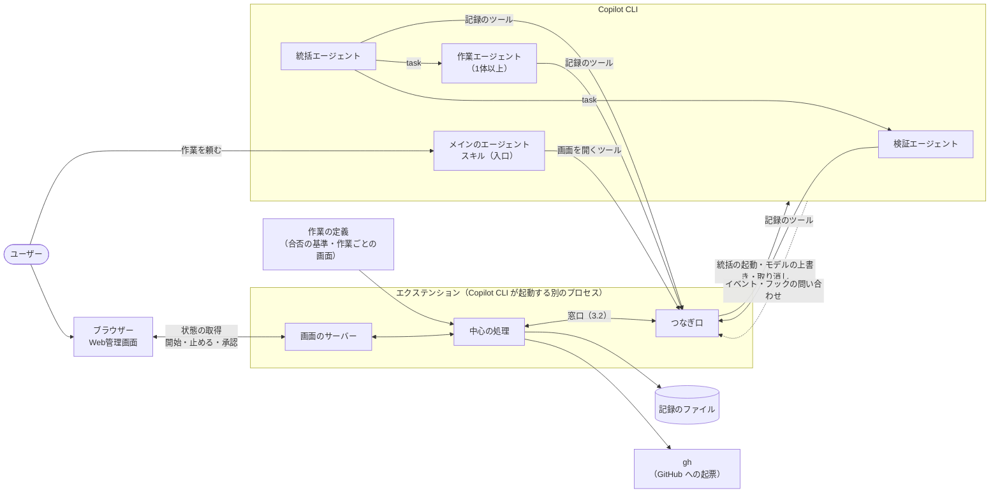
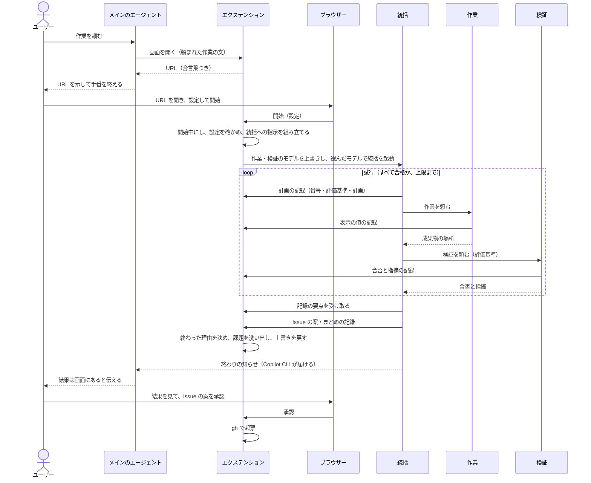
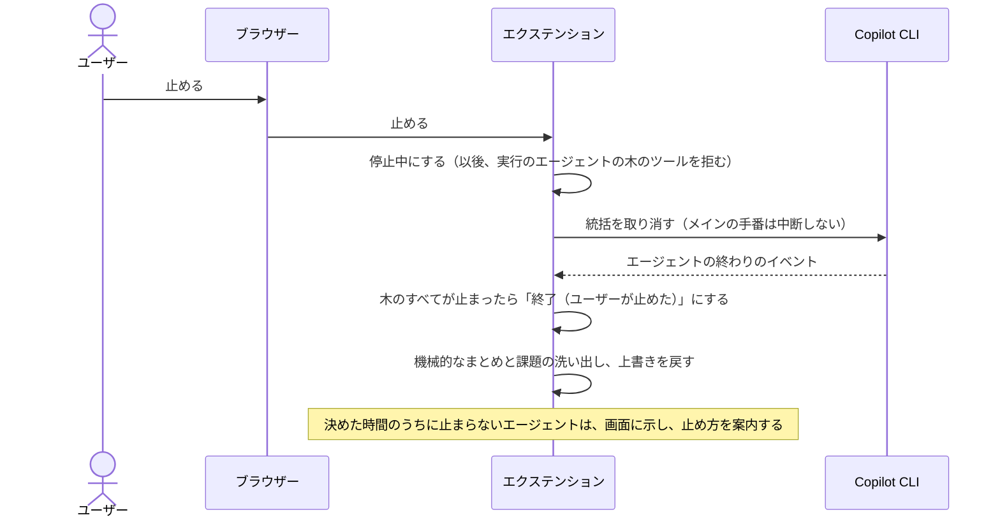
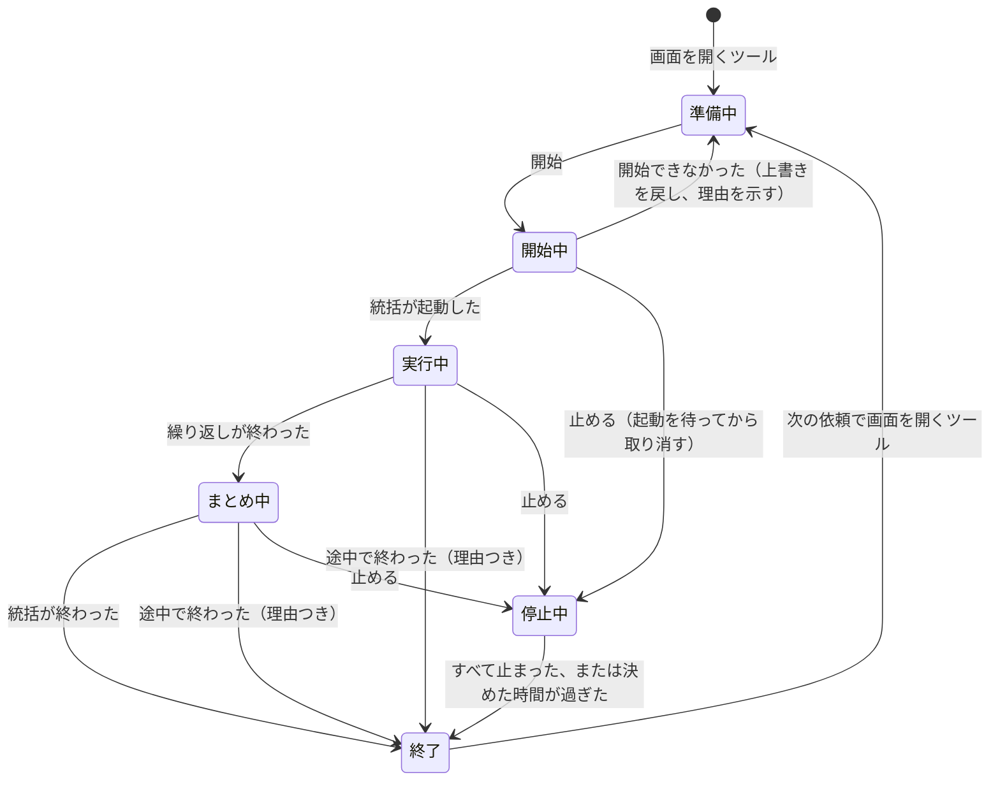

# 生成プラグインの構造

生成プラグインがどんな部品でできていて、どう動くかを示す。中心は、どの生成プラグインにも共通する「土台」（ひな形の共通部分。憲章 第15条2項）である。仕様は [出力の要件](../specs/output-requirements.md) にある。クリエイターがこの構造をどう作るかは [クリエイターの構造](creator-structure.md)、どう試験するかは [試験の設計](testing.md) にある。

## 1. 範囲

| 区分 | 中身 | 書く人 |
| --- | --- | --- |
| 土台 | Web管理画面とその仕組み、エージェントの決まった手順、記録と課題の洗い出し、Issue の起票 | クリエイターのひな形 |
| 作業ごとの部分 | 作業の手順とナレッジ、合否の基準、作業ごとの画面の定義、作業ごとのスクリプトや MCP サーバー | クリエイターの作業エージェント（[クリエイターの構造](creator-structure.md) 3.1） |

この設計書では、土台の作りと、作業ごとの部分を入れる場所と形を定める。

## 2. 設計で重視すること

ユーザーがこれまでに経験した失敗（ナレッジ「ハーネスエンジニアリングの目的と人間の役割」）が起きないことを、具体的な場面で決め、それぞれを満たす決定に結び付ける。

| 重視すること | こうなれば満たす（場面） | 要件 | 決定 |
| --- | --- | --- | --- |
| 開始で確実に動き出す | 画面で開始を押すと、チャットで何もしなくても統括エージェントが動き出し、画面が「実行中」になる。2回押しても統括は1体だけ | REQ-005 | 4.3 |
| すぐ止まる | 止めるを押すと、この実行のエージェントが取り消され、その後この実行のエージェントはツールを使えない。チャットでのほかの作業は巻き込まない。止まったことを確かめてから、画面が「終了（ユーザーが止めた）」になる | REQ-009 | 4.4 |
| 表示が実際とずれない | エージェントの開始・終了・失敗・許可の待ちが、再読み込みなしで約1秒のうちに画面に出る。終わったエージェントが「実行中」のまま残らない | REQ-008 | 4.5、4.14 |
| 途中で切れても残らない | `/clear` でエクステンションが読み込み直されても、前の実行が「実行中」のまま残らず、「途中で切れた」と示される | REQ-008、REQ-012 | 4.13 |
| サーバーが残らない・ぶつからない | いつもの番号が使われていても起動する。Copilot CLI を終えると、異常終了でもサーバーのプロセスが残らない | REQ-029 | 4.2 |
| 手元だけで開ける | ほかのマシンからも、同じマシンのほかの Web ページからも、開始・停止・起票を送れない | REQ-006 | 4.2 |
| 費用の低いモデルでも同じ画面 | 作業ごとの画面は、AI が決まった形の定義を書くだけでできる。見た目と動きは土台が決める | REQ-028、REQ-030、REQ-031 | 4.9 |
| 作ることと判定することが混ざらない | 検証エージェントは成果物を書き換えられない。ユーザーと確かめた基準は、評価基準から外せない | REQ-010、REQ-011 | 4.7、4.8 |
| Copilot CLI がなくても土台を試せる | 偽物のつなぎ口（3.2）で、画面と中心の処理を試験できる | REQ-039、REQ-042 | 3.2 |

## 3. 全体の構成

### 3.1 部品のつながり



- エクステンションは、Copilot CLI がセッションの始めに別のプロセスとして起動する Node.js のプログラムである。ツールとフックの登録、イベントの受け取り、エージェントの起動と取り消しができる（4.1）。
- 統括・作業・検証は、どれもカスタムエージェント（サブエージェント）である。メインのエージェントは、作業の依頼を受け取って画面を示すだけで、作業には加わらない（4.7）。

### 3.2 エクステンションの中の分け方

エクステンションの中を3つに分ける。Copilot CLI に依る部分を薄くし、それ以外を Copilot CLI なしで試せるようにするためである。

| 部分 | 役割 | Copilot CLI への依存 |
| --- | --- | --- |
| つなぎ口 | 起動したときに、記録のツールとフックを登録する。Copilot CLI のイベント、ツールの呼び出し、フックの問い合わせを、中立の形（下の窓口の表）に直して中心の処理に渡す。中心の処理の頼みを、Copilot CLI の呼び出しに直す | Copilot SDK（Copilot CLI をプログラムから操作する公式の部品。以下 SDK）だけを使う |
| 中心の処理 | 実行の状態、決まりの確かめ（基準、上限、呼んだエージェント）、終わった理由、課題の洗い出し、記録、起票 | なし |
| 画面 | 画面のサーバーと、HTML・CSS・JavaScript の画面。共通の描画の部品で、作業ごとの画面の定義を出す | なし |

中心の処理とつなぎ口は、次の窓口でだけやり取りする。

| 向き | 窓口 | つなぎ口が使う Copilot CLI の機能 |
| --- | --- | --- |
| 中心 → つなぎ口 | 統括を起動する | `session.rpc.tasks.startAgent` |
| | エージェントを取り消す／動いているエージェントの一覧 | `session.rpc.tasks.cancel`、`session.rpc.tasks.list` |
| | サブエージェントのモデルを上書きする／戻す | `session.rpc.tools.updateSubagentSettings` |
| | 今のモデルと、選べるモデルの一覧を返す | `session.rpc.model.getCurrent`、`rpc.models.list` |
| | チャットに書く | `session.log` |
| つなぎ口 → 中心 | 中立のイベント：エージェントの開始・設定・終わり（最後の返事つき）・失敗 | `subagent.started`、`subagent.configured`、`subagent.completed`、`subagent.failed`、フック `onSubagentStop` の `response` |
| | 中立のイベント：ツールの開始・終わり | `tool.execution_start`、`tool.execution_complete` |
| | 中立のイベント：許可・返事・利用の上限の待ち | `permission.requested`、`user_input.requested`、`session_limits_exhausted.requested` |
| | 中立のイベント：手番の終わり（中断されたか） | `session.idle` |
| | 記録のツールが呼ばれた（呼んだエージェントの番号つき） | ツールの登録（`ToolInvocation.agentId`） |
| | ツールを使ってよいかを問う（エージェントの番号と親の番号つき） | フック `onPreToolUse` |

- 試験では、つなぎ口を偽物に差し替えて、中心の処理と画面を動かす。偽物は生成プラグインのテストのフォルダに置き、プラグイン本体には試験のためだけの機能を入れない。
- 開発の試験（Claude Code で行う）では、試験の仕組みが Agent SDK 用のつなぎ口を持ち、同じ中心の処理と画面を動かす（[試験の設計](testing.md) 4章）。

### 3.3 どこで動くか

| 部品 | 動く場所 | 起動 | 終了 | サンドボックス（4.12） |
| --- | --- | --- | --- | --- |
| メイン・統括・作業・検証のエージェント | Copilot CLI のプロセス | ユーザーの依頼、開始ボタン | 手番の終わり、取り消し | エージェントが動かすコマンドは中 |
| エクステンション（画面のサーバーを含む） | Copilot CLI が起動する別のプロセス | セッションの始めと `/clear` のとき。サーバーは画面を開くツールが初めて呼ばれたとき | Copilot CLI の終了と `/clear` のとき | 外の見込み（要確認） |
| 画面 | ユーザーのブラウザー | URL を開いたとき | タブを閉じたとき | 対象外 |
| gh | エクステンションが起動する短い子プロセス | 承認ボタン | 起票が終わったとき | エクステンションと同じ |

### 3.4 部品と要件

| 部品 | 置き場所（例） | 役割 | 書く人 | 対応する要件 |
| --- | --- | --- | --- | --- |
| マニフェスト | `plugin.json` | Agent Plugins の形式の名前・版・説明・リポジトリ | ひな形と組み立て | REQ-004、REQ-014 |
| スキル（入口） | `skills/<名前>/SKILL.md` | メインのエージェントの手順（4.7） | 手順はひな形、description と作業の説明は作業エージェント | REQ-005 |
| 統括エージェント | `com.github.copilot/agents/orchestrator.agent.md` | 計画・実行・評価の繰り返し、振り返り | 手順はひな形、作業ごとの指示とナレッジは作業エージェント | REQ-010、REQ-011、REQ-013 |
| 作業エージェント | `com.github.copilot/agents/worker.agent.md`（1つ以上） | 成果物を作る | 作業エージェント（ひな形の決まりつき） | REQ-010 |
| 検証エージェント | `com.github.copilot/agents/verifier.agent.md` | 評価基準ごとの合否と指摘 | 手順はひな形、作業ごとの見方は作業エージェント | REQ-010、REQ-011 |
| つなぎ口 | `com.github.copilot/extensions/<名前>/extension.mjs` | 3.2 | ひな形 | REQ-005、REQ-007〜REQ-009、REQ-029 |
| 中心の処理 | 同じフォルダの `core/` | 3.2 | ひな形 | REQ-005〜REQ-014 |
| 画面 | 同じフォルダの `ui/` | 3.2 | ひな形 | REQ-005〜REQ-008、REQ-012〜REQ-014、REQ-025、REQ-030、REQ-031 |
| 作業の定義 | 同じフォルダの `task.json` | 合否の基準、作業ごとの画面、繰り返しの上限の既定（6.4） | 作業エージェント | REQ-007、REQ-011、REQ-031、REQ-038 |
| 作業ごとの部品 | `mcp.json`、`scripts/` など | 作業に要るスクリプトや MCP サーバー | 作業エージェント | 作業ごと |
| 憲章・仕様書・設計書 | `docs/` | 生成プラグインを保守するための文書 | 共通部分はひな形、作業ごとの部分は作業エージェント | REQ-001〜REQ-003 |
| テスト | `tests/` | 1・2段目の入口、偽物のつなぎ口、ナレッジの一覧、EVAL の課題 | ひな形と組み立て、EVAL の課題は作業エージェント | REQ-001、REQ-039、REQ-042 |

## 4. 設計の決定

### 4.1 画面と Copilot CLI のつなぎ方

- 決めたこと：Web管理画面は、生成プラグインに入れたエクステンション（`com.github.copilot/extensions/<名前>/extension.mjs`）で動かす。
- 理由：開始で動き出す、すぐ止まる、Copilot CLI の終了でサーバーも終わる、の3つを1つの公式の部品で満たせるのは、エクステンションだけである。
- 引き換えになること：Copilot CLI 1.0.98 では試験的な機能で、ユーザーが `/experimental on` で有効にする必要がある。Copilot CLI の更新で使い方が変わることがある。エクステンションが読み込まれていないとき、メインのエージェントは、有効にするしかたを示して止まる（4.7。仕様にない振る舞いなので、仕様の判断待ち）。

| 代案 | 採らなかった理由 |
| --- | --- |
| フックとシェルのコマンド | 止める仕組み（ツールの使用を拒むフック）は、エージェントが次にツールを使うときにしか効かず、時間切れでは素通りになる。既定の設定では、サンドボックスを有効にすると、Linux ではフックから画面のサーバーに届かない。開始を待つのを、AI がコマンドを繰り返し実行することに頼る |
| MCP サーバーの中で画面を動かす | ツールの呼び出しは既定で30秒で時間切れになる。サンドボックスの中で動く。セッションにメッセージを送ったり、エージェントを止めたりできない |
| canvas（エクステンションが出す画面の窓） | エクステンションの一部で、これも試験的である。GUI のない環境では、OS の窓（ブラウザーではない、パソコンの画面に直接開く窓）が開かず、URL を示すだけになる。将来、ブラウザーの代わりに使える |

- 実行環境：エクステンションは JavaScript で、`import` で部品を読み込む書き方（ES モジュール）で書く。Copilot CLI に同梱の実行環境で動くので、ユーザーは Node.js を別に入れなくてよい（Copilot CLI 1.0.98 の実装で確認。実機は要確認）。画面は素の HTML・CSS・JavaScript で、組み立ての手順（ビルド）も外部の配信元（CDN）も使わない。手元だけで、毎回同じに動かすためである。

### 4.2 画面のサーバー

- エクステンションと同じプロセスで動かし、子プロセスを作らない。Copilot CLI は終了時にエクステンションを止め（終了の合図、5秒後に強制終了）、異常終了でも、エクステンションは親のプロセスがいなくなったことを約1秒で見つけて終わる（Copilot CLI 1.0.98 の実装で確認。実機は要確認）。サーバーも一緒に終わる（REQ-029）。
- サーバーは、メインのエージェントが画面を開くツールを初めて呼んだときに起動する（REQ-029）。
- 待ち受けるのは 127.0.0.1 だけにする（REQ-006）。番号は土台の既定を使い、ほかのプログラムに使われていたら、OS に空いている番号を選ばせる。
- 起動ごとに乱数の合言葉を作り、画面の URL に入れる（例：`http://127.0.0.1:8731/?k=<合言葉>`）。画面は、サーバーへの問い合わせのたびに合言葉を付け、サーバーは合言葉がない問い合わせを断る。あわせて、問い合わせ先の名前（Host）が 127.0.0.1 か localhost で、番号が合っていることを確かめる。ユーザーのブラウザーで開いているほかの Web ページから、手元のサーバーに開始・停止・起票を送られないようにするためである。
- 1つのセッションでは、同時に1つの実行だけを扱う。実行中に画面を開くツールがまた呼ばれたら、新しく始めず、今の URL を返す。終わった後に呼ばれたら、新しい実行の準備に戻す。前の実行の記録はファイルに残る（4.10）。

| 代案 | 採らなかった理由 |
| --- | --- |
| 合言葉なし（127.0.0.1 だけ） | 同じマシンのほかの Web ページから、開始や起票を送られる |
| ログインの画面 | 1人が手元で使うには手間が多い。URL を開くだけで使えなくなる |

### 4.3 開始

- 開始ボタンを押すと、中心の処理は実行を「開始中」にし、設定を確かめる（必須の項目、上限の回数が1以上、選んだモデルが選択肢にあるか）。つなぎ口が次を行う。
  1. 上書きの前の値を控えてから、作業・検証のモデルを、このセッションに限って上書きする（`updateSubagentSettings`）。
  2. 統括を、選んだモデルで、裏で動くエージェントとして起動する（`tasks.startAgent`）。結果の番号（`agentId`）を、実行のエージェントの木の根にする（4.4）。
- 起動できたら「実行中」にする。失敗したとき（使えないモデルなど）は、上書きを前の値に戻し、「準備中」に戻して理由を画面に示す。ユーザーは設定を変えて、もう一度開始できる。
- 開始ボタンは、押すとすぐに押せなくなる。開始中か実行中に届いた開始は断るので、統括は1体だけ起動する。開始中に止めるが届いたら、統括の起動を頼む前なら起動しない。頼んだ後なら、起動の結果を待ってから取り消す（4.4）。
- 統括への指示文は、中心の処理が決まった形で組み立てる。中身は、頼まれた作業の文、繰り返しの上限、作業ごとの設定の値、ユーザーと確かめた合否の基準（作業の定義から、番号と文をそのまま）である。

| 代案 | 採らなかった理由 |
| --- | --- |
| メインのエージェントにメッセージを送って、統括を呼ばせる（`session.send`） | 動き出すかが AI の判断に頼る。統括のモデルを画面で選べない（REQ-007） |
| メインのエージェント自身が統括になる | プラグインからは、メインのエージェントのモデルを決められない（[クリエイターの構造](creator-structure.md) 3.2）。統括のモデルを画面で選べない |

### 4.4 止める

- 止める範囲は、この実行のエージェント（統括と、その下の作業・検証）だけにする。メインのエージェントの手番は中断しない。ユーザーがチャットでしているほかの作業を巻き込まないためである。
- 中心の処理は、イベントとフックの入力から、実行のエージェントの木を持つ。根は統括の番号（4.3）で、親の番号（`parentAgentId`）が木に入るエージェントを、その下に足していく。
- 止めるボタンを押すと、中心の処理は実行を「停止中」にし、つなぎ口が統括を取り消す（`tasks.cancel`）。統括の下の作業・検証まで止まるかは要確認（11章 #6）。止まらないときは、裏のエージェントをすべて取り消す（`cancelAllBackgroundAgents`）に替える。
- 停止中と停止の後は、エクステンションのフック（ツールを使う前に呼ばれる `onPreToolUse`）で、入力のエージェントの番号（`agentId`）が木に入るツールの使用だけを拒む。ほかのエージェントのツールは拒まないので、拒むのをやめる処理は要らない。止まらないエージェントが残っても、ユーザーはほかの作業を続けられる。
- フックは安全網であり、頼り切らない。エクステンションのフックにも時間切れがあり、失敗したときや登録できないときは、ツールを通す側に倒れる。組織の設定（`allowManagedHooksOnly`）で止められることもある（11章 #13）。
- イベントで、木のすべてのエージェントの終わりを確かめたら、実行を「終了（ユーザーが止めた）」にする。
- 決めた時間（例：10秒）のうちに終わりを確かめられないエージェントは、画面に「止まっていないエージェント」として示し、止め方（チャットで Esc を2回押す、または Copilot CLI を終える）を案内する。そのうえで実行は「終了（ユーザーが止めた）」にする。
- 作業エージェントが始めたシェルの処理は、エージェントを取り消しても残ることがある（`cancelAllBackgroundAgents` も、裏に回したシェルは止めない）。残った処理を止める手段は要確認（11章 #14）。止めても止まらなかったエージェントと処理は、課題の一覧に入れる（4.10）。

| 代案 | 採らなかった理由 |
| --- | --- |
| セッション全体を止める（裏のエージェントをすべて取り消し、メインの手番も中断する） | 実行と関係のない裏の作業や、ユーザーのチャットまで止める |
| フックでツールを拒むだけにする | エージェントが次にツールを使うときにしか効かない。失敗したときは通す側に倒れる |

### 4.5 状態の届け方

- つなぎ口は、中立のイベント（3.2）を中心の処理に渡す。サブエージェントの中で起きたイベントには、そのエージェントの番号が付く。
- 中心の処理は、イベントからエージェントごとの状態（6.1）、担当している作業（`task` を呼んだときの説明）、使っているモデル、最後に動いた時刻を作る。
- 画面のエージェントの枠は、役割ごとに決まった数で出す（統括1、作業は定義の数、検証1）。試行ごとに起動し直したエージェントは、同じ枠の中で入れ替わる。起動ごとの履歴は、結果の試行ごとの表に出す。
- 計画・実行・評価のどれかは、動いているエージェントで決める。検証が動いていれば評価、作業が動いていれば実行、そのどちらでもなく統括が動いていれば計画とする。AI の申告に頼らないので、表示が実際とずれない。今が何回目の試行かは、統括の計画の記録（4.8）で決める。
- エージェント間のデータの受け渡しの図は、構成が決まっているので土台が描く（統括 → 作業 → 統括 → 検証 → 統括）。今まさに受け渡しているところを、動いているエージェントから強調する。
- 画面は、1秒ごとにサーバーから状態の全体を取り直す。状態は小さく、全体を取り直せば、取り逃しも、つなぎ直しの処理も要らない。状態の全体に入れる返事は要約だけにし、全文は、ユーザーが開いたときに別の窓口で取る（6.3）。サーバーにつながらなくなったら（Copilot CLI を終えたときなど）、画面にそう示す。

| 代案 | 採らなかった理由 |
| --- | --- |
| サーバーから変化を送り続ける（SSE） | 届くのは速いが、つなぎ直しと取り逃しの処理が要り、表示が止まる失敗の元になる。1秒の遅れは、人が見て監督するには十分短い |
| 統括にフェーズを申告させる | AI が申告を忘れると、表示が実際とずれる |

### 4.6 役割ごとのモデル

- 統括は起動時のモデルの指定（4.3）、作業と検証はセッションに限った上書きで、画面で選んだモデルを効かせる。実行が終わったら、上書きの前の値に戻す。
- 役割ごとの既定は、エージェントの定義の `model`（優先する順のリスト）の1か所にだけ書き、画面の初めの値はそこから読む。統括と検証は思考力の高いモデル、作業は費用の低いモデルである。上書きが効かないときの備えにもなる。
- 選択肢は、選べるモデルの一覧（`rpc.models.list`）から出す（動くかは要確認、11章 #10）。
- 実行の前に、今のモデルを取得する（`model.getCurrent`）。Auto のとき、公式に書かれているのは、サブエージェントが定義の `model` に関係なくセッションのモデルを引き継ぐことだけである。起動時の指定と上書きが Auto で効くかは要確認（11章 #7）。そのため、画面には「Auto のため、選んだモデルで動かないことがある」と示す（REQ-007）。
- 実際に動いたモデル（`subagent.started` などのイベントの `model`）を、エージェントごとに画面に出す。選んだモデルと違うときは、そのことを示し、課題の一覧にも入れる（4.10）。

| 代案 | 採らなかった理由 |
| --- | --- |
| 統括に、`task` の呼び出しのたびにモデルを渡させる | Copilot CLI の組み込みの指示は、ユーザーが明示的に求めたときだけモデルを渡すよう AI に求めている。プラグインの指示で渡すかは確かめられず、AI の判断に頼る。上書きが効かないと分かったときの代わりにする |
| エージェントの定義のファイルを書き換える | インストールしたプラグインはコピーで、更新で消える |
| ユーザーの設定ファイルを書き換える | ユーザーの設定を、プラグインが勝手に変えることになる |

### 4.7 エージェントの構成

| エージェント | 置き場所 | 使えるツール | 役割 |
| --- | --- | --- | --- |
| メイン | スキル（入口） | ユーザーが選んだもの | 作業の依頼を受け取り、画面を開くツールに渡して URL を示す。あわせて、実行中は `/clear` しないこと（4.13）と、任せたいツールを前もって許可するしかた（4.14）を示す。統括の終わりの知らせ（Copilot CLI が届ける）を受けたら、結果が画面にあることを伝える。エクステンションのツールがないときは、`/experimental on` で有効にして Copilot CLI を起動し直すよう示して止まる（仕様の判断待ち） |
| 統括 | カスタムエージェント | `agent`（`task`）、`read`、`search`、記録のツール | 計画・実行・評価の繰り返しと振り返り（4.8、4.10）。成果物は書かない |
| 作業（1体以上） | カスタムエージェント | `read`、`edit`、`execute`、`search`、作業ごとの MCP のツール、表示の記録のツール | 成果物を作る。自分の成果物を判定しない |
| 検証 | カスタムエージェント | `read`、`search`、合否の記録のツール | 評価基準ごとの合否と指摘を記録し、統括に返す。書き込みのツールがないので、成果物を直せない（REQ-010） |

- 統括・作業・検証の `tools` には `skill` を入れない。サブエージェントがスキルを呼び、メインのエージェント向けの手順を始めてしまうのを防ぐためである（ナレッジ「カスタムエージェント」）。ただし、Copilot CLI で `skill` を外すとスキルを呼べなくなるかは要確認である（公式の `tools` の別名の表に `skill` はない。11章 #16）。効かないときは、作業・検証への指示に「スキルを使わない」と書き、入口のスキルの description を、サブエージェントから呼ばれにくい書き方にする。
- 入れ子は、エクステンションが起動した統括 → 作業・検証 で、Copilot CLI の深さの上限（既定は4（公式ドキュメントでは6））に収まる。作業と検証は `agent` を持たず、さらにエージェントを呼ばない。
- 作業エージェントを2体以上にするかは、クリエイターが部品の分け方として決める（[クリエイターの構造](creator-structure.md) 3.1）。

### 4.8 計画・実行・評価の繰り返し

統括は、試行ごとに次を行う（REQ-011）。

1. 計画：記録のツールで、試行の番号、評価基準、計画を知らせる。2回目からは、前の試行の指摘への対応を計画に入れる。
2. 実行：作業エージェントに、計画と評価基準とナレッジを渡して頼む。
3. 評価：検証エージェントに、評価基準と成果物の場所を渡して頼む。検証エージェントは、評価基準ごとの合否と指摘を、自分で記録のツールに知らせてから統括に返す。
4. すべて合格なら繰り返しを終える。そうでなければ、上限の回数まで次の試行に進む。

中心の処理は、記録を受け取るたびに決まりを機械的に確かめ、合わないときはツールの結果をエラーにして、統括に直させる。断られたやり直しには上限（例：3回）を置き、超えたら実行を「途中で終わった」にする。

- 計画の評価基準に、ユーザーと確かめた基準（作業の定義の番号と文）が、文言を変えずにすべて入っていること。統括が足した基準は認める。
- 試行の番号が前の試行の次で、上限の回数を超えないこと。
- 合否の記録が、検証エージェントから来たこと（記録のツールの呼び出しに付くエージェントの番号で確かめる。11章 #8）と、その試行の評価基準がすべてそろっていること。

終わった理由は、AI の申告ではなく、記録とイベントから中心の処理が決める（REQ-012）。

| 終わった理由 | 決め方 |
| --- | --- |
| 評価基準をすべて満たした | 最後の合否の記録ですべて合格 |
| 上限の回数に達した | 上限の試行で合格しなかった |
| ユーザーが止めた | 画面で止めた（4.4） |
| 途中で終わった（理由つき） | 統括の失敗、繰り返しを終えないまま統括が終わった、チャットから中断された、AI クレジットの上限、最後の試行で合否の記録がない、記録のやり直しが上限を超えた、途中で切れた（4.13） |

仕様（REQ-012）の終わった理由は上の3つなので、「途中で終わった」は仕様の判断待ちである。

### 4.9 作業ごとの部分

- 作業ごとの画面（開始前の設定、実行中の表示、結果の見せ方。REQ-026、REQ-031）は、作業の定義のファイル（6.4）に、決まった形で書く。共通の描画の部品が、それを土台と同じ見た目で出す。
- 部品の種類は少なくする。設定は、文字・数・選択・チェック・ファイルやフォルダの場所の入力。表示は、値の一覧・表・進み具合・文章・画像・ファイルへのリンク。グラフなどは、作業エージェントが画像のファイルとして作って見せる。
- 作業エージェントが書くのは定義だけで、HTML は書かない。費用の低いモデルでも、毎回同じ品質の画面になる（REQ-028、憲章 第15条1項）。定義の形は、土台にある決まり（スキーマ）で1段目の試験が確かめる。
- 作業ごとの表示の値は、統括や作業エージェントが記録のツールで送り、中心の処理が定義と照らして確かめる。
- クリエイターは、画面で見たいことを聞くとき（REQ-026）、用意のある部品の中で決め、見本（9章）で確かめる。用意のない表示を望まれたら、近い部品を示す。足りない部品は、作業ごとに HTML を足さず、クリエイター自身の改善として土台に足す。仕様（REQ-026、REQ-031）にこの決まりはないので、仕様の判断待ちである。
- ユーザーと確かめた合否の基準は、作業の定義を元とする。統括への指示（4.3）と計画の確かめ（4.8）は、ここから読む。EVAL の課題のファイル（`tests/` の中）には、基準の番号と文を写し、採点のしかた（プログラムかモデルか）を足す（[試験の設計](testing.md) 10.1）。1段目の試験で、写しが作業の定義と同じかを確かめる。
- 代案の「作業ごとに HTML を書かせる」は採らない。費用の低いモデルでは品質がそろわず、見た目がばらばらになる（REQ-028、REQ-030）。

クリエイターが作業エージェントに示す支え（憲章 第15条3項）は次のとおりである。

| 支えること | 示すもの |
| --- | --- |
| デザインの仕方 | 部品の種類と、どの場面でどれを使うかの例 |
| 機能の作り込み方 | 設定の値が統括への指示にどう入るか、表示の値をいつ送るか |
| Copilot CLI との連携の仕方 | 記録のツールの使い方（6.2）。つなぎ口は土台にあり、作業ごとには書かない |

### 4.10 記録と課題

- 中心の処理は、実行ごとに、受け取ったイベントと記録、実行の状態の変わり目を、JSON Lines（1行に1件の JSON）のファイルに書きながら進める（6.5）。置き場所は、プラグインごとの書き込める場所（`PLUGIN_DATA`）の下の、実行ごとのフォルダである（エクステンションに渡るかは要確認、11章 #9）。古い記録は件数で消す（例：20件を超えたら古いものから）。消すのは終わった実行だけにする。
- 終わった後、中心の処理が、記録から課題を機械的に洗い出す（REQ-013、憲章 第24条1項）。

  | 観点 | 見つけるもの |
  | --- | --- |
  | 実行の失敗 | 失敗したツール、失敗したエージェント、途中で終わった実行 |
  | 詰まり・止まり | 決めた時間（例：5分）イベントがないエージェント、同じツールを同じ引数で繰り返した跡、止めても止まらなかったエージェントとシェルの処理 |
  | データの流れ | 計画 → 作業 → 検証 → 合否の記録がそろわない試行、まとめのない終わり、選んだモデルと実際のモデルの違い |

- 繰り返しが終わったときは、統括が最後に、記録の要点（機械的な洗い出しの結果を含む）を記録のツールで受け取って振り返り、Issue の案（題と本文）を足してから、まとめを記録する。
- ユーザーが止めたときと途中で終わったときは、エージェントを動かさない。止めた後に作業を続けるエージェントを作らないためである（REQ-009）。まとめは、中心の処理が記録から機械的に作る（試行の数、最後の合否、止めた・終わった時点のフェーズ）。
- 機械的に見つけた課題にも、決まった形の Issue の案を付ける。
- 代案の「ユーザーの作業フォルダに記録を置く」は採らない。ユーザーの成果物に記録が混ざり、作業ごとに置き場所が変わるためである。

### 4.11 Issue の起票

- 画面の課題の一覧で、案ごとに承認のボタンを押すと、中心の処理が `gh issue create --repo <OWNER/REPO>` で起票し、できた Issue の URL を画面に出す（REQ-014）。ボタンは押したら押せなくし、1つの案が2回起票されないようにする。
- リポジトリは、マニフェスト（`plugin.json`）の `repository` から知る。インストールしたプラグインはコピーで、`.git` が残らないためである（Copilot CLI 1.0.57 の更新履歴）。`repository` は URL なので、GitHub の URL から `OWNER/REPO` を取り出す。GitHub の URL でなければ起票できないと示す。
- 題と本文は、シェルを通さず、`gh` に引数の配列と標準入力で渡す。題や本文がコマンドの一部として解釈されないようにするためである。
- 画面を開いたときに、起票できるかを確かめる。`repository` がない、`gh` がない、`gh` でログインしていない、のどれかのときは、承認のボタンを押せなくし、何をすれば起票できるかを示す（GitHub に公開して `repository` を書き、プラグインを入れ直す。インストールはコピーなので、入れ直さないと反映されない。`gh` を入れてログインする）。
- エクステンションには機微な環境変数が渡らない。`gh` の認証に要るときは、SDK の `joinSession({ requestedEnvironmentVariables })` で、ユーザーの承認つきで `GITHUB_TOKEN` などを受け取る（11章 #11）。

| 代案 | 採らなかった理由 |
| --- | --- |
| Copilot CLI に組み込みの GitHub MCP サーバー | 既定では Issue を作れない。作れるようにするには、ユーザーが Copilot CLI の起動時の設定を変える必要がある |
| 新しい Issue のページを、題と本文を入れて開く | GitHub の画面で、もう一度送るボタンを押す必要があり、「承認すると起票される」（REQ-014）に合わない |

### 4.12 サンドボックス

- Copilot CLI のサンドボックスの対象は、シェルのコマンド、フック、手元で動かす MCP と LSP のサーバーで、エクステンションは公式の説明の対象に入っていない。そのため、エクステンションは外で動き、サンドボックスを有効にしても画面が開ける見込みである（要確認、11章 #3）。
- 作業エージェントが動かすコマンドは、サンドボックスの中のまま動く。エクステンションも中で動くと分かったら、画面のつなぎ方を見直す。

### 4.13 読み込み直されたとき

- Copilot CLI は、`/clear` のとき（前に出ているセッションが入れ替わったときも）エクステンションを読み込み直す。メモリの中の状態は消え、画面のサーバーも止まる。
- 中心の処理は、実行の状態を記録のファイル（6.5）に書きながら進める。読み込み直されたら、終わっていない実行を記録から見つけ、「途中で終わった（途中で切れた）」として終わらせる。次に画面を開いたときにそのことを示し、課題の一覧にも入れる。
- 前の実行の統括がまだ動いていれば、記録に残した統括の番号を、動いているエージェントの一覧（`tasks.list`）で見つけて取り消す。`/clear` で裏のエージェントがどうなるかは要確認（11章 #15）。
- 今の実行に当たらない記録のツールの呼び出しは断り、「画面とのつながりが切れたので作業を終えてください」と返す。
- 入口のスキルと画面に、「実行中は /clear しない」と示す。

### 4.14 許可の確認と利用の上限

- 記録のツールは、許可の確認を省く設定（`skipPermission: true`）で登録する。画面の状態を書くだけで、ファイルやコマンドなど外を変えないためである。それでも、最初に1回だけ確認が出る。
- 作業エージェントの `edit`・`execute` などの許可の確認は、チャットに出る。中心の処理は、許可・返事・利用の上限の待ち（3.2）を受け取り、そのエージェントを「チャットで許可（返事）を待っています」と画面に示す。
- プラグインが勝手に許可はしない。README と入口のスキルで、任せたいツールを前もって許可するしかたを案内する。許可の確認をチャットで行うことは、画面だけで操作できること（REQ-005）の外なので、仕様の判断待ちである。

## 5. 場面ごとの流れ

### 5.1 頼んでから終わるまで



ブラウザーは、このあいだずっと、1秒ごとに状態の全体を取り直す。

### 5.2 止める



## 6. 状態とデータ

### 6.1 状態の移り変わり



読み込み直されたとき（4.13）は、終わっていない実行を記録の上で「終了（途中で切れた）」にする。

| エージェントの状態 | 変わるきっかけ |
| --- | --- |
| 待機 | 実行の始め |
| 実行中 | エージェントの開始、待ちが終わった |
| 待ち（チャットで許可・返事を待っています） | 許可・返事・利用の上限の待ち |
| 完了 | エージェントの終わり（取り消されていない） |
| 失敗 | エージェントの失敗 |
| 停止 | 止めた後のエージェントの終わりや失敗 |
| 止まっていない | 止めてから決めた時間が過ぎた |

- 状態は、すべて中心の処理が1か所で持つ。画面からの頼みとイベントは、順番待ちの列に入れ、1つずつ最後まで処理する。処理の途中で Copilot CLI の返事を待つあいだ（起動の結果を待つなど）も、次の頼みやイベントは列で待たせる。そのため、開始と止めるが重なっても、状態が食い違わない。
- 状態には版の番号を付け、変わるたびに上げる。画面は、版の番号が変わったときだけ描き直す。

### 6.2 記録のツール

エクステンションが Copilot CLI に足すツールである。名前の頭には、プラグインどうしでぶつからないよう、生成プラグインの名前を付ける（例：`weekly-report_plan`）。どれも `skipPermission: true` で登録する（4.14）。今の実行に当たらない呼び出しは断る（4.13）。

| ツール（例） | 呼ぶもの | 渡すもの | 中心の処理が確かめること |
| --- | --- | --- | --- |
| `<名前>_open` | メイン | 頼まれた作業の文 | 実行中なら新しく始めず、今の URL を返す |
| `<名前>_plan` | 統括 | 試行の番号、評価基準、計画 | 4.8 の決まり |
| `<名前>_verdict` | 検証 | 試行の番号、評価基準ごとの合否と指摘 | 4.8 の決まり |
| `<名前>_show` | 統括、作業 | 作業ごとの表示の番号と値（画像やファイルは場所） | 作業の定義にある表示で、値の形が合うこと |
| `<名前>_review` | 統括 | なし | 機械的な洗い出しの結果と、記録の要点を返す |
| `<名前>_issue` | 統括 | Issue の案（題と本文） | 題と本文があること |
| `<名前>_finish` | 統括 | 実行全体のまとめ | 統括が呼んだこと |

### 6.3 画面のサーバーの窓口

| 窓口 | 中身 |
| --- | --- |
| `GET /` | 画面 |
| `GET /api/state` | 状態の全体（下） |
| `GET /api/agents/<番号>/reply` | エージェントの最後の返事の全文 |
| `GET /api/files/<番号>` | 記録のツールで知らされた画像やファイル（それ以外は出さない） |
| `POST /api/start` | 設定を送って開始する |
| `POST /api/stop` | 止める |
| `POST /api/issues/<番号>/file` | 案を承認して起票する |

- どの窓口も、合言葉と問い合わせ先の名前を確かめる（4.2）。
- 状態の全体には、次が入る：実行の状態と終わった理由、設定、Auto かどうか、今のフェーズ、試行の番号と上限、エージェントの枠ごとの役割・状態・担当・選んだモデル・実際のモデル・最後に動いた時刻・最後の返事の要約、試行ごとの評価基準・計画・合否と指摘・起動したエージェント、作業ごとの表示の値、まとめ、課題と Issue の案と起票の状態、起票できるかとその理由、止まっていないエージェント、版の番号。

### 6.4 作業の定義

`com.github.copilot/extensions/<名前>/task.json`（例）。作業エージェントが書く。

| 項目 | 中身 |
| --- | --- |
| 名前 | 画面の題に出す作業の名前 |
| 繰り返しの上限の既定 | 開始前の設定の初めの値 |
| 合否の基準 | ユーザーと確かめた基準。番号（例：`C-01`）、文、もとになった「合否の決め方」のナレッジの番号（例：`K-03`） |
| 作業エージェント | 作業エージェントの名前と、画面での呼び名 |
| 開始前の設定 | 作業ごとの設定の部品（番号、見出し、種類、初めの値、選択肢、必須か、説明） |
| 表示 | 実行中と終わった後の表示の部品（番号、見出し、種類、いつ見せるか） |

- 合否の基準に付けるナレッジの番号は、「合否の決め方」のナレッジのものだけにする。ほかのナレッジの番号は、作業の定義とテストのフォルダを除くファイル（エージェントの指示など）に書く。構造の検査は、ナレッジの一覧の種類ごとに、この置き場所で番号を突き合わせる（[試験の設計](testing.md) 10.3）。

### 6.5 記録のファイル

- 実行ごとのフォルダ（例：`<PLUGIN_DATA>/runs/<開始の日時>/`）に、`log.jsonl`（イベント、記録、実行の状態の変わり目を、届いた順に1行ずつ）と、`result.json`（終わったときの状態の全体）を置く。`result.json` がない実行が、終わっていない実行である（4.13）。
- 記録には、ユーザーの作業の中身が入る。手元のフォルダにだけ置き、外へは送らない。Issue の案に何を書くかは、統括とユーザーの承認で決まる。

## 7. フォルダの構成

```text
<生成プラグイン>/
├─ plugin.json                    マニフェスト
├─ README.md                      使い方（/experimental on、ツールの前もっての許可を含む）
├─ skills/<名前>/SKILL.md         入口のスキル
├─ com.github.copilot/
│  ├─ agents/                     統括・作業・検証のカスタムエージェント
│  └─ extensions/<名前>/
│     ├─ extension.mjs            つなぎ口（入口）
│     ├─ core/                    中心の処理
│     ├─ ui/                      画面
│     └─ task.json                作業の定義
├─ mcp.json、scripts/ など        作業ごとの部品（要るとき）
├─ docs/                          憲章・仕様書・設計書
└─ tests/                         1・2段目の入口、偽物のつなぎ口、ナレッジの一覧、EVAL の課題
```

- エクステンションの入口は `extension.mjs` にする（`extension.cjs`、`extension.js` も認められている）。中心の処理と画面は、入口から相対の場所で読み込む。
- `core/`、`ui/`、`extension.mjs` は、ひな形からそのまま入れ、作業エージェントは書き換えない。ひな形と同じであることは、クリエイターが組み立ての後に確かめる（[クリエイターの構造](creator-structure.md)）。生成プラグインの1段目では確かめない。クリエイターがない環境では比べられず、ユーザーが土台を直すと必ず落ちるためである。

## 8. 要件のたどり方

生成プラグインの要件の番号から、設計書の箇所・実装資産・テストをたどれるようにする（REQ-003、憲章 第6条3項）。

- 生成プラグインの設計書に、追跡の表（要件の番号 → 設計書の節 → ファイル → テスト）を置く。土台にあたる要件の行は、ひな形に初めから入れておき、作業ごとの要件の行は作業エージェントが足す。
- テストの名前に、確かめる要件の番号を入れる。
- 1段目の試験で、仕様書のすべての要件の番号が追跡の表にあり、表に書いたファイルがあり、その番号を名前に持つテストがあることを確かめる。
- 生成プラグインの憲章は、ひな形に入れる。成果物の優先順位と開発・保守の順番（REQ-002）は、ひな形の文のまま残す。

## 9. クリエイターの画面での流用

クリエイターの画面（REQ-043、REQ-044）は、同じ中心の処理と画面を、見るだけの使い方で動かす（憲章 第15条2項、第18条）。

- クリエイターのエクステンション（`com.github.copilot/extensions/<クリエイターの画面の名前>/extension.mjs`）は、ひな形の中にある中心の処理と画面を読み込む。土台の写しは持たない。ひな形はスキルのフォルダの中にあり、エクステンションとしては読み込まれない。
- 見るだけなので、入力の欄、開始前の設定、開始と止めるボタン、承認のボタンを出さない。
- 出すもの：決まったこと（ナレッジ、流用する資産）、まだ聞いていない項目、生成前の確認で示すもの（ナレッジの一覧、振る舞いの案、Web管理画面の見本、EVAL の課題と合否の基準）、試験の結果、会話例。
- メインのエージェントは、決まったことを記録のツールで、そのつど知らせる。生成前の確認で、この一覧のナレッジに番号と種類を付けたものが、構造の検査で突き合わせるナレッジの一覧になる（[試験の設計](testing.md) 10.3）。画面の一覧と確認の一覧を同じにするためである（REQ-043）。
- 試験の結果は、試験の入口と EVAL の実行が書いたファイルを読んで出す。
- Web管理画面の見本（REQ-027）：生成前の確認で、メインのエージェントが、クリエイターの作業エージェントに作業の定義の案を書かせ、それを同じ描画の部品に仮のデータを入れて出す。ユーザーが直したら、作業エージェントに直させて出し直す。よいと答えた定義を、そのまま組み立てに渡す。作業の定義を書くのを作業エージェント1人にすることで、見本で直したことが必ず生成プラグインに入り（REQ-027）、画面のファイルを費用の低いモデルが書く（REQ-028）。
- 合言葉、127.0.0.1 だけで待ち受けること、Copilot CLI の終了で終わること、サンドボックスとの関係も同じである。クリエイターを使うにも `/experimental on` が要る。
- 土台を変えると、クリエイターの画面も変わる。そのため、クリエイターの2段目で、画面も試験する（[試験の設計](testing.md) 3章）。

## 10. 試験で確かめること

試験の段階と進め方は [試験の設計](testing.md) にある。土台については、次を確かめる。

| 段階 | 確かめること | 要件 |
| --- | --- | --- |
| 1 構造の検査 | 作業の定義が決まりの形に合う。EVAL の課題の基準の写しが作業の定義と同じ。ナレッジの番号が種類ごとの置き場所にある（6.4）。検証エージェントの `tools` に書き込みとコマンドがない。統括・作業・検証の `tools` に `skill` がない（効くかは要確認、4.7）。記録のツールの名前の頭がプラグインの名前。追跡の表（8章） | REQ-003、REQ-004、REQ-010、REQ-011 |
| 2 部品の試験（中心の処理） | 偽物のつなぎ口で、開始すると選んだモデルで統括が起動され、指示文に基準と作業ごとの設定の値がすべて入る。開始中に止めると統括が残らない。起動に失敗すると上書きが前の値に戻る。基準が欠けた計画、上限を超える計画、検証以外からの合否の記録が断られ、やり直しが上限を超えると途中で終わる。終わった理由が正しく決まる。止めると統括だけが取り消され、木のエージェントのツールだけが拒まれる。読み込み直すと、終わっていない実行が「途中で切れた」になる。許可の待ちのイベントで、エージェントが「待ち」になる。わざと失敗させたイベントの流れで、その失敗が課題に出る | REQ-005、REQ-008〜REQ-013、REQ-031 |
| 2 部品の試験（サーバー） | 127.0.0.1 だけで待ち受ける。合言葉や名前が違う問い合わせを断る。いつもの番号がふさがっていても起動する。知らされていないファイルを出さない。偽物の `gh` で、承認すると起票され、2回押しても1件だけで、`repository` がないときや GitHub の URL でないときはボタンが押せない | REQ-006、REQ-014、REQ-029 |
| 2 部品の試験（画面） | Playwright で、偽物のつなぎ口からイベントを流し、再読み込みなしで表示が変わる、止めると「終了（ユーザーが止めた）」になる。フェーズとエージェントの状態が、スクロールせずに見える。Auto のとき「選んだモデルで動かないことがある」と出る。幅を変えても崩れない、文字を大きくしても崩れない、色の差、状態が文字でも示される、長い内容が畳まれている | REQ-005、REQ-007、REQ-008、REQ-012、REQ-030 |

- Issue の案の分かりやすさ（REQ-025）は、プログラムでは決められないので、最終確認で人が見る（機械的な案の決まった文と、EVAL の記録に残った統括の案）。
- つなぎ口そのものは、Copilot CLI がないと確かめられないので、最終確認で人が手元の Copilot CLI で確かめる（[試験の設計](testing.md) 9章）。確かめることは11章にまとめる。

## 11. 実機で確かめること

ログインした Copilot CLI でしか確かめられない前提である。その項目に頼る部品を作る前に、確かめ用の小さなプログラムで確かめる。#4〜#6 と #8 は土台の作りを左右するので、最初に確かめる。

| # | 確かめること | 効く決定 | 違ったときの代わりの案 |
| --- | --- | --- | --- |
| 1 | プラグインに入れたエクステンションが、`/experimental on` のもとで、ユーザーの許可なしに読み込まれるか。`--plugin-dir` でも読み込まれるか。Copilot SDK では `requestExtensions: true` で読み込まれるか（実験モードの旗は要らない。`-p` で動かすときは EXTENSIONS の旗が要る） | 4.1 | 許可が要るなら、入口のスキルと README で案内する |
| 2 | Node.js を入れていないマシンで、エクステンションが動くか | 4.1 | README の準備に Node.js を足す |
| 3 | サンドボックスを有効にしても、エクステンションが外で動き、画面が開けるか | 4.12 | 有効にしたときの案内を足すか、つなぎ方を見直す |
| 4 | `tasks.startAgent` で、プラグインのカスタムエージェントを、選んだモデルで起動できるか。エージェントの名前の形（`<プラグイン>:<エージェント>` など）。結果の番号がイベントの番号と同じか | 4.3、4.6 | メインのエージェントにメッセージを送って起動させる |
| 5 | `updateSubagentSettings` で、プラグインのエージェントのモデルを上書きできるか。キーの形 | 4.6 | 統括の指示で、`task` の呼び出しのたびにモデルを渡させる |
| 6 | 統括を取り消す（`tasks.cancel`）と、統括の下で動いている作業・検証まで止まるか。止まるまでの時間 | 4.4 | 裏のエージェントをすべて取り消す（`cancelAllBackgroundAgents`） |
| 7 | Auto のとき、`model.getCurrent` が何を返すか。起動時の指定と上書きが効くか | 4.6 | 効かないなら役割ごとの選択を押せなくし、「Auto が選んだモデルで動く」と示す |
| 8 | サブエージェントの `tools` に、エクステンションのツールを書けるか（書き方）。ツールの呼び出しに付く `ToolInvocation.agentId`（実験的）で、呼んだエージェントが分かるか（分かる見込み） | 4.7、4.8 | 合否の記録を、検証エージェントの最後の返事から中心の処理が読み取る |
| 9 | エクステンションに `PLUGIN_ROOT` と `PLUGIN_DATA` が渡るか | 4.10 | 入口のファイルの場所から求める。データは、セッションごとのフォルダ（`session.workspacePath`。例：`~/.copilot/session-state/<セッションの番号>/`）に置く |
| 10 | エクステンションから、選べるモデルの一覧（`rpc.models.list`）を取れるか | 4.6 | 選択肢を、エージェントの定義の既定と今のモデルだけにする |
| 11 | 機微な環境変数が除かれたエクステンションから、`gh` で起票できるか。`requestedEnvironmentVariables` で `GITHUB_TOKEN` などを受け取れるか | 4.11 | `gh` の認証のしかたを README で案内する |
| 12 | 裏で動かした統括が終わったとき、メインのエージェントに知らせが届くか | 4.7 | 終わったことをエクステンションがチャットに書く（`session.log`） |
| 13 | エクステンションのフックの時間切れと失敗時の扱い。裏のサブエージェントのツールにも効くか。フックの入力に `agentId` と `parentAgentId` が入るか | 4.4 | フックを使わず、取り消しと「止まっていないエージェント」の案内だけにする |
| 14 | エージェントを取り消した後に、作業エージェントが始めたシェルの処理が残るか。残ったものを止める手段 | 4.4 | 残ったことを画面と課題の一覧に示し、止め方を案内する |
| 15 | `/clear` で、裏で動く統括とその下のエージェントがどうなるか。読み込み直した後に `tasks.list` で見つけられるか | 4.13 | 見つけられないときは、止まっていないかもしれないことを画面に示し、止め方を案内する |
| 16 | `tools` から `skill` を外すと、Copilot CLI でもスキルを呼べなくなるか | 4.7 | 作業・検証への指示に「スキルを使わない」と書く。スキルの description で、サブエージェントから呼ばれにくくする |
| 17 | Copilot CLI を異常終了させても、画面のサーバーのプロセスが残らないか | 4.2 | 画面のサーバーが、Copilot CLI のプロセスがいなくなったことを自分でも見張って終わる |

## 根拠

- 憲章 第5条、第6条1項・3項、第9条、第10条、第15条、第18条、第19条〜第24条
- 出力の要件（REQ-001〜REQ-014、REQ-025、REQ-029〜REQ-031）、作る流れの要件（REQ-026〜REQ-028、REQ-043、REQ-044）、試験の要件（REQ-038、REQ-039、REQ-042）
- ナレッジ「ハーネスエンジニアリングの目的と人間の役割」「画面と Copilot CLI のつなぎ方」「カスタムエージェント」「プラグイン」「自己改善」「AI の思考サイクル（PDS）」「KISS」
- SWEBOK V4 第2章（アーキテクチャの記述と決定の根拠、品質の特性）、第3章（設計で考える事項：並行性、イベントの扱い、データの永続化、エラーと耐障害性、セキュリティ）

## 出典

- [About extensions for GitHub Copilot CLI](https://docs.github.com/en/copilot/concepts/agents/copilot-cli/about-cli-extensions)（試験的な機能であること、置き場所、入口のファイル名、`extensions.mode`）
- [Creating an extension for GitHub Copilot CLI](https://docs.github.com/en/copilot/tutorials/create-an-extension)（`skipPermission`）
- [GitHub Copilot CLI command reference](https://docs.github.com/en/copilot/reference/copilot-cli-reference/cli-command-reference)（`task` の呼び出しごとのモデル、モデルが決まる順、サブエージェントの深さの上限、MCP の時間切れ）
- [GitHub Copilot CLI plugin reference](https://docs.github.com/en/copilot/reference/copilot-cli-reference/cli-plugin-reference)（`com.github.copilot/` の中、`PLUGIN_ROOT`・`PLUGIN_DATA`）
- [GitHub Copilot hooks reference](https://docs.github.com/en/copilot/reference/hooks-configuration)（フックの時間切れと素通り）
- [Configuring local sandbox settings](https://docs.github.com/en/copilot/how-tos/cloud-and-local-sandboxes/configuring-local-sandbox-settings)（サンドボックスの対象、ローカルネットワークの許可）
- [Copilot CLI changelog](https://github.com/github/copilot-cli/blob/main/changelog.md)（1.0.6 エクステンションのツールと許可、1.0.57 インストールしたプラグインに `.git` が残らない、1.0.62 プラグインがエクステンションを同梱できる、1.0.79・1.0.80 `com.github.copilot/extensions/`、1.0.85 `allowManagedHooksOnly` がエクステンションのフックも止める）
- [Agent Plugins Specification 1.0.0](https://github.com/agentplugins/agent-plugins-spec/blob/main/spec/1.0.0.md)（マニフェストの `repository`、ベンダーのフォルダ、`PLUGIN_DATA`）
- Copilot CLI 1.0.98 の npm パッケージ（`@github/copilot`）に含まれるプログラム：`copilot-sdk/docs/extensions.md`・`agent-author.md`（エクステンションの起動と終了、`/clear` での読み込み直し、ツールとフックの登録）、`copilot-sdk/types.d.ts`・`extension.d.ts`（`ToolInvocation.agentId`、フックの入力の `agentId`・`parentAgentId`、`requestExtensions`、`requestedEnvironmentVariables`）、`copilot-sdk/generated/rpc.d.ts`（`tasks.startAgent`・`cancel`・`list`、`tools.updateSubagentSettings`、`cancelAllBackgroundAgents`、`model.getCurrent`、`models.list`）、`copilot-sdk/generated/session-events.d.ts`（`subagent.*`、`permission.requested`、`user_input.requested`、`session_limits_exhausted.requested` のイベント）、`schemas/api.schema.json`（`hooks.invoke`）、`preloads/extension_bootstrap.mjs`（親のプロセスの見張り）、`cli-main.js`（エクステンションを読み込む条件）
- [Web Content Accessibility Guidelines (WCAG) 2.2](https://www.w3.org/TR/WCAG22/)
- [SWEBOK Guide V4.0](https://www.computer.org/education/bodies-of-knowledge/software-engineering/v4)
