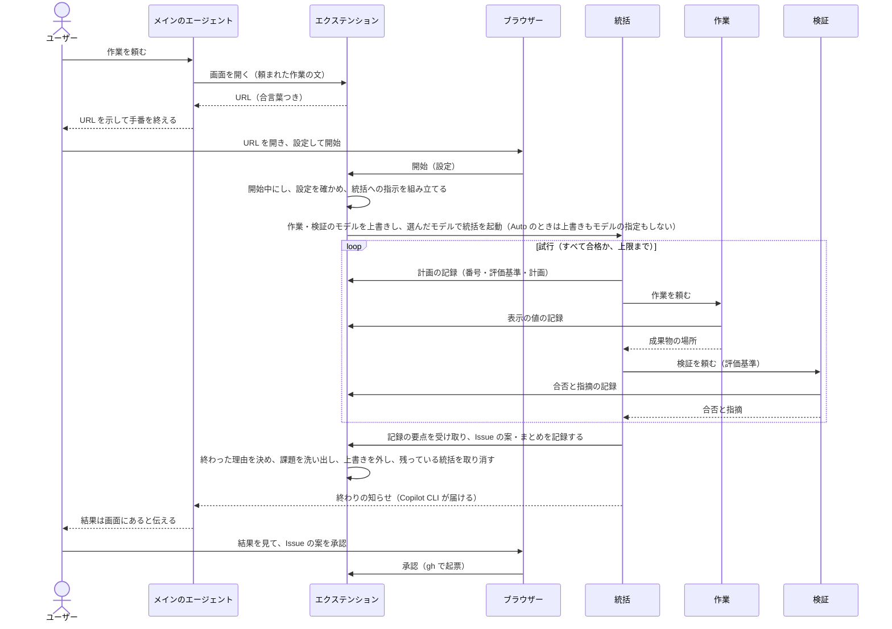
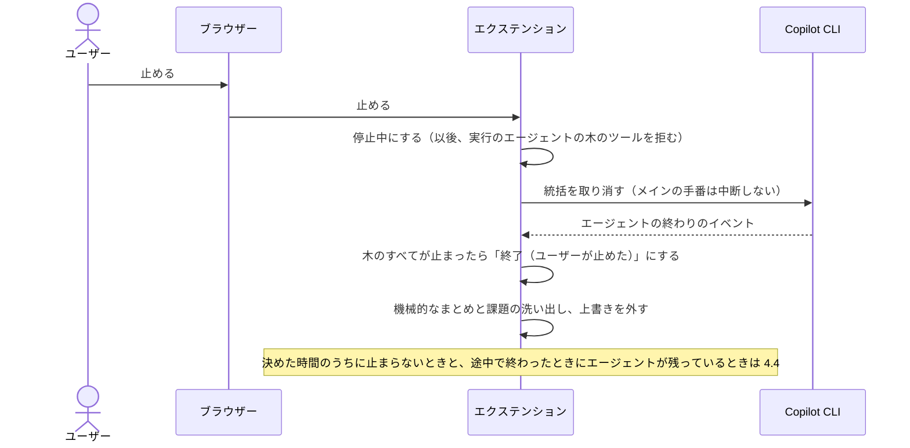
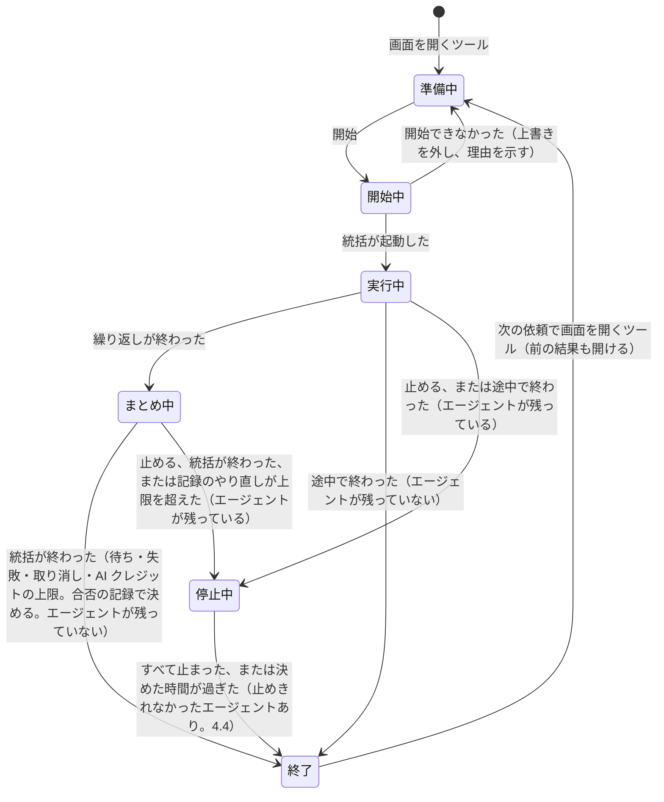

# 生成プラグインの構造

生成プラグインがどんな部品でできていて、どう動くかを示す。中心は、どの生成プラグインにも共通する「土台」（ひな形の共通部分。憲章 第15条2項）である。仕様は [出力の要件](../specs/output-requirements.md) にある。クリエイターがこの構造をどう作るかは [クリエイターの構造](creator-structure.md)、どう試験するかは [試験の設計](testing.md) にある。

## 1. 範囲

| 区分 | 中身 | 書く人 |
| --- | --- | --- |
| 土台 | Web管理画面とその仕組み、エージェントの決まった手順、記録と課題の洗い出し、Issue の起票 | クリエイターのひな形 |
| 作業ごとの部分 | 作業の手順とナレッジ、合否の基準、作業ごとの画面の定義、作業ごとのスクリプトや MCP サーバー | クリエイターの作業エージェント（[クリエイターの構造](creator-structure.md) 3.1） |

この設計書では、土台の作りと、作業ごとの部分を入れる場所と形を定める。

## 2. 設計で重視すること

ユーザーがこれまでに経験した失敗（ナレッジ「ハーネスエンジニアリングの目的と人間の役割」）が起きないことを、具体的な場面で決め、それぞれを満たす決定に結び付ける。

| 重視すること | こうなれば満たす（場面） | 要件 | 決定 |
| --- | --- | --- | --- |
| 開始で確実に動き出す | 画面で開始を押すと、チャットで何もしなくても統括エージェントが動き出し、画面が「実行中」になる。2回押しても、起動が時間切れになった後に遅れて起動しても、動く統括は1体だけ | REQ-005 | 4.3 |
| 画面だけで操作が終わる | この実行のエージェントがツールの許可を求めると、画面に出て、画面で承認か拒否を選べる（チャットにも同時に出て、先に答えたほうが効く）。ユーザーがチャットでしているほかの作業の許可は、画面に出ず、今までどおりチャットに出る。利用の上限の確認は、費用の承認なのでチャットで答える（画面には待っていることを示す） | REQ-005 | 4.14 |
| すぐ止まる | 止めるを押すと、この実行のエージェントが取り消され、その後この実行のエージェントはツールを使えない。チャットでのほかの作業は巻き込まない。止まったことを確かめてから、画面が「終了（ユーザーが止めた）」になる。決めた時間のうちに止まらないエージェントが残ったら、「止めきれなかったエージェントあり」と分けて示し、そのエージェントのツールを拒み続ける | REQ-009 | 4.4 |
| 表示が実際とずれない | エージェントの開始・終了・失敗・許可の待ちが、再読み込みなしで約1秒のうちに画面に出る。終わったエージェントが「実行中」のまま残らない | REQ-008 | 4.5、4.14 |
| 途中で切れても残らない | `/clear` でエクステンションが読み込み直されても、前の実行が「実行中」のまま残らず、「途中で終わった（途中で切れた）」と示される。ほかのセッションで動いている実行は巻き込まない | REQ-008、REQ-012 | 4.13、6.5 |
| サーバーが残らない・ぶつからない | いつもの番号が使われていても起動する。Copilot CLI を終えると、異常終了でもサーバーのプロセスが残らない | REQ-029 | 4.2 |
| 手元だけで開ける | ほかのマシンからも、同じマシンのほかの Web ページからも、エージェントが作ったファイルの中のスクリプトからも、開始・停止・起票を送れない | REQ-006 | 4.2、6.3 |
| 費用の低いモデルでも同じ画面 | 作業ごとの画面は、AI が決まった形の定義を書くだけでできる。見た目と動きは土台が決める | REQ-028、REQ-030、REQ-031 | 4.9 |
| 作ることと判定することが混ざらない | 検証エージェントは成果物を書き換えられない。ユーザーと確かめた基準は、評価基準から外せない | REQ-010、REQ-011 | 4.7、4.8 |
| Copilot CLI がなくても土台を試せる | 偽物のつなぎ口（3.2）で、画面と中心の処理を試験できる | REQ-039、REQ-042 | 3.2 |

## 3. 全体の構成

### 3.1 部品のつながり

- エクステンションは、Copilot CLI がセッションの始めに別のプロセスとして起動する Node.js のプログラムである。ツールとフックの登録、イベントの受け取り、エージェントの起動と取り消しができる（4.1）。統括・作業・検証は、どれもカスタムエージェント（サブエージェント）である。メインのエージェントは、作業の依頼を受け取って画面を示すだけで、作業には加わらない（4.7）。

### 3.2 エクステンションの中の分け方

エクステンションの中を3つに分ける。Copilot CLI に依る部分を薄くし、それ以外を Copilot CLI なしで試せるようにするためである。

| 部分 | 役割 | Copilot CLI への依存 |
| --- | --- | --- |
| つなぎ口 | 起動したときに、記録のツールとフックを登録する。Copilot CLI のイベント、ツールの呼び出し、フックの問い合わせを、中立のイベント（Copilot CLI に依らない形のイベント。下の窓口の表）に直して中心の処理に渡す。中心の処理の頼みを、Copilot CLI の呼び出しに直す | Copilot SDK（Copilot CLI をプログラムから操作する公式の部品。以下 SDK）だけを使う |
| 中心の処理 | 実行の状態、決まりの確かめ（基準、上限、呼んだエージェント）、終わった理由、課題の洗い出し、記録、起票 | なし |
| 画面 | 画面のサーバーと、HTML・CSS・JavaScript の画面。共通の描画の部品で、作業ごとの画面の定義を出す | なし |

中心の処理とつなぎ口は、次の窓口でだけやり取りする。

| 向き | 窓口 | つなぎ口が使う Copilot CLI の機能 |
| --- | --- | --- |
| 中心 → つなぎ口 | 統括を起動する | `session.rpc.tasks.startAgent` |
| | エージェントを取り消す／動いているエージェントの一覧 | `session.rpc.tasks.cancel`、`session.rpc.tasks.list` |
| | サブエージェントのモデルを上書きする／外す | `session.rpc.tools.updateSubagentSettings` |
| | 今のモデルと、選べるモデルの一覧を返す | `session.rpc.model.getCurrent`、`rpc.models.list` |
| | チャットに書く | `session.log` |
| つなぎ口 → 中心 | 中立のイベント：エージェントの開始・設定・終わり（最後の返事、取り消されたか）・失敗 | `subagent.started`、`subagent.configured`、`subagent.completed`（`cancelled`）、`subagent.failed`、フック `onSubagentStop` の `response` |
| | 中立のイベント：ツールの開始・終わり | `tool.execution_start`、`tool.execution_complete` |
| | 許可の求め（中心の処理が答えるか、何も返さない。4.14）、返事・利用の上限の待ち | `joinSession` の `onPermissionRequest`、`permission.requested`、`user_input.requested`、`session_limits_exhausted.requested` |
| | 中立のイベント：待ちの終わり（`requestId` つき。どこで答えが出ても届く） | `permission.completed`、`user_input.completed`、`session_limits_exhausted.completed` |
| | 中立のイベント：エージェントが手番を終えて待ちに入った（エージェントの番号つき） | `system.notification`（`data.kind.type` が `agent_idle`）。出ないときは `tasks.list` の状態で見る（要確認、11章 #19） |
| | 記録のツールが呼ばれた（呼んだエージェントの番号つき） | ツールの登録（`ToolInvocation.agentId`） |
| | ツールを使ってよいかを問う（エージェントの番号と親の番号つき） | フック `onPreToolUse` |

- 試験では、つなぎ口を偽物に差し替えて、中心の処理と画面を動かす。偽物は生成プラグインのテストのフォルダに置き、プラグイン本体には試験のためだけの機能を入れない。開発の試験（Claude Code で行う）では、試験の仕組みが Agent SDK 用のつなぎ口を持ち、同じ中心の処理と画面を動かす（[試験の設計](testing.md) 4章）。

### 3.3 どこで動くか

| 部品 | 動く場所 | 起動 | 終了 | サンドボックス（4.12） |
| --- | --- | --- | --- | --- |
| メイン・統括・作業・検証のエージェント | Copilot CLI のプロセス | ユーザーの依頼、開始ボタン | 手番（エージェントが返事をし終えるまでのひと区切り）の終わり、取り消し | エージェントが動かすコマンドは中 |
| エクステンション（画面のサーバーを含む） | Copilot CLI が起動する別のプロセス | セッションの始めと `/clear` のとき。サーバーは画面を開くツールが初めて呼ばれたとき | Copilot CLI の終了と `/clear` のとき（4.2、4.13） | 外の見込み（要確認） |
| 画面 | ユーザーのブラウザー | URL を開いたとき | タブを閉じたとき | 対象外 |
| gh | エクステンションが起動する短い子プロセス | 承認ボタン | 起票が終わったとき、時間の上限で止めたとき（4.11） | エクステンションと同じ |

### 3.4 部品と要件

| 部品 | 置き場所（例） | 役割 | 書く人 | 対応する要件 |
| --- | --- | --- | --- | --- |
| マニフェストと README | `plugin.json`、`README.md` | Agent Plugins の形式の名前・版・説明・リポジトリ。README は使い方（`/experimental on` と、読み込みのときの確認。4.1） | ひな形と組み立て | REQ-004、REQ-014 |
| スキル（入口） | `skills/<名前>/SKILL.md` | メインのエージェントの手順（4.7） | 手順はひな形、description はクリエイターのメインのエージェント、作業の説明は作業エージェント | REQ-005 |
| 統括エージェント | `com.github.copilot/agents/orchestrator.agent.md` | 計画・実行・評価の繰り返し、振り返り | 手順はひな形、作業ごとの指示とナレッジは作業エージェント | REQ-010、REQ-011、REQ-013 |
| 作業エージェント | `com.github.copilot/agents/worker.agent.md`（1つ以上） | 成果物を作る | 作業エージェント（ひな形の決まりつき） | REQ-010 |
| 検証エージェント | `com.github.copilot/agents/verifier.agent.md` | 評価基準ごとの合否と指摘 | 手順はひな形、作業ごとの見方は作業エージェント | REQ-010、REQ-011 |
| つなぎ口 | `com.github.copilot/extensions/<名前>/extension.mjs` | 3.2 | ひな形 | REQ-005、REQ-007〜REQ-009、REQ-029 |
| 中心の処理 | 同じフォルダの `core/` | 3.2 | ひな形 | REQ-005〜REQ-014 |
| 画面 | 同じフォルダの `ui/` | 3.2 | ひな形 | REQ-005〜REQ-008、REQ-012〜REQ-014、REQ-025、REQ-030、REQ-031 |
| 作業の定義 | 同じフォルダの `task.json` | 合否の基準、作業ごとの画面、繰り返しの上限の既定（6.4） | 作業エージェント | REQ-007、REQ-011、REQ-031、REQ-038 |
| 作業ごとの部品 | `mcp.json`、`scripts/` など | 作業に要るスクリプトや MCP サーバー | 作業エージェント | 作業ごと |
| 憲章・仕様書・設計書 | `docs/` | 生成プラグインを保守するための文書 | 共通部分はひな形、作業ごとの部分は作業エージェント | REQ-001〜REQ-003 |
| テスト | `tests/` | 1・2段目の入口、偽物のつなぎ口、ナレッジの一覧、EVAL の課題 | ひな形と組み立て、EVAL の課題は作業エージェント | REQ-001、REQ-039、REQ-042 |

## 4. 設計の決定

### 4.1 画面と Copilot CLI のつなぎ方

- 決めたこと：Web管理画面は、生成プラグインに入れたエクステンション（`com.github.copilot/extensions/<名前>/extension.mjs`）で動かす。
- 理由：開始で動き出す、すぐ止まる、Copilot CLI の終了でサーバーも終わる、の3つを1つの公式の部品で満たせるのは、エクステンションだけである。
- 引き換えになること：Copilot CLI 1.0.98 では試験的な機能で、ユーザーが `/experimental on` で有効にする必要がある。Copilot CLI の更新で使い方が変わることがある。また、エクステンションは確認を省くツール（4.14）、フック（4.4）、許可の求めの扱い（4.14）を登録するので、Copilot CLI 1.0.98 は読み込みのときに1回、これらを許すかの確認（`kind` が `extension-permission-access`）をチャットに出す。断ると、ツールもフックも登録されず、エクステンションは読み込まれないのと同じになる（`cli-main.js`）。README と入口のスキルで、この確認の意味（記録のツールが確認なしで画面の状態だけを書く、止めたエージェントのツールを拒む、画面で許可に答える）と、許可する理由（許可しないと画面で開始も監視もできない）を示す。エクステンションのツールがないとき、メインのエージェントは、有効にしていないか確認を断ったかのどちらかとして直し方を示して止まる（4.7。仕様にない振る舞いなので、仕様の判断待ち）。確認がいつ出るかは要確認（11章 #1）。

| 代案 | 採らなかった理由 |
| --- | --- |
| フックとシェルのコマンド | エージェントを取り消せず、ツールを拒むことしかできない。開始を、AI がコマンドを繰り返し実行することに頼る。既定の設定のサンドボックスでは、Linux でフックから画面のサーバーに届かない |
| MCP サーバーの中で画面を動かす | ツールの呼び出しは既定で30秒で時間切れになる。サンドボックスを有効にすると、既定でその中で動く（サンドボックス自体は既定でオフ）。セッションにメッセージを送る手段が、公式の資料に見当たらない |
| canvas（エクステンションが出す画面の窓） | エクステンションの一部で、これも試験的である。GUI（窓やボタンで操作する画面）のない環境では、OS の窓（ブラウザーではない、パソコンの画面に直接開く窓）が開かず、URL を示すだけになる。将来、ブラウザーの代わりに使える |

- 実行環境：エクステンションは JavaScript で、`import` で部品を読み込む書き方（ES モジュール）で書く。Copilot CLI 1.0.98 のプログラムでは、エクステンションを Copilot CLI 自身の実行ファイルで起動し（`cli-main.js` の `launcherProgram: process.execPath`）、起動された側は、起動用の `extension_bootstrap.mjs` を受け取ると自分でそれを読み込む（`index.js`）。更新履歴 1.0.55 にも「CLI を1つの実行ファイルとして動かすときも、エクステンションが正しく起動する」とある。そのため、ユーザーは Node.js を別に入れなくてよい（要確認、11章 #2）。画面は素の HTML・CSS・JavaScript で、組み立ての手順（ビルド）も外部の配信元（CDN）も使わない。手元だけで、毎回同じに動かすためである。

### 4.2 画面のサーバー

- エクステンションと同じプロセスで動かし、子プロセスを作らない。エクステンションと一緒に終わるので、Copilot CLI を終えるとサーバーも終わる（REQ-029）。Copilot CLI は終了時にエクステンションを止め（終了の合図、5秒後に強制終了）、異常終了でも、エクステンションは親のプロセスがいなくなったことを約1秒で見つけて終わる（要確認、11章 #17）。
- 待ち受けるのは 127.0.0.1 だけにする（REQ-006）。番号は土台の既定を使い、ほかのプログラムに使われていたら、OS に空いている番号を選ばせる。
- 起動ごとに乱数の合言葉を作り、画面の URL に入れる（例：`http://127.0.0.1:8731/?k=<合言葉>`）。画面は、サーバーへの問い合わせのたびに合言葉を付け、サーバーは合言葉がない問い合わせを断る。あわせて、問い合わせ先の名前（Host）が 127.0.0.1 か localhost で、番号が合っていることを確かめる。ユーザーのブラウザーで開いているほかの Web ページから、手元のサーバーに開始・停止・起票を送られないようにするためである。代案の「合言葉なし（127.0.0.1 だけ）」は、同じマシンのほかの Web ページから開始や起票を送られるので採らない。「ログインの画面」は、1人が手元で使うには手間が多く、URL を開くだけで使えなくなるので採らない。
- 1つのセッションでは、同時に1つの実行だけを扱う。実行中に画面を開くツールがまた呼ばれたら、新しく始めず、今の URL を返す。終わった後に呼ばれたら、新しい実行の準備に戻す。準備中の画面からも、前の実行の結果と、承認していない Issue の案を開ける（記録のファイルの `result.json` と起票の印から出す。6.5）。前の実行は、同じセッションの最後の実行に限る（同じセッションの実行がなければ、同じ作業フォルダの最後の実行）。

### 4.3 開始

- 開始ボタンを押すと、中心の処理は実行を「開始中」にし、設定を確かめる（必須の項目、上限の回数が1以上、選んだモデルが選択肢にあるか）。つなぎ口が次を行う。
  1. 作業・検証のモデルを、このセッションに限って上書きする（`updateSubagentSettings`）。上書きしたことを記録のファイルに書く（4.13）。
  2. 統括を、選んだモデルで、裏で動くエージェントとして起動する（`tasks.startAgent`）。渡す名前（`name`。`tasks.list` の `displayName` に出る）に実行の番号を入れる。結果の番号（`agentId`）を、実行のエージェントの木の根にする（4.4）。
- Auto のときは手順1（上書き）を行わず、統括はモデルを指定せずに起動する（4.6）。
- 起動できたら「実行中」にする。失敗したとき（使えないモデル、時間切れなど。6.1）は、上書きを外し（4.6）、「準備中」に戻して理由を画面に示す。ユーザーは設定を変えて、もう一度開始できる。時間切れのときは、起動したかが分からない。そこで、準備中に戻す前に `tasks.list` でその名前のエージェントを探し、見つかれば取り消して、拒む一覧（4.4）に入れる。見つからなくても、その実行は「開始できなかった（起動したかは分からない）」として記録に残す。その後に届いた、どの実行の根でもない統括の `subagent.started` も、取り消して拒む一覧に入れる。遅れて起動した統括が、画面に出ないまま動き続けないためである。
- 開始ボタンは、押すとすぐに押せなくなる。開始中か実行中に届いた開始は断るので、統括は1体だけ起動する。開始中に届いた止めるは、開始の処理が終わってから処理する（6.1）。
- 統括への指示文は、中心の処理が決まった形で組み立てる。中身は、頼まれた作業の文、繰り返しの上限、作業ごとの設定の値、ユーザーと確かめた合否の基準（作業の定義から、番号と文をそのまま）である。
- 代案の「メインのエージェントにメッセージを送って、統括を呼ばせる（`session.send`）」は、動き出すかが AI の判断に頼り、統括のモデルを画面で選べない（REQ-007）ので採らない。「メインのエージェント自身が統括になる」は、プラグインからメインのエージェントのモデルを決められず（[クリエイターの構造](creator-structure.md) 3.2）、統括のモデルを画面で選べないので採らない。

### 4.4 止める

- 止める範囲は、この実行のエージェント（統括と、その下の作業・検証）だけにする。メインのエージェントの手番は中断しない。ユーザーがチャットでしているほかの作業を巻き込まないためである。
- 中心の処理は、イベントとフックの入力から、実行のエージェントの木を持つ。根は統括の番号（4.3）で、親の番号（`parentAgentId`）が木に入るエージェントを、その下に足していく。木に入れたエージェントの番号は、記録のファイルにも書く（6.5）。
- 止めるボタンを押すと、中心の処理は実行を「停止中」にし、つなぎ口が統括を取り消す（`tasks.cancel`）。統括の下の作業・検証まで止まるかは要確認（11章 #6）。止まらないときは、木に入っているエージェントの番号ごとに `tasks.cancel` を呼ぶ。統括が `task` で同期して呼んだ作業・検証が、動いているエージェントの一覧（`tasks.list`）に載り、番号で取り消せるかも要確認である（同）。
- 中心の処理が実行を終えると決めた時点（途中で終わったとき、まとめ中に統括が終わったとき、記録のやり直しが上限を超えたとき。4.8、6.1）で、まだ動いているエージェントがあれば、止めると同じ手順を通す（停止中にする → 木を取り消す → 木のツールを拒む → 止まったのを確かめて終了にする。止めきれなければ、下の止めきれなかったときの扱いにする）。実行が終わった後に待ち（idle）で残った統括の取り消しは 6.1 にある。
- 何を拒むか：エクステンションのフック（ツールを使う前に呼ばれる `onPreToolUse`）で、入力のエージェントの番号（`agentId`）が拒む一覧に入るツールの使用だけを拒む。ほかのエージェントのツールは拒まないので、拒むのをやめる処理は要らない。止まらないエージェントが残っても、ユーザーはほかの作業を続けられる。拒む一覧のエージェントの許可の求めも、すぐ拒む（4.14。フックに続く2つ目の安全網）。
- 拒む一覧の中身：このセッションの、終わったすべての実行の木を合わせたもの（終わった理由で分けない）である。停止中にした時点か実行が終わった時点で、その実行の木を入れ、親の番号が一覧に入るエージェントも足していく。エクステンションが起動したときの作り直しは 6.5 にある。
- フックは安全網であり、頼り切らない。公式に書かれているのは、フックの時間切れは通す側に倒れることである（公式のフックの説明、更新履歴 1.0.67）。コマンドのフックは、エラーのときは拒む側に倒れる（同、更新履歴 1.0.57）。エクステンションのフックが失敗したときの扱いは公式の記述がなく、要確認である（11章 #13）。組織の設定（`allowManagedHooksOnly`）で止められることもある（更新履歴 1.0.85）。
- イベントで、木のすべてのエージェントの終わりを確かめたら、実行を終了にする（終わった理由は 4.8）。決めた時間（例：10秒）のうちに終わりを確かめられないエージェントや、取り消しの呼び出しが時間切れになったエージェント（6.1）は、画面に「止まっていないエージェント」として示し、止め方（チャットで Esc を2回押す、または Copilot CLI を終える）を案内する。そのうえで、終わった理由に「止めきれなかったエージェントあり」を添え、ふつうの終わり方と分けて示す。止めた後に作業を続けるエージェントがないこと（REQ-009）を満たせなかったと、ユーザーが分かるようにするためである。止めきれなかったエージェントが残っていても、次の開始はできる。古いエージェントのツールは拒み続け、画面には残っていることを示す。仕様（REQ-009）にない振る舞いなので、仕様の判断待ちである。
- 作業エージェントが始めたシェルの処理は、エージェントを取り消しても残ることがある（rpc.d.ts の `cancelAllBackgroundAgents` の説明に、裏に回したシェルは残るとある）。残った処理を止める手段は要確認（11章 #14）。止めても止まらなかったエージェントと処理は、課題の一覧に入れる（4.10）。
- 代案の「セッション全体を止める（裏のエージェントをすべて取り消し、メインの手番も中断する）」は、実行と関係のない裏の作業や、ユーザーのチャットまで止めるので採らない。「フックでツールを拒むだけにする」は、エージェントが次にツールを使うときにしか効かず、時間切れでは通す側に倒れるので採らない。

### 4.5 状態の届け方

- つなぎ口は、中立のイベント（3.2）を中心の処理に渡す。サブエージェントの中で起きたイベントには、そのエージェントの番号が付く。中心の処理は、イベントからエージェントごとの状態（6.1）、担当している作業（`task` を呼んだときの説明）、使っているモデル、最後に動いた時刻を作る。
- 画面のエージェントの枠は、役割ごとに決まった数で出す（統括1、作業は定義の数、検証1）。試行ごとに起動し直したエージェントは、同じ枠の中で入れ替わる。起動ごとの履歴は、結果の試行ごとの表に出す。
- 計画・実行・評価のどれかは、動いているエージェントで決める。検証が動いていれば評価、作業が動いていれば実行、そのどちらでもなく統括が動いていれば計画とする。AI の申告に頼らないので、表示が実際とずれない。今が何回目の試行かは、統括の計画の記録（4.8）で決める。
- エージェント間のデータの受け渡しの図は、構成が決まっているので土台が描く（統括 → 作業 → 統括 → 検証 → 統括）。今まさに受け渡しているところを、動いているエージェントから強調する。
- 画面は、1秒ごとにサーバーから状態の全体を取り直す。状態は小さく、全体を取り直せば、取り逃しも、つなぎ直しの処理も要らない。状態の全体に入れる返事は要約だけにし、全文は、ユーザーが開いたときに別の窓口で取る（6.3）。サーバーにつながらなくなったら（Copilot CLI を終えたときなど）、画面にそう示す。実行中は、`/clear` しないこと（4.13）も画面に示す。
- 代案の「サーバーから変化を送り続ける（SSE）」は、届くのは速いが、つなぎ直しと取り逃しの処理が要り、表示が止まる失敗の元になるので採らない。1秒の遅れは、人が見て監督するには十分短い。「統括にフェーズを申告させる」は、AI が申告を忘れると表示が実際とずれるので採らない。

### 4.6 役割ごとのモデル

- 統括は起動時のモデルの指定（4.3）、作業と検証はセッションに限った上書きで、画面で選んだモデルを効かせる。
- 実行が終わったら、上書きを外す（`null` を渡す）。今の上書きの値を読む窓口が見当たらず、設定はまとめて置き換わる恐れがあるので（rpc.d.ts の `SubagentSettings`、`UpdateSubagentSettingsRequest`）、前の値には戻さない。外すと、このセッションのほかのサブエージェントの上書きも消えるので、そのことを開始前の設定に示す（11章 #5）。
- 役割ごとの既定は、エージェントの定義の `model`（優先する順のリスト）の1か所にだけ書き、画面の初めの値はそこから読む。統括と検証は思考力の高いモデル、作業は費用の低いモデルである。上書きが効かないときの備えにもなる。選択肢は、選べるモデルの一覧（`rpc.models.list`）から出す（動くかは要確認、11章 #10）。
- 定義の書き方は、公式と実装で食い違う。今の公式のコマンドリファレンス（Custom agent frontmatter fields）は、`model` を1つのモデル、優先する順のリストを `models`、方針を `modelPolicy` としている。Copilot CLI 1.0.98 の実装は、`model` にリストを受け付け（runtime.node の文字列 "Expected a non-empty list of model names"、組み込みの `definitions/explore.agent.yaml` が `model: [..]`）、方針の項目は `model-policy` である。設計では実装で確かめた `model` のリストを使い、`models` で書いたときに効くかは要確認とする（11章 #18）。
- 実行の前に、今のモデルを取得する（`model.getCurrent`）。Auto のとき、公式に書かれているのは、サブエージェントが定義の `model` に関係なくセッションのモデルを引き継ぐことだけである。そこで、仕様（REQ-007）の文言のとおり、画面に「Auto のため、役割ごとのモデルは効かず、Auto が選んだモデルで動きます」と示し、役割ごとのモデルを選べなくする。起動時の指定と上書きもしない。Auto でもそれらが効くかは要確認（11章 #7）。
- 実際に動いたモデル（`subagent.started` などのイベントの `model`）を、Auto のときも含めて、エージェントごとに画面に出す。選んだモデルと違うときは、そのことを示し、課題の一覧にも入れる（4.10）。

| 代案 | 採らなかった理由 |
| --- | --- |
| 統括に、`task` の呼び出しのたびにモデルを渡させる | Copilot CLI の組み込みの指示は、ユーザーが明示的に求めたときだけモデルを渡すよう AI に求めている。プラグインの指示で渡すかは確かめられず、AI の判断に頼る。上書きが効かないと分かったときの代わりにする |
| エージェントの定義のファイルを書き換える | インストールしたプラグインはコピーで、更新で消える |
| ユーザーの設定ファイルを書き換える | ユーザーの設定を、プラグインが勝手に変えることになる |

### 4.7 エージェントの構成

| エージェント | 置き場所 | 使えるツール | 役割 |
| --- | --- | --- | --- |
| メイン | スキル（入口） | ユーザーが選んだもの | 作業の依頼を受け取り、画面を開くツールに渡して URL を示す。あわせて、実行中は `/clear` しないこと（4.13）を示す。統括の終わりの知らせ（Copilot CLI が届ける）を受けたら、結果が画面にあることを伝える。エクステンションのツールがないときは、`/experimental on` で有効にしていないか、読み込みのときのエクステンションの確認を断ったかのどちらかとして、両方の直し方（有効にして起動し直す、起動し直して確認を許可する）を示して止まる（4.1。仕様の判断待ち） |
| 統括 | カスタムエージェント | `agent`（`task`）、`read`、`search`、記録のツール | 計画・実行・評価の繰り返しと振り返り（4.8、4.10）。成果物は書かない |
| 作業（1体以上） | カスタムエージェント | `read`、`edit`、`execute`、`search`、作業ごとの MCP のツール、表示の記録のツール | 成果物を作る。自分の成果物を判定しない。何体にするかは、クリエイターが部品の分け方として決める（[クリエイターの構造](creator-structure.md) 3.1） |
| 検証 | カスタムエージェント | `read`、`search`、作業ごとの確かめの MCP のツール、合否の記録のツール | 評価基準ごとの合否と指摘を記録し、統括に返す。書き込みのツールがないので、成果物を直せない（REQ-010） |

- 判定にコマンドの結果が要る基準は、成果物を書き換えない確かめのスクリプトを、作業ごとの MCP のツールとして検証エージェントに渡す（クリエイターが部品の分け方として決める）。代案の「検証エージェントに `execute` を持たせる」は、コマンドで成果物を書き換えられるので採らない。
- 統括・作業・検証の `tools` には `skill` を入れない。サブエージェントがスキルを呼び、メインのエージェント向けの手順を始めてしまうのを防ぐためである（ナレッジ「カスタムエージェント」）。ただし、Copilot CLI で `skill` を外すとスキルを呼べなくなるかは要確認である（公式の `tools` の別名の表に `skill` はない。11章 #16）。効かないときは、作業・検証への指示に「スキルを使わない」と書き、入口のスキルの description を、サブエージェントから呼ばれにくい書き方にする。
- 入れ子は、エクステンションが起動した統括 → 作業・検証 で、Copilot CLI の深さの上限に収まる。上限の既定は4（Copilot CLI 1.0.98 の更新履歴 1.0.71。公式ドキュメントでは6）である。作業と検証は `agent` を持たず、さらにエージェントを呼ばない。

### 4.8 計画・実行・評価の繰り返し

統括は、試行ごとに次を行う（REQ-011）。

1. 計画：記録のツールで、試行の番号、評価基準、計画を知らせる。2回目からは、前の試行の指摘への対応を計画に入れる。
2. 実行：作業エージェントに、計画と評価基準とナレッジを渡して頼む。
3. 評価：検証エージェントに、評価基準と成果物の場所を渡して頼む。検証エージェントは、評価基準ごとの合否と指摘を、自分で記録のツールに知らせてから統括に返す。
4. すべて合格なら繰り返しを終える。そうでなければ、上限の回数まで次の試行に進む。

ひな形の統括の手順には、作業・検証を `task` の `mode: "sync"` で1体ずつ呼ぶこと、呼ぶ名前はプラグインの名前を付けた形（例：`<プラグイン>:worker`）にすることを書く。同期で1体ずつ呼べば、試行の順番と画面のフェーズが記録とずれない。名前を付けた形にするのは、ユーザーやほかのプラグインに同じ名前のエージェントがあっても取り違えないためである（公式のコマンドリファレンスの Custom agent locations：同じ ID は先に読み込んだほうが使われる。名前の形は要確認、11章 #4）。中心の処理は、裏で動かす呼び方（`subagent.started` の `executionMode` が `sync` でないなど）を見つけたら、決まりに合わないこととして記録し、課題に入れる（要確認、11章 #20）。

中心の処理は、記録を受け取るたびに決まりを機械的に確かめ、合わないときはツールの結果をエラーにして、統括に直させる。断られたやり直しには上限（例：3回）を置く。超えたら、実行中（繰り返しの途中）なら、実行を「途中で終わった（記録のやり直しが上限を超えた）」にして、統括を取り消す（4.4）。まとめ中なら、統括を取り消したうえで、合否の記録で「評価基準をすべて満たした」か「上限の回数に達した」に決め、やり直しの上限を超えたことを課題に入れる（6.1）。

- 計画の評価基準に、ユーザーと確かめた基準（作業の定義の番号と文）が、文言を変えずにすべて入っていること。統括が足した基準は認める。
- 試行の番号が前の試行の次で、上限の回数を超えないこと。
- 合否の記録が、検証エージェントから来たこと（記録のツールの呼び出しに付くエージェントの番号で確かめる。11章 #8）と、その試行の評価基準がすべてそろっていること。その試行の作業エージェントが終わる前の合否の記録は断る。
- 前の試行がすべて合格なら、次の計画の記録を断り、まとめに進むよう返す。
- 実行中（繰り返しの途中）の `_review`・`_issue`・`_finish` は断り、「まだ繰り返しの途中です」と返す。まとめ中に移るのは、合否の記録ですべて合格か、上限の試行の合否が記録されたときである。

終わった理由は、AI の申告ではなく、記録とイベントから中心の処理が決める（REQ-012）。

| 終わった理由 | 決め方 |
| --- | --- |
| 評価基準をすべて満たした | 最後の合否の記録ですべて合格。まとめ中に、統括が終わったときと記録のやり直しが上限を超えたときは、きっかけ（待ちに入った・失敗した・取り消された・AI クレジットの上限・記録のやり直しの上限）によらず、合否の記録でこれか次に決める（6.1） |
| 上限の回数に達した | 上限の試行で合格しなかった |
| ユーザーが止めた | 画面で止めた（4.4。止めきれなかったときも同じ） |
| 途中で終わった（理由つき） | 実行中に統括が終わったときに、次で決める。AI クレジットの上限（利用の上限の知らせに、ユーザーがクレジットを足さずに答えた（`session_limits_exhausted.completed` の `response.action` が `cancel`）か、答えが出ないまま統括が終わった。知らせそのものは「待ち」として扱う。4.14）、チャットから中断された（画面で止めていないのに、統括が取り消されて終わった）、統括の失敗、繰り返しを終えないまま統括が終わった（待ちに入ったか終わった）。ほかに、実行中に記録のやり直しが上限を超えた、途中で切れた（4.13）。クレジットを足して（`add`・`set`・`unset`）続いた後に統括が終わったときは、ほかのきっかけと同じに扱う |

止めきれなかったエージェントが残ったときは、終わった理由に「止めきれなかったエージェントあり」を添える（4.4）。仕様（REQ-012）の終わった理由は上の3つなので、「途中で終わった」と「止めきれなかったエージェントあり」は仕様の判断待ちである。

### 4.9 作業ごとの部分

- 作業ごとの画面（開始前の設定、実行中の表示、結果の見せ方。REQ-026、REQ-031）は、作業の定義のファイル（6.4）に、決まった形で書く。共通の描画の部品が、それを土台と同じ見た目で出す。
- 部品の種類は少なくする。設定は、文字・数・選択・チェック・ファイルやフォルダの場所の入力。表示は、値の一覧・表・進み具合・文章・画像・ファイルへのリンク。グラフなどは、作業エージェントが画像のファイルとして作って見せる。画像として出すのは決めた種類（png、jpeg、gif、webp）だけで、SVG や HTML はファイルへのリンクにする（6.3）。
- 作業エージェントが書くのは定義だけで、HTML は書かない。費用の低いモデルでも、毎回同じ品質の画面になる（REQ-028、憲章 第15条1項）。定義の形は、土台にある決まり（スキーマ）で1段目の試験が確かめる。作業ごとの表示の値は、統括や作業エージェントが記録のツールで送り、中心の処理が定義と照らして確かめる。代案の「作業ごとに HTML を書かせる」は、費用の低いモデルでは品質がそろわず、見た目がばらばらになる（REQ-028、REQ-030）ので採らない。
- クリエイターは、画面で見たいことを聞くとき（REQ-026）、用意のある部品の中で決め、見本（9章）で確かめる。用意のない表示を望まれたら、近い部品を示す。足りない部品は、作業ごとに HTML を足さず、クリエイター自身の改善として土台に足す。仕様（REQ-026、REQ-031）にこの決まりはないので、仕様の判断待ちである。
- ユーザーと確かめた合否の基準は、作業の定義を元とする。統括への指示（4.3）と計画の確かめ（4.8）は、ここから読む。EVAL の課題のファイル（`tests/` の中）には、基準の番号と文を写し、採点のしかた（プログラムかモデルか）を足す（[試験の設計](testing.md) 10.1）。1段目の試験で、写しが作業の定義と同じかを確かめる。
- クリエイターが作業エージェントに示す支え（憲章 第15条3項）は、デザインの仕方（部品の種類と、どの場面でどれを使うかの例）、機能の作り込み方（設定の値が統括への指示にどう入るか、表示の値をいつ送るか）、Copilot CLI との連携の仕方（記録のツールの使い方。6.2。つなぎ口は土台にあり、作業ごとには書かない）である。

### 4.10 記録と課題

- 中心の処理は、実行ごとに、受け取ったイベントと記録、実行の状態の変わり目を、JSON Lines（1行に1件の JSON）のファイルに書きながら進める（形と置き場所は 6.5）。終わった後、中心の処理が、記録から課題を機械的に洗い出し、決まった形の Issue の案を付ける（REQ-013、憲章 第24条1項）。

  | 観点 | 見つけるもの |
  | --- | --- |
  | 実行の失敗 | 失敗したツール、失敗したエージェント、途中で終わった実行 |
  | 詰まり・止まり | 決めた時間（例：5分）イベントがないエージェント、同じツールを同じ引数で繰り返した跡、止めても止まらなかったエージェントとシェルの処理 |
  | データの流れ | 計画 → 作業 → 検証 → 合否の記録がそろわない試行、まとめのない終わり、選んだモデルと実際のモデルの違い |

- 繰り返しが終わったときは、統括が最後に、記録の要点（機械的な洗い出しの結果を含む）を記録のツールで受け取って振り返り、Issue の案（題と本文）を足してから、まとめを記録する。ユーザーが止めたときと途中で終わったときは、エージェントを動かさない。止めた後に作業を続けるエージェントを作らないためである（REQ-009）。まとめは、中心の処理が記録から機械的に作る（試行の数、最後の合否、止めた・終わった時点のフェーズ）。まとめ中に統括がまとめを記録しないまま終わったときも同じに作る（6.1）。

### 4.11 Issue の起票

- 画面の課題の一覧で、案ごとに承認のボタンを押すと、中心の処理が `gh issue create --repo <OWNER/REPO>` で起票し、できた Issue の URL を画面に出す（REQ-014）。ボタンは押したら押せなくする。起票の前に、案ごとの印のファイルを「なければ作る」形で（排他的に）作り、作れたときだけ起票する。2つのセッションから同じ案を承認しても、2回起票されないためである。本文の終わりには、案ごとに一意の印（例：実行の番号と案の番号）を入れる。二重の起票を見分けるためである（下）。題と本文は、シェルを通さず、`gh` に引数の配列と標準入力で渡す。題や本文がコマンドの一部として解釈されないようにするためである。
- 起票の状態（起票中／起票済みと Issue の URL／失敗と理由／起票したか分からない）は、案ごとの印のファイルに書き、画面はそこから読む。`result.json` には書き足さない。2つのセッションが `result.json` を置き換えて、起票の状態を消し合わないためである。
- 順番待ちの列（6.1）に入れるのは、印のファイルを作ることと、結果を印に書くことだけにする。`gh` そのものは列の外で動かし、時間の上限（例：60秒）を付ける。`gh` を待つあいだも、止めるや許可の求めの処理を遅らせないためである。印には起票の試みごとの番号を入れ、結果は、印がまだ自分の試みのものであるときだけ書く。もう一度承認されて印が入れ替わった後に、前の試みの結果で上書きしないためである。
- `gh` が失敗を返したとき（ログインの切れなど）は、印を「失敗」にして理由を示す。時間の上限を超えて止めたときは、送信は済んで返事だけ遅れたことがありうるので、印を「起票したか分からない」にする。起票中のまま決めた時間（例：5分。`gh` の上限より長くする）が過ぎた印も、読む側が同じに扱う（Copilot CLI ごと終わって印が残った場合）。どちらも、もう一度承認できる。もう一度承認したときは、前の印の名前を変えて退けてから、また「なければ作る」形で作る（名前の変更は1つのセッションだけが成功する）。前の印が「起票したか分からない」なら、起票の前に、そのリポジトリの Issue を `gh issue list --state all --json title,url,body` で取り出し（新しいものから例：100件）、本文にその案の印がある Issue を探す。あればその URL を「起票済み」として印に書き、なければ起票する。二重に起票しないためである。題の一致は見分けに使わない。機械的な案（4.10）は同じ題になりやすく、前の実行の別の Issue と取り違えるためである。探す処理が失敗したり時間の上限を超えたりしたときは、起票に進まず、印を「起票したか分からない」にして、もう一度承認できるようにする。
- リポジトリは、マニフェスト（`plugin.json`）の `repository` から知る。インストールしたプラグインはコピーで、`.git` が残らないためである（Copilot CLI 1.0.57 の更新履歴）。`repository` は URL なので、GitHub の URL から `OWNER/REPO` を取り出す。GitHub の URL でなければ起票できないと示す。
- 画面を開いたときに、起票できるかを確かめる。`repository` がない、`gh` がない、`gh` でログインしていない、のどれかのときは、承認のボタンを押せなくし、何をすれば起票できるかを示す（GitHub に公開して `repository` を書き、プラグインを入れ直す。インストールはコピーなので、入れ直さないと反映されない。`gh` を入れてログインする）。
- 起票は `gh` のログイン（`gh` 自身が持つ資格情報）に任せる。エクステンションには機微な環境変数が渡らない。SDK の `joinSession` の `requestedEnvironmentVariables` で求めることはできるが、ユーザーが断るとエクステンションごと読み込まれない（copilot-sdk/extension.d.ts）ので、`GITHUB_TOKEN` などは求めない。エクステンションの中から `gh` が認証できないときは、起票できない理由と直し方を画面に示す（11章 #11）。
- 代案の「Copilot CLI に組み込みの GitHub MCP サーバー」は、既定では Issue を作れず、作れるようにするにはユーザーが Copilot CLI の起動時の設定を変える必要があるので採らない。「新しい Issue のページを、題と本文を入れて開く」は、GitHub の画面でもう一度送るボタンを押す必要があり、「承認すると起票される」（REQ-014）に合わないので採らない。

### 4.12 サンドボックス

- Copilot CLI のサンドボックスの対象は、シェルのコマンド、フック、手元で動かす MCP のサーバーと LSP のサーバー（言語サーバー。コードの補完などをする）で、エクステンションは公式の説明の対象に入っていない。そのため、エクステンションは外で動き、サンドボックスを有効にしても画面が開ける見込みである（要確認、11章 #3）。作業エージェントが動かすコマンドは、サンドボックスの中のまま動く。エクステンションも中で動くと分かったら、画面のつなぎ方を見直す。

### 4.13 読み込み直されたとき

- Copilot CLI は、`/clear` のとき（前に出ているセッションが入れ替わったときも）エクステンションを読み込み直す。メモリの中の状態は消え、画面のサーバーも止まる。中心の処理は、実行の状態を記録のファイル（6.5）に書きながら進めておく。エクステンションが起動したとき（セッションの始めと読み込み直し）に、終わっていない実行のうち途中で切れたものを、「途中で終わった（途中で切れた）」として終わらせる（見分け方は 6.5）。次に画面を開いたときにそのことを示し、課題の一覧にも入れる。
- 自分のセッションで始めた実行（記録のセッションの番号が今と同じ）に、モデルを上書きしたことが残っていれば、上書きを外す（4.6）。前の実行の統括がまだ動いていれば、記録に残した統括の番号を、動いているエージェントの一覧（`tasks.list`）で見つけて取り消す。`/clear` で裏のエージェントがどうなるかは要確認（11章 #15）。今の実行に当たらない記録のツールの呼び出しは断り、「画面とのつながりが切れたので作業を終えてください」と返す。

### 4.14 許可の確認と利用の上限

- 記録のツールは、許可の確認を省く設定（`skipPermission: true`）で登録する。画面の状態を書くだけで、ファイルやコマンドなど外を変えないためである。そのかわり、読み込みのときのエクステンションの確認（4.1）が1回出る。
- 前提：許可の求め（`permission.requested`）は、つながっているすべての相手（チャットの画面、各エクステンション）に同じイベントとして同時に届き、それぞれの `onPermissionRequest` が同時に呼ばれ、最初に答えたものが効く。`no-result` は何も返さないだけである（copilot-sdk/index.js・extension.js の `_handleBroadcastEvent` → `_executePermissionAndRespond`。実機での振る舞いは要確認、11章 #21）。答えが出ると、どこで答えたかによらず `permission.completed` が届く（session-events.d.ts の `PermissionCompletedData`。「この求めの画面を閉じること」とある）。
- 決めたこと：エクステンションは、許可の求めを受け取って答える仕組み（`joinSession` の `onPermissionRequest`）を登録する。プラグインが勝手に許可することはしない。答えるのは、画面でのユーザーの承認だけである。どのエージェントの求めかは、求めに付くツールの呼び出しの番号（`toolCallId`）を、エージェントの番号つきのイベント（`tool.execution_start`、`permission.requested`）と突き合わせて知る（要確認、11章 #21）。求めには、次のとおり答える。
  - この実行の木のエージェントの求め（作業エージェントの `edit`・`execute` など）は、画面に出し、ユーザーが画面で承認か拒否を選ぶ。セッション全体で許可したいときは、チャットの確認で選ぶ。同じ求めはチャットにも出るので、チャットで答えてもよく、先に答えたほうが効く。答えが出るまで、そのエージェントは待ち、画面には「許可を待っています（画面かチャットで答えられます）」と示す。答えを待つあいだも、順番待ちの列（6.1）は止めない。ほかの場所で答えが出たら（`permission.completed`）、画面の待ちを消し、答えを待っていた `onPermissionRequest` は何も返さずに終える（6.1）。
  - 停止中の実行と拒む一覧（4.4）のエージェントの求めは、すぐ拒む。止めたときに画面で答えを待っている求めにも、すぐ拒否を返す。
  - それ以外の求め（ユーザーがチャットでしているほかの作業、エクステンション自身の権限の求め。6.3）は、画面には出さない。エクステンションは何も返さない（`kind: "no-result"`。types.d.ts）。チャットの確認は今までどおり出る。
  - 開始中に届いた許可の求めは、列（6.1）の後ろに入れ、開始の処理が終わって木の根が決まってから、木に入るかを確かめて分ける。
- 利用の上限（AI クレジット）の確認と、エージェントからの質問は、チャットでだけ答える。画面には「チャットで返事を待っています」と示す。利用の上限の確認は費用の承認なので、画面からは答えない。これらが REQ-005 の「操作」に含まれるかは、仕様の判断待ちである。
- 理由：許可の確認まで画面で答えられるので、開始から終わりまでの操作が画面だけで終わり、REQ-005 を満たす見込みである。チャットで答えても、同じように効く。更新履歴 1.0.87 には、エクステンションの許可の扱いがサブエージェントのツールの求めに答えると、チャットの確認が重ねて残らない（答えが出たら閉じる）とある。チャットにも出た確認が、画面で答えた後に残らないということである。
- エージェントが合言葉を知って、画面の許可の窓口に承認を送るおそれは受け入れる。それを送れるのは、すでにサンドボックスの外でコマンドの実行を許されたエージェントで、もともとユーザーと同じこと（設定の書き換えなど）ができるためである。Linux でサンドボックスを有効にしていれば、ネットワークが分かれるので届かない見込みである。生成プラグインは合言葉をファイルに書かない。

| 代案 | 採らなかった理由 |
| --- | --- |
| 許可の確認はチャットだけで行い、画面には待っていることを示す（README と入口のスキルで、任せたいツールを前もって許可するしかたを案内する） | 画面だけで操作が終わらない（REQ-005）。11章 #21 を実機で確かめられなかったときの代わりにする。そのときは、許可の確認をチャットで行ってよいか、仕様の判断が要る |
| 画面にも「このセッションでは許可」を出す | 同じ求めはチャットにも同時に出ており、チャットでは Copilot CLI が、出してよい条件のとき（求めの `canOfferSessionApproval` が真で、`managedApprovalRequired` が真でないとき。`cli-main.js`）にだけこの選択肢を出す。覚えられる範囲は求めの種類で変わり（書き込みでは、すべてのファイル操作）、`/clear` の後に残るかも確かめていない。画面に出すと、これらの条件と範囲をすべて画面の側で正しく扱う必要があり、複雑になる |

## 5. 場面ごとの流れ

### 5.1 頼んでから終わるまで

### 5.2 止める

## 6. 状態とデータ

### 6.1 状態の移り変わり

途中で切れた実行（4.13）は、記録の上で終了にし、終わった理由を「途中で終わった（途中で切れた）」とする。

| エージェントの状態 | 変わるきっかけ |
| --- | --- |
| 待機 | 実行の始め |
| 実行中 | エージェントの開始、待ちの終わり（3.2） |
| 待ち（許可を待っています／チャットで返事を待っています） | 許可の求め、返事・利用の上限の待ち（4.14） |
| 完了 | エージェントの終わり（取り消されていない） |
| 失敗 | エージェントの失敗 |
| 停止 | 取り消されて終わった。止めた後のエージェントの終わりや失敗 |
| 止まっていない | 止めてから決めた時間が過ぎた |

- 状態は、すべて中心の処理が1か所で持つ。画面からの頼みとイベントは、順番待ちの列に入れ、1つずつ最後まで処理する。処理の途中で Copilot CLI の返事を待つあいだ（起動の結果を待つなど）も、次の頼みやイベントは列で待たせる。そのため、開始と止めるが重なっても、状態が食い違わない。状態には版の番号を付け、変わるたびに上げる。画面は、版の番号が変わったときだけ描き直す。
- 列の中で待つ Copilot CLI の呼び出し（`tasks.startAgent`、`tasks.cancel`、`updateSubagentSettings`、`tasks.list`）には、すべて待ち時間の上限（例：10秒）を付け、列が止まり続けないようにする。時間切れのとき、開始中なら準備中に戻して上書きを外し、理由を示す（統括を探して取り消すことは 4.3）。止める処理なら、止めきれなかったエージェントありの扱い（4.4）に進む。
- 待ちの終わり（3.2）を受けたら、その `requestId` の求めを画面の待ちから消し、エージェントを実行中に戻す。
- 統括が終わったら（手番を終えて待ちに入った（3.2）、失敗した、取り消されて終わった）、実行を終える。終わった理由は状態で決める（4.8）。画面で止めていれば、止めきれなかったときも含めて「ユーザーが止めた」にする。
  - まとめ中なら、きっかけ（待ち・失敗・取り消し・AI クレジットの上限・記録のやり直しの上限）によらず、合否の記録で「評価基準をすべて満たした」か「上限の回数に達した」に決める。きっかけと、まとめの記録（`<名前>_finish`）がないときの「まとめのない終わり」は課題に入れ、まとめは中心の処理が記録から機械的に作る（4.10）。
  - 実行中なら「途中で終わった」にする。最後の利用の上限の知らせ（4.14）にクレジットを足さずに答えた（待ちの終わりの `response.action` が `cancel`）か、まだ答えが出ていなければ「AI クレジットの上限」、それ以外はきっかけで理由を決める（4.8 の表）。
- Copilot CLI 1.0.98 のエージェントは、手番を終えた後も「idle（次の頼みを待っている）」で残り、メッセージでまた動き出しうる（rpc.d.ts の `TaskStatus`、更新履歴 1.0.72・1.0.92）。そのため、実行が終わったら、終わった理由によらず、統括がまだ `tasks.list` に残っていれば取り消す（要確認、11章 #19）。
- ツールを使ってよいかの問い合わせ（エクステンションの `onPreToolUse`）は、列に入れず、今の状態（その呼び出しの `agentId` が拒む一覧に入るか。4.4）だけを見てすぐ答える。記録のツールの呼び出しも、停止中や終了の後なら、列に入れずにすぐ断る。許可の求めも、停止中か拒む一覧に入るなら、列に入れずにすぐ拒む（4.14）。Issue の起票の `gh` も列の外で動かす（4.11）。

### 6.2 記録のツール

エクステンションが Copilot CLI に足すツールである（登録のしかたは 4.14、断る場合は 4.13）。名前の頭には、プラグインどうしでぶつからないよう、生成プラグインの名前を付ける（例：`weekly-report_plan`）。

| ツール（例） | 呼ぶもの | 渡すもの | 中心の処理が確かめること |
| --- | --- | --- | --- |
| `<名前>_open` | メイン | 頼まれた作業の文 | 実行中なら新しく始めず、今の URL を返す |
| `<名前>_plan` | 統括 | 試行の番号、評価基準、計画 | 4.8 の決まり |
| `<名前>_verdict` | 検証 | 試行の番号、評価基準ごとの合否と指摘 | 4.8 の決まり |
| `<名前>_show` | 統括、作業 | 作業ごとの表示の番号と値（画像やファイルは場所） | 作業の定義にある表示で、値の形が合うこと。画像やファイルは、作業フォルダの中にあること（6.3） |
| `<名前>_review` | 統括 | なし | 機械的な洗い出しの結果と、記録の要点を返す |
| `<名前>_issue` | 統括 | Issue の案（題と本文） | 題と本文があること |
| `<名前>_finish` | 統括 | 実行全体のまとめ | 統括が呼んだこと |

### 6.3 画面のサーバーの窓口

| 窓口 | 中身 |
| --- | --- |
| `GET /` | 画面 |
| `GET /api/state` | 状態の全体（下） |
| `GET /api/agents/<番号>/reply` | エージェントの最後の返事の全文 |
| `GET /api/files/<番号>` | 記録のツールで知らされた、作業フォルダの中の画像やファイル（それ以外は出さない。下） |
| `POST /api/start` | 設定を送って開始する |
| `POST /api/stop` | 止める |
| `POST /api/issues/<番号>/file` | 案を承認して起票する |
| `POST /api/permissions/<番号>` | 画面で待っている許可の求めに、承認か拒否を答える（4.14）。もう答えが出た求めには「ほかの場所で答えが出ました」と返す |

- どの窓口も、合言葉と問い合わせ先の名前を確かめる（4.2）。
- ファイルの窓口は、作業フォルダの中かどうかを、シンボリックリンクをたどった後の本当の場所で確かめる。画像として返すのは決めた種類（png、jpeg、gif、webp）だけで、SVG と HTML を含むそれ以外は、ダウンロードさせる形（`Content-Disposition: attachment`）で返す。どれにも、スクリプトを動かさない指定（`Content-Security-Policy: sandbox` と `X-Content-Type-Options: nosniff`）を付ける。エージェントが作ったファイルの中のスクリプトが、合言葉を読んで開始・停止・起票を送るのを防ぐためである。
- エージェントや記録から来た文字（最後の返事、作業ごとの表示の値、Issue の案、許可の求めのコマンドの文など）は、すべて文字として出し、HTML として扱わない。画面の応答には、自分のサーバーのスクリプトだけを動かす指定（`Content-Security-Policy` の `script-src 'self'` など）を付ける。画面で許可に答えられるので、エージェントが書いた文字の中のスクリプトに、承認を押させないためである。
- 許可の求めでは、判断に要る情報を出す：求めたエージェントの役割、ツールの種類、コマンドの全文かファイルの場所、触るかもしれないパスや URL、注意の文（session-events.d.ts の `PermissionRequestShell` の `fullCommandText`・`possiblePaths`・`possibleUrls`・`warning` など）。サンドボックスの外で動かす求め（`requestSandboxBypass`）は目立たせる。エクステンション自身の権限の求め（`kind` が `extension-permission-access`、`extension-env-access`）は、画面で扱わない（何も返さない）。出す項目は、共通の表示（REQ-031）のうち監視（REQ-005）の一部とする。
- 状態の全体には、次が入る：実行の状態と終わった理由、設定、Auto かどうか、今のフェーズ、試行の番号と上限、エージェントの枠ごとの役割・状態・担当・選んだモデル・実際のモデル・最後に動いた時刻・最後の返事の要約、試行ごとの評価基準・計画・合否と指摘・起動したエージェント、作業ごとの表示の値、まとめ、課題と Issue の案と起票の状態、起票できるかとその理由、止まっていないエージェント、画面で答えを待っている許可の求め、準備中のときは前の実行の結果、版の番号。

### 6.4 作業の定義

`com.github.copilot/extensions/<名前>/task.json`（例）。作業エージェントが書く。

| 項目 | 中身 |
| --- | --- |
| 名前 | 画面の題に出す作業の名前 |
| 繰り返しの上限の既定 | 開始前の設定の初めの値 |
| 合否の基準 | ユーザーと確かめた基準。番号（例：`C-01`）、文、もとになった「合否の決め方」のナレッジの番号（例：`K-03`） |
| 作業エージェント | 作業エージェントの名前と、画面での呼び名 |
| 開始前の設定 | 作業ごとの設定の部品（番号、見出し、種類、初めの値、選択肢、必須か、説明） |
| 表示 | 実行中と終わった後の表示の部品（番号、見出し、種類、いつ見せるか） |

- 合否の基準に付けるナレッジの番号は、「合否の決め方」のナレッジのものだけにする。ほかのナレッジの番号は、作業の定義とテストのフォルダを除くファイル（エージェントの指示など）に書く。構造の検査は、ナレッジの一覧の種類ごとに、この置き場所で番号を突き合わせる（[試験の設計](testing.md) 10.3）。

### 6.5 記録のファイル

- 置き場所は、プラグインごとの書き込める場所（`PLUGIN_DATA`）の下の、実行ごとのフォルダ（例：`<PLUGIN_DATA>/runs/<開始の日時>-<ぶつからない番号>/`）である（エクステンションに渡るかは要確認、11章 #9）。`PLUGIN_DATA` は同じプラグインのすべてのセッションで共有されるので、フォルダの名前は、開始の日時に、ほかの実行とぶつからない番号を足して作る。古い記録は件数で消す（例：20件を超えたら古いものから）。消すのは終わった実行だけにする。代案の「ユーザーの作業フォルダに記録を置く」は、ユーザーの成果物に記録が混ざり、作業ごとに置き場所が変わるので採らない。記録には、ユーザーの作業の中身が入る。手元のフォルダにだけ置き、外へは送らない。Issue の案に何を書くかは、統括とユーザーの承認で決まる。
- フォルダには、`log.jsonl`（イベント、記録、実行の状態の変わり目を、届いた順に1行ずつ）、`result.json`（終わったときの状態の全体）、`alive`（生きている印）、`issues/`（案ごとの起票の印。4.11）を置く。`log.jsonl` には、実行を始めたセッションの番号と作業フォルダ、モデルを上書きしたこと、木に入れたエージェントの番号（4.4）も書き、読むときは、最後の行が書きかけなら読み飛ばす。`result.json` は、一時ファイルに書いてから名前を変えて置く。起票の状態は `result.json` に書き足さず、`issues/` の印に持つ（4.11）。`result.json` がない実行が、終わっていない実行である。
- 途中で切れた実行の見分け方（4.13）：自分のセッション（記録のセッションの番号が今と同じ）の終わっていない実行は、生きている印を待たずに、すぐ途中で切れたとする。1つのセッションに、エクステンションのプロセスは1つだけと見込み（要確認、11章 #23）、その実行を動かすものはもう残っていないためである。見込みが違ったら、自分のセッションの実行も生きている印で見分ける。そのときも、木は起動の直後から拒む一覧に入れてよい（ほかのプロセスのエージェントのツールは、このプロセスのフックに届かないので害がない）。生きている印は、ほかのセッションの実行を見分けるときにだけ使う。実行中のエクステンションは、終わっていない自分の実行の `alive` に、数秒ごと（例：5秒）に今の時刻を書く。ほかのセッションの終わっていない実行は、印が決めた時間（例：30秒）より古いものだけを途中で切れたとし、起動したときに印が新しかった実行は、決めた時間が過ぎてからもう一度確かめる。1つの Copilot CLI で複数のセッションを並べて使っても、ほかのセッションで動いている実行を書き換えないためである（親のプロセスの番号では見分けられない）。`/clear` でセッションの番号が変わるかで扱いが変わるので、11章 #15 の結果で決める（番号が変わるなら、前のセッションの実行は印で見分ける）。
- 拒む一覧（4.4）は、エクステンションが起動したときに、自分のセッションの終わったすべての実行（いま途中で切れたとした実行を含む）の `log.jsonl` にある、木に入れたエージェントの番号から作り直す。ほかのセッションの実行は使わない。エクステンションのフックに届くのは自分のセッションのツールの使用だけで、ほかのセッションのエージェントの番号は役に立たず、番号が重なれば誤って拒むおそれがあるためである。

## 7. フォルダの構成

- 置き場所は 3.4 の表のとおりである。エクステンションの入口は `extension.mjs` にする（`extension.cjs`、`extension.js` も認められている）。中心の処理と画面は、入口から相対の場所で読み込む。`core/`、`ui/`、`extension.mjs` は、ひな形からそのまま入れ、作業エージェントは書き換えない。ひな形と同じであることは、クリエイターが組み立ての後と直しのたびに確かめる（[クリエイターの構造](creator-structure.md) 4.1）。生成プラグインの1段目では確かめない。クリエイターがない環境では比べられず、ユーザーが土台を直すと必ず落ちるためである。

## 8. 要件のたどり方

生成プラグインの要件の番号から、設計書の箇所・実装資産・テストをたどれるようにする（REQ-003、憲章 第6条3項）。

- 生成プラグインの設計書に、追跡の表（要件の番号 → 設計書の節 → ファイル → 確かめ方 → テスト）を置く。確かめ方は、自動のテスト、EVAL、人が確かめる、のどれかである。土台にあたる要件の行は、ひな形に初めから入れておき、作業ごとの要件の行は作業エージェントが足す。テストの名前に、確かめる要件の番号を入れる。
- 1段目の試験で、仕様書のすべての要件の番号が追跡の表にあり、表に書いたファイルがあり、確かめ方が書かれていることを確かめる。確かめ方が自動のテストの行だけ、その番号を名前に持つテストがあるかを突き合わせる。
- 生成プラグインの憲章は、ひな形に入れる。成果物の優先順位と開発・保守の順番（REQ-002）は、ひな形の文のまま残す。

## 9. クリエイターの画面での流用

クリエイターの画面（REQ-043、REQ-044）は、土台の一部を流用し、見るだけの使い方で動かす（憲章 第15条2項、第18条）。

- 流用するのは、描画の部品、画面のサーバー、合言葉（127.0.0.1 だけで待ち受けることを含む）、Copilot CLI の終了で終わることにとどめる。生成プラグインの実行の状態（試行、エージェントの木、終わった理由）は流用しない。クリエイターの画面に出す状態は、クリエイターのエクステンションが持つ。サンドボックスとの関係も同じで、クリエイターを使うにも `/experimental on` が要る。
- クリエイターのエクステンション（`com.github.copilot/extensions/<クリエイターの画面の名前>/extension.mjs`）は、ひな形の中にある描画の部品と画面のサーバーを読み込む。土台の写しは持たない。ひな形はスキルのフォルダの中にあり、エクステンションとしては読み込まれない。見るだけなので、入力の欄、開始前の設定、開始と止めるボタン、承認のボタンを出さない。
- メインのエージェントは、次のツールで画面を開き、画面に出すものをそのつど知らせる。

| ツール（例） | 中身 | 要件 |
| --- | --- | --- |
| 画面を開く（`<クリエイターの名前>_open`。生成プラグインの `<名前>_open` と取り違えない名前にする） | サーバーを起動し、合言葉つきの URL を返す | REQ-043 |
| 決まったことを知らせる | 引き出したナレッジ、流用する資産 | REQ-043 |
| まだ聞いていない項目を知らせる | 項目ごとの質問のうち、まだ聞いていない項目 | REQ-043 |
| 生成前の確認で示すものを知らせる | ナレッジの一覧（番号と種類つき）、振る舞いの案、Web管理画面の見本にする作業の定義の案、EVAL の課題と合否の基準 | REQ-044 |
| 試験の結果を知らせる | 試験の入口と EVAL の実行が書いた結果のファイルの場所。画面はそのファイルを読んで出す | REQ-044 |

- 生成前の確認で知らせたナレッジの一覧が、構造の検査で突き合わせるナレッジの一覧になる（[試験の設計](testing.md) 10.3）。画面の一覧と確認の一覧を同じにするためである（REQ-043）。
- 会話例は、ファイルを開くリンクで出す（[クリエイターの構造](creator-structure.md) 4.4）。質問の改善案の起票（REQ-049）も、クリエイターのエクステンションのツールで行う（同 4.5）。表の見るだけのツールは、画面の状態を書くだけなので、記録のツール（4.14）と同じく確認を省いて（`skipPermission`）登録し、読み込みのときの確認（4.1）について生成プラグインと同じ案内をする。起票のツールは確認を省かない（同 4.5）。土台を変えると、クリエイターの画面も変わる。そのため、クリエイターの2段目で、画面も試験する（[試験の設計](testing.md) 3章）。
- Web管理画面の見本（REQ-027）：生成前の確認で、メインのエージェントが、クリエイターの作業エージェントに作業の定義の案を書かせ、それを同じ描画の部品に仮のデータを入れて出す。ユーザーが直したら、作業エージェントに直させて出し直す。よいと答えた定義を、そのまま組み立てに渡す。作業の定義を書くのを作業エージェント1人にすることで、見本で直したことが必ず生成プラグインに入り（REQ-027）、画面のファイルを費用の低いモデルが書く（REQ-028）。

## 10. 試験で確かめること

試験の段階と進め方は [試験の設計](testing.md) にある。土台については、次を確かめる。

| 段階 | 確かめること | 要件 |
| --- | --- | --- |
| 1 構造の検査 | 作業の定義が決まりの形に合う。EVAL の課題の基準の写しが作業の定義と同じ。ナレッジの番号が種類ごとの置き場所にある（6.4）。検証エージェントの `tools` に書き込みとコマンドがない。統括・作業・検証の `tools` に `skill` がない（効くかは要確認、4.7）。記録のツールの名前の頭がプラグインの名前。追跡の表（8章） | REQ-003、REQ-004、REQ-010、REQ-011 |
| 2 部品の試験（中心の処理） | 偽物のつなぎ口で、開始すると選んだモデルで統括が起動され、指示文に基準と作業ごとの設定の値がすべて入る。開始中に止めても、起動が時間切れになった後に遅れて起動しても、統括が残らない。起動に失敗するか時間切れになると上書きが外れる。基準が欠けた計画、上限を超える計画、検証以外からの合否の記録、作業エージェントが終わる前の合否の記録、すべて合格の後の計画、繰り返しの途中のまとめの記録が断られる。裏で動かす呼び方の `subagent.started` が課題に入る。実行が終わると、残っている統括が取り消される。記録のやり直しが上限を超えると統括が取り消され、実行中なら「途中で終わった（記録のやり直しが上限を超えた）」になり、まとめ中なら合否の記録で終わった理由が決まって、上限を超えたことが課題に出る。終わった理由が正しく決まる（画面で止めずに統括が取り消されると「チャットから中断された」）。止めると統括だけが取り消され、拒む一覧のエージェントのツールだけが拒まれ、決めた時間のうちに止まらないと「止めきれなかったエージェントあり」になり、それでも次の開始ができる。起動し直すと、自分のセッションの終わっていない実行はすぐに、ほかのセッションの実行は生きている印が古いものだけが「途中で切れた」になり、拒む一覧が自分のセッションの記録だけから作り直され、自分のセッションで始めた実行の上書きだけが外れる。書きかけの最後の行がある記録も読める。偽物のつなぎ口から許可の求めを流すと、この実行のエージェントの求めは画面の答えか待ちの終わりまで待ち、チャットでのほかの作業とエクステンション自身の権限の求めには何も返さず（`no-result`）、拒む一覧のエージェントの求めはすぐ拒まれる。返事の待ちのイベントで「待ち」になり、待ちの終わりで実行中に戻る。統括が待ちに入るか失敗するか取り消されると実行が終わり、実行中なら「途中で終わった」（上限の知らせにクレジットを足さずに答えたか、答えが出ないままなら「AI クレジットの上限」。クレジットを足した後に統括が終わったときは、AI クレジットの上限にならない）、まとめ中ならきっかけとまとめの記録の有無によらず合否の記録で決まり、きっかけと「まとめのない終わり」が課題に出る。gh が時間の上限を超えると印が「起票したか分からない」になり（起票中のまま5分過ぎた印も同じ）、もう一度承認すると、本文にその案の印がある Issue があればその URL を起票済みにし、なければ起票する（前の実行に同じ題の Issue があっても、今回の案は起票される）。探す処理が失敗するか時間の上限を超えると、起票せず「起票したか分からない」のままになる。前の試みの結果が新しい印を上書きしない。わざと失敗させたイベントの流れで、その失敗が課題に出る | REQ-005、REQ-008〜REQ-013、REQ-031 |
| 2 部品の試験（サーバー） | 127.0.0.1 だけで待ち受ける。合言葉や名前が違う問い合わせを断る。いつもの番号がふさがっていても起動する。知らされていないファイルと、作業フォルダの外のファイル（外を指すシンボリックリンクを含む）を出さない。SVG と HTML は画像として出さず、ダウンロードさせる形で返し、どのファイルにもスクリプトを動かさない指定が付く。偽物の `gh` で、承認すると起票され、2回押しても、2つのサーバーから同じ案を承認しても1件だけで、`gh` が失敗すると印が失敗になってもう一度承認でき、`repository` がないときや GitHub の URL でないとき、`gh` が認証できないときはボタンが押せず、理由と直し方が出る | REQ-006、REQ-014、REQ-029 |
| 2 部品の試験（画面） | Playwright で、偽物のつなぎ口からイベントを流し、再読み込みなしで表示が変わる、止めると「終了（ユーザーが止めた）」になる。許可の求めがコマンドの全文と注意つきで画面に出て、承認・拒否でき、ほかの場所で答えが出ると待ちが消える。返事や表示の値に HTML を入れても、スクリプトが動かない。フェーズとエージェントの状態が、スクロールせずに見える。Auto のとき「Auto のため、役割ごとのモデルは効かず、Auto が選んだモデルで動きます」と出て、役割ごとのモデルを選べない。終わった後に準備中に戻っても、同じセッションの前の結果と承認していない Issue の案を開ける。幅を変えても崩れない、文字を大きくしても崩れない、色の差、状態が文字でも示される、長い内容が畳まれている | REQ-005、REQ-007、REQ-008、REQ-012、REQ-030 |

- Issue の案の分かりやすさ（REQ-025）は、プログラムでは決められないので、最終確認で人が見る（機械的な案の決まった文と、EVAL の記録に残った統括の案）。作業の定義の見出しと説明は、生成前の確認の見本でユーザーが見る。土台の決まった文言は、ひな形を直すときに人が確かめる。つなぎ口そのものは、Copilot CLI がないと確かめられないので、最終確認で人が手元の Copilot CLI で確かめる（[試験の設計](testing.md) 9章）。確かめることは11章にまとめる。

## 11. 実機で確かめること

ログインした Copilot CLI でしか確かめられない前提である。その項目に頼る部品を作る前に、確かめ用の小さなプログラムで確かめる。確かめ用の小さなプログラムは、人がログインした手元の Copilot CLI で動かす。#1、#4〜#6、#8、#13、#19、#21 は土台の作りを左右するので、最初に確かめる。

| # | 確かめること | 効く決定 | 違ったときの代わりの案 |
| --- | --- | --- | --- |
| 1 | プラグインに入れたエクステンションが、`/experimental on` のもとで読み込まれるか。読み込みのときのエクステンションの確認（`extension-permission-access`）が、セッションごとに出るか、`/clear` の読み込み直しのたびに出るか、答えが残るか（チャットの確認には「このセッションでは聞かない」の選択肢がある）。断った後に出し直すしかた。`--plugin-dir` でも読み込まれるか。Copilot SDK では `requestExtensions: true` で読み込まれるか（実験モードの旗は要らない。`-p` で動かすときは EXTENSIONS の旗が要る）。Copilot SDK のセッションで、読み込みのときの確認が `onPermissionRequest` に届き、許可で答えられるか | 4.1、4.7、[試験の設計](testing.md) 10.4 | 読み込み直しのたびに出るなら、入口のスキルと README で、`/clear` の後にも許可するよう案内する。出し直せないなら、Copilot CLI の起動し直しを案内する。SDK のセッションで答えられないなら、EVAL で Copilot CLI を起動するときに、この確認を前もって許可する指定（Creating an extension の `--allow-tool='extension-permission-access(...)'` の形）を渡す |
| 2 | Node.js を入れていないマシンで、エクステンションが動くか | 4.1 | README の準備に Node.js を足す |
| 3 | サンドボックスを有効にしても、エクステンションが外で動き、画面が開けるか | 4.12 | 有効にしたときの案内を足すか、つなぎ方を見直す |
| 4 | `tasks.startAgent` で、プラグインのカスタムエージェントを、選んだモデルで起動できるか。エージェントの名前の形（`<プラグイン>:<エージェント>` など）と、`task` の `agent_type` に書く名前の形。結果の番号がイベントの番号と同じか | 4.3、4.6、4.8 | メインのエージェントにメッセージを送って起動させる |
| 5 | `updateSubagentSettings` で、プラグインのエージェントのモデルを上書きできるか。キーの形。今の上書きを読めるか、一部だけ変えられるか | 4.3、4.6 | 上書きできないなら、統括の指示で、`task` の呼び出しのたびにモデルを渡させる。今の上書きを読めるか一部だけ変えられるなら、終わったときに外さず前の値に戻す |
| 6 | 統括を取り消す（`tasks.cancel`）と、統括の下で動いている作業・検証まで止まるか。止まるまでの時間。取り消しが、対象のエージェントの実行中のツールの終わりを待つか。統括が `task` で同期して呼んだ作業・検証が `tasks.list` に載り、番号で `tasks.cancel` できるか。手がかりとして、`subagent.completed` の `cancelled` の説明に、先祖のエージェントが止められたときも含むとある（session-events.d.ts） | 4.4、6.1 | 木に入っているエージェントの番号ごとに `tasks.cancel` を呼ぶ。それもできないときは、止まらないことを画面に示して止め方を案内し、そのエージェントのツールを拒み続ける（4.4） |
| 7 | Auto のとき、`model.getCurrent` が何を返すか。起動時の指定と上書きが効くか | 4.6 | Auto でも起動時の指定や上書きが効くと分かったら、仕様（REQ-007）の文言を見直すよう、ユーザーに諮る |
| 8 | サブエージェントの `tools` に、エクステンションのツールを書けるか（書き方）。ツールの呼び出しに付く `ToolInvocation.agentId`（実験的）で、呼んだエージェントが分かるか（分かる見込み） | 4.7、4.8 | 合否の記録を、検証エージェントの最後の返事から中心の処理が読み取る |
| 9 | エクステンションに `PLUGIN_ROOT` と `PLUGIN_DATA` が渡るか | 6.5 | 入口のファイルの場所から求める。データは、セッションごとのフォルダ（`session.workspacePath`。例：`~/.copilot/session-state/<セッションの番号>/`）に置く |
| 10 | エクステンションから、選べるモデルの一覧（`rpc.models.list`）を取れるか | 4.6 | 選択肢を、エージェントの定義の既定と今のモデルだけにする |
| 11 | 機微な環境変数が除かれたエクステンションの中から、`gh` のログインで起票できるか | 4.11 | `gh` の認証のしかたを README で案内する |
| 12 | 裏で動かした統括が終わったとき、メインのエージェントに知らせが届くか | 4.7 | 終わったことをエクステンションがチャットに書く（`session.log`） |
| 13 | エクステンションのフックの時間切れと、失敗したときの扱い。裏のサブエージェントのツールにも効くか。フックの入力に `agentId` と `parentAgentId` が入るか | 4.4 | フックを使わず、取り消しと「止まっていないエージェント」の案内だけにする |
| 14 | エージェントを取り消した後に、作業エージェントが始めたシェルの処理が残るか。残ったものを止める手段。手がかりとして、`tasks.list` にはシェルのタスクも入る（rpc.d.ts の `TaskShellInfo`） | 4.4 | 残ったことを画面と課題の一覧に示し、止め方を案内する |
| 15 | `/clear` で、裏で動く統括とその下のエージェントがどうなるか。読み込み直した後に `tasks.list` で見つけられるか。セッションの番号とモデルの上書きが引き継がれるか。`/clear` の直後に、印の古さの判定が正しく働くか | 4.13、6.5 | 見つけられないときは、止まっていないかもしれないことを画面に示し、止め方を案内する |
| 16 | `tools` から `skill` を外すと、Copilot CLI でもスキルを呼べなくなるか | 4.7 | 作業・検証への指示に「スキルを使わない」と書く。スキルの description で、サブエージェントから呼ばれにくくする |
| 17 | Copilot CLI を異常終了させても、画面のサーバーのプロセスが残らないか | 4.2 | 画面のサーバーが、Copilot CLI のプロセスがいなくなったことを自分でも見張って終わる |
| 18 | エージェントの定義で、`model` のリストと、公式ドキュメントの `models` のどちらが効くか | 4.6 | 効くほうの書き方にそろえる。どちらも効かないときは、`model` に1つのモデルを書く |
| 19 | `tasks.startAgent` で起動した統括が、手番を終えた後に idle で残るか。そのとき `subagent.completed` が出るか。`system.notification` の `agent_idle` が、この統括にも出るか。メッセージで動き出すか | 6.1 | `agent_idle` が出ないなら、`tasks.list` の状態が idle になったことで、統括が待ちに入ったとみなす |
| 20 | 統括が `task` を background で呼んだときに、イベント（`subagent.started` の `executionMode` など）で分かるか | 4.8 | 分からないなら、統括の指示だけに頼り、試行の記録の順番（計画 → 作業の終わり → 合否）の確かめで支える |
| 21 | エクステンションの `onPermissionRequest` に、裏の統括とその下のエージェントの許可の求めが届くか。どのエージェントの求めかが分かるか。実行のエージェントの求めのときも、チャットに同時に確認が出るか。`no-result` のとき、チャットの確認がそのまま出るか。Copilot SDK のセッションとエクステンションの両方に `onPermissionRequest` があるとき、先に答えたほうが効くか。答えるまでエージェントが待つか。何も返さなかった（`no-result`）求めに、後から `session.rpc.permissions.handlePendingPermissionRequest` で答えられるか | 4.14、[試験の設計](testing.md) 10.4（30秒のうちに答えが出ないときに EVAL の仕組みが自分で答える） | 許可の確認はチャットだけで行い、画面には待っていることを示す（4.14 の代案。そのときは仕様の判断が要る）。後から答えられないなら、EVAL の仕組みは時間切れまで `onPermissionRequest` の返事を保留してから、決めで答える |
| 22 | 1つの Copilot CLI で複数のセッションを並べたとき、生きている印で、ほかのセッションの動いている実行を誤って途中で切れたにしないか | 6.5 | 決めた時間を長くする。それでも誤るなら、ほかのセッションの実行は途中で切れたにせず、画面で前の実行を開いたときに、切れているかもしれないと示す |
| 23 | 同じセッションを2つの Copilot CLI で開いたとき、両方でエクステンションが読み込まれるか | 6.5 | 読み込まれるなら、自分のセッションの実行も生きている印で見分ける |

## 根拠

- 憲章 第5条、第6条1項・3項、第9条、第10条、第15条、第18条、第19条〜第24条
- 出力の要件（REQ-001〜REQ-014、REQ-025、REQ-029〜REQ-031）、作る流れの要件（REQ-026〜REQ-028、REQ-043、REQ-044、REQ-049）、試験の要件（REQ-038、REQ-039、REQ-042）
- ナレッジ「ハーネスエンジニアリングの目的と人間の役割」「画面と Copilot CLI のつなぎ方」「カスタムエージェント」「プラグイン」「自己改善」「AI の思考サイクル（PDS）」「KISS」
- SWEBOK V4 第2章（アーキテクチャの記述と決定の根拠、品質の特性）、第3章（設計で考える事項：並行性、イベントの扱い、データの永続化、エラーと耐障害性、セキュリティ）

## 出典

- [About extensions for GitHub Copilot CLI](https://docs.github.com/en/copilot/concepts/agents/copilot-cli/about-cli-extensions)（試験的な機能であること、置き場所、入口のファイル名、`/extensions mode`（Load & Augment、Load Only、Disabled））
- [Creating an extension for GitHub Copilot CLI](https://docs.github.com/en/copilot/tutorials/create-an-extension)（`skipPermission`、`--allow-tool='extension-permission-access(...)'`）
- [GitHub Copilot CLI command reference](https://docs.github.com/en/copilot/reference/copilot-cli-reference/cli-command-reference)（Custom agent frontmatter fields の `model`・`models`・`modelPolicy`、Custom agent locations の同じ ID のエージェントの扱い、`task` の呼び出しごとのモデル、モデルが決まる順、サブエージェントの深さの上限、MCP の時間切れ）
- [GitHub Copilot CLI plugin reference](https://docs.github.com/en/copilot/reference/copilot-cli-reference/cli-plugin-reference)（`com.github.copilot/` の中、`PLUGIN_ROOT`・`PLUGIN_DATA`）
- [GitHub Copilot hooks reference](https://docs.github.com/en/copilot/reference/hooks-configuration)（フックの時間切れは通す側、コマンドのフックのエラーは拒む側に倒れること）
- [Configuring local sandbox settings](https://docs.github.com/en/copilot/how-tos/cloud-and-local-sandboxes/configuring-local-sandbox-settings)（サンドボックスの対象、ローカルネットワークの許可）
- [Copilot CLI changelog](https://github.com/github/copilot-cli/blob/main/changelog.md)（1.0.6 エクステンションのツールと許可、1.0.55 1つの実行ファイルで動かすときのエクステンションの起動、1.0.57 インストールしたプラグインに `.git` が残らない・`preToolUse` のフックのエラーで拒む、1.0.62 プラグインがエクステンションを同梱できる、1.0.67 フックの時間切れで通す、1.0.71 サブエージェントの深さの既定を4に下げた、1.0.72 サブエージェントにメッセージを送り続けられる、1.0.79（`com.github.copilot/extensions/` にエクステンションを置ける）、1.0.80-0（パッケージの changelog.json にある先行版。Agent Plugins の形式では `com.github.copilot/` の中だけを読む）、1.0.85 `allowManagedHooksOnly` がエクステンションのフックも止める、1.0.87 エクステンションの許可の扱いがサブエージェントのツールの求めに答えると、チャットの確認が重ねて残らない、1.0.92 裏で動くエージェントへのメッセージが手番を導く）
- [Agent Plugins Specification 1.0.0](https://github.com/agentplugins/agent-plugins-spec/blob/main/spec/1.0.0.md)（マニフェストの `repository`、ベンダーのフォルダ、`PLUGIN_DATA`）
- Copilot CLI 1.0.98 の npm パッケージ（`@github/copilot`）に含まれるプログラム：`copilot-sdk/docs/extensions.md`・`agent-author.md`（エクステンションの起動と終了、`/clear` での読み込み直し、ツールとフックの登録）、`copilot-sdk/types.d.ts`・`extension.d.ts`・`docs/examples.md`（`JoinSessionConfig` の `onPermissionRequest` と `kind: "no-result"`、`ToolInvocation.agentId`、フックの入力の `agentId`・`parentAgentId`、`requestExtensions`、`requestedEnvironmentVariables` を断るとエクステンションが読み込まれないこと）、`copilot-sdk/generated/rpc.d.ts`（`tasks.startAgent`・`cancel`・`list`、`TasksStartAgentRequest.name` と `displayName`、`TaskStatus` の `idle`、`TaskShellInfo`、`tools.updateSubagentSettings` と `SubagentSettings`・`UpdateSubagentSettingsRequest`、`cancelAllBackgroundAgents`、`permissions.handlePendingPermissionRequest`、`model.getCurrent`、`models.list`）、`copilot-sdk/generated/session-events.d.ts`（`subagent.*` と `cancelled`・`executionMode`、`permission.requested` と許可の求めの `toolCallId`・`PermissionRequestShell`・`requestSandboxBypass`・`canOfferSessionApproval`・`managedApprovalRequired`・`extension-permission-access`、`permission.completed`、`user_input.*`、`session_limits_exhausted.*` と待ちの終わりの `response.action`、`system.notification` の `agent_idle` のイベント）、`schemas/api.schema.json`（`hooks.invoke`）、`preloads/extension_bootstrap.mjs`（親のプロセスの見張り）、`cli-main.js`（エクステンションを読み込む条件、`launcherProgram`、読み込みのときの `extension-permission-access` の確認と断ったときの扱い、チャットの確認に「このセッションでは許可」を出す条件）、`index.js`・`extension.js`（起動用のファイルの読み込み、許可の求めをすべての相手に届けて最初の答えを使う `_handleBroadcastEvent`）、`definitions/explore.agent.yaml`（`model` のリスト）、`runtime.node`（`model` のリストを求める文字列、`model-policy`、`task` の `mode` と `agent_type`）
- [Web Content Accessibility Guidelines (WCAG) 2.2](https://www.w3.org/TR/WCAG22/)
- [SWEBOK Guide V4.0](https://www.computer.org/education/bodies-of-knowledge/software-engineering/v4)
